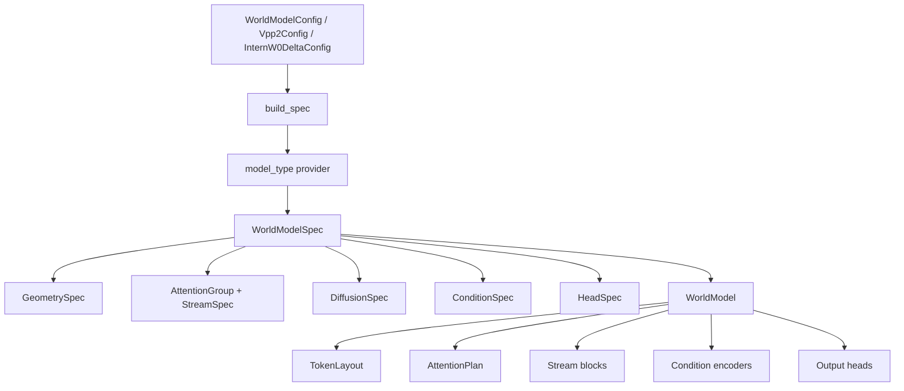
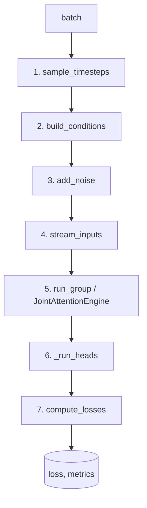
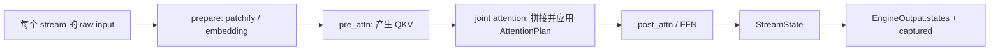
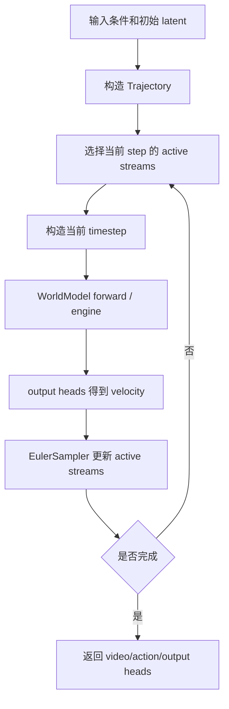
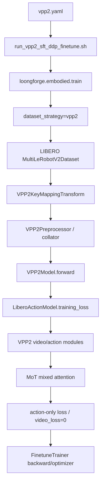
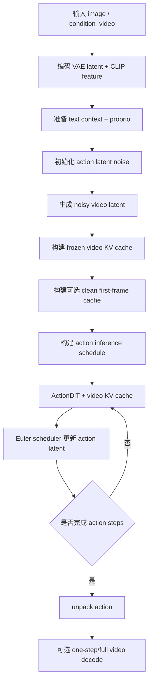
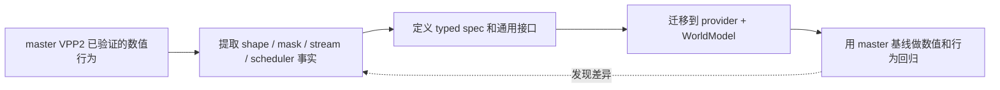
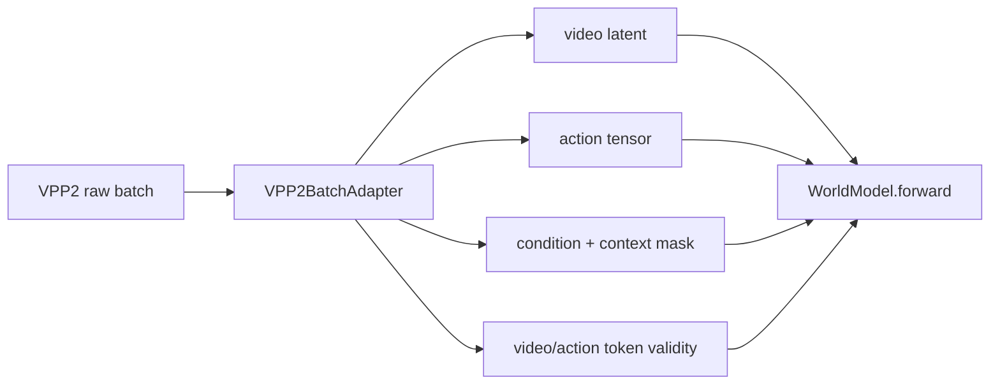

# `loongforge/embodied/model/arch` 模块梳理

本文基于 `dev_wam_restruct` 分支当前代码，对
`loongforge/embodied/model/arch` 的职责、代码结构、训练流程、推理流程和
功能完备度进行说明。

> 更新说明：下文记录的是初次梳理时的架构状态。此后已完善 visibility 的动态
> 噪声绑定、token key validity 接口、FlexAttention mask 编译及 engine 接入；
> 当前 visibility 主接口是 reader-centric 的 `intra` + `reads` / `regions`
> 声明，详细接口与使用边界见
> [visibility/README.md](loongforge/embodied/model/arch/visibility/README.md)，
> VPP2 对照测试见
> [test_arch_visibility_vpp2_parity.py](tests/embodied/unit/test_arch_visibility_vpp2_parity.py)。
> 对照范围为 attention mask、SDPA 输出及 Q/K/V 梯度；数值结果后续另行添加，
> 本次未运行对照测试，也不据此宣称完整训练等价。
> RGB padding 到 latent/token 的转换、masked loss 和 VPP2 训练阶段策略仍需
> 在训练数据与模型适配层补齐。

## 结论先行

`arch` 目录是一套面向 embodied world model 的模型架构重构框架。它把模型拆成
Geometry/Layout、Visibility、Streams、Diffusion、Heads 和 Assembly 等层，
通过 `WorldModelSpec` 描述模型拓扑，再由 `WorldModel` 组装并执行训练流程。

当前状态可以概括为：

> **VPP2/FastWAM 风格的训练主干已经形成，静态 shape、token layout、可见性、
> 双流 WAN block、联合 attention、flow loss、provider 和部分 checkpoint 迁移
> 已经具备；但是模型级采样、KV cache、KV routing 执行、CFG dropout、per-axis
> noising/loss weighting，以及 InternW0-Δ 的专用 head/target 链路尚未完成。**

因此，它还不能被认为是“训练、推理、所有模型变体均已完备”的完整世界模型框架。
更准确的评价是：**核心训练架构可用，端到端推理和部分模型变体仍处于重构阶段**。

## 1. 目录整体定位

该目录的核心目标不是实现某一个具体模型，而是把不同 embodied 模型的共同结构
抽象为：

```text
输入配置
  │
  ▼
WorldModelSpec
  │  描述 geometry、streams、visibility、diffusion、heads、conditions
  ▼
WorldModel
  │  组装所有模块，并固定训练/推理的编排顺序
  ├── TokenLayout
  ├── AttentionPlan
  ├── Stream blocks
  ├── JointAttentionEngine
  ├── Diffusion schedule / loss
  └── Output heads
```

顶层接口约束写在 `loongforge/embodied/model/arch/__init__.py`，其中最重要的
四条跨层接口是：

| 接口 | 作用 |
| --- | --- |
| `AttentionPlan` / `CompiledMask` | 把可见性规则编译成 attention mask |
| `TokenLayout.labels_of()` | 为规则和 diffusion 提供静态 token 标签 |
| `EngineOutput.captured` | 把中间 hidden state 交给 heads |
| `forward(batch) -> (loss, metrics)` | 对训练器暴露统一入口 |

代码中还强调了三个全局不变量：

1. `AttentionPlan.structural` 是无 batch 维度的二维 `[L, L]` mask。
2. 序列和 cache shape 应保持静态，以便后续使用 CUDA Graph。
3. 不增加不兼容的 `state_dict` 前缀，以保证旧 checkpoint 的迁移能力。

## 2. 文件和子模块职责

### 2.1 顶层文件

| 文件 | 主要职责 |
| --- | --- |
| `geometry.py` | L0 几何层。推导 latent grid、patch grid、video token 数、padding 和动作时间块。 |
| `layout.py` | 把多个 stream 拼成联合 token 序列，记录 segment 和 token labels。 |
| `builder.py` | 构建 `WorldModel`，执行训练 forward、loss 计算，并预留 sample 入口。 |
| `model_configuration_arch.py` | 把配置文件转换为 typed config 和 `WorldModelSpec`。 |
| `modeling_arch.py` | 面向训练器的 `ArchWorldModel`，负责 VAE/图像编码和 batch 桥接。 |
| `transfer.py` | 旧 VPP2 checkpoint key 到当前模型 key 的重映射。 |
| `__init__.py` | 导出公共对象并记录架构层间接口。 |

### 2.2 `spec/`

`spec` 是构建期描述层，不直接执行 tensor 计算。

- `spec/core.py`：递归 `Spec`、`build()` 和 provider 注册表。
- `spec/world.py`：`WorldModelSpec` 和 V1-V9 等构建期校验。
- `spec/overrides.py`：对 geometry、stream scalar、head 和 backend override
  做严格合并与校验。
- `spec/providers/dual_stream_wan.py`：VPP2、FastWAM、InternW0-Δ 共用的
  双流 WAN 拓扑工厂。
- `spec/providers/vpp2/spec.py`：VPP2 provider。
- `spec/providers/fastwam/spec.py`：FastWAM provider。
- `spec/providers/internw0_delta/spec.py`：InternW0-Δ provider，包含更多
  辅助 loss/head，但其中有明确占位实现。

provider 的设计原则是：配置文件可以覆盖数值参数，但不应该通过 YAML 改写
模型拓扑或算法语义。

### 2.3 `visibility/`

这一层负责回答“某个 query token 能看到哪些 key token”。

- `combine.py`：`Visibility` 谓词，以及 `&`、`|`、`~`、`restrict`。
- `rules.py`：同 stream、跨 stream、frame/chunk causal、prefix、noise gate
  等原子规则。
- `declarative.py`：当前模型侧 `intra + reads`、regions 与显式 gate 声明；
  冗余的旧 preset 注册表已删除。
- `mask.py`：将规则 materialize 成 dense、SDPA 或 flex attention 所需的
  `AttentionPlan`。

规则本身使用 token labels，而不是直接依赖 tensor shape。这样可以把
`frame`、`chunk`、`stream` 等结构事实集中到 `TokenLayout`。

### 2.4 `streams/`

这一层实现多流模型和联合 attention。

- `streams/spec.py`：`StreamSpec`、layer 映射和 modulation slot。
- `streams/state.py`：`StreamState`、`QKV` 和 stream module 协议。
- `streams/engine.py`：`AttentionGroup`、`JointAttentionEngine`。
- `streams/conditions.py`：条件来源和注入方式。
- `streams/encoders.py`：当前主要是 proprio 等条件的 token encoder。
- `streams/routing.py`：`KVRoute` 的声明和构建期校验。
- `streams/cache.py`：KV cache 的 shape/lifetime 协议。
- `streams/blocks/wan_dit.py`：RoPE、Norm、attention、FFN、modulation 等
  WAN DiT 基础算子。
- `streams/blocks/wan_streams.py`：`WanVideoStream` 和 `ActionStream`，
  实现 patchify、action embedding 以及 stream 的四阶段协议。

`JointAttentionEngine` 本身不是 `nn.Module`，也不持有参数；参数全部位于
stream module 中。这一设计是为了避免 FSDP/ZeRO 在 engine 层进行不必要的
参数聚合。

### 2.5 `diffusion/`

这一层定义训练监督和未来采样所需的数学对象。

- `timesteps.py`：UniformShift、LogitNormal、BetaDist、Constant 等 timestep
  sampler。
- `schedule.py`：Rectified Flow、Constant Sigma 等加噪和 target 公式。
- `broadcast.py`：依据 layout label 进行 token 级广播。
- `loss.py`：MSE、CosineDistance、loss weight ramp。
- `stepping.py`：`Trajectory`、`UniformSteps`、`EulerSampler`。
- `spec.py`：把 sampler、schedule、loss、gate 组织成 `DiffusionSpec`。

数学组件大多已经独立实现，但它们还没有全部接入模型级 `WorldModel.sample()`。

### 2.6 `heads/`

这一层把 stream 的最终或中间 hidden state 转换成训练目标空间。

- `heads/spec.py`：head 名称、输入 hidden state、输出宽度和 timestep 需求。
- `heads/hidden_ref.py`：引用最终 state 或某个 joint layer capture。
- `heads/flow.py`：`PatchFlowHead`、`LinearHead`、`NormLinearHead`、
  `IdentityHead`。

`WorldModel` 会从 `HeadSpec` 自动推导哪些 joint layer 需要 capture，避免
head 表和 engine capture 表重复维护。

## 3. 从配置到模型的构建流程

典型构建链路如下：



主要代码位置：

- `model_configuration_arch.py:97` 左右：导入 provider 并构造 spec。
- `spec/world.py:830` 左右：根据 `model_type` 找 provider，应用配置覆盖。
- `spec/core.py:112` 左右：递归构建 `Spec`。
- `builder.py:241-301`：构造 stream、condition encoder、visibility plan、head
  和 layer index map。

`WorldModel.__init__` 中的装配顺序是固定的：

1. 根据 `StreamSpec` 构建各 stream block。
2. 构建 condition encoder。
3. 将 visibility materialize 成每个 attention group 的 `AttentionPlan`。
4. 构建 output heads，并推导 engine 的 capture 请求。
5. 解析 joint layer 到 local layer 的映射。

## 4. TokenLayout：多模态 token 如何组织

`TokenLayout` 是整个架构的静态序列描述。它维护：

- 每个 stream 在联合序列中的 `[start, stop)` segment；
- 无 batch 维度的 token labels；
- 从联合序列切回 per-stream tensor 的逻辑。

例如，视频和动作两个 stream 会形成：

```text
联合序列:
┌──────────────────────────────┬────────────────┐
│ video tokens                 │ action tokens  │
│ [0, padded_seq_len)          │ [.., horizon)  │
└──────────────────────────────┴────────────────┘

labels:
stream, frame, row, col, pad, chunk
```

`layout.py:223-270` 的 `TokenLayout.from_geometry()` 默认约定：

- 第一个 stream 是 video，token 数来自 `geometry.padded_seq_len`；
- 后续 stream 使用 `geometry.action_horizon`；
- stream 顺序就是联合序列的拼接顺序。

`layout.py:362-403` 为 action token 设置：

```python
aligned = step // geometry.action_video_freq_ratio
chunk[...] = aligned
frame[...] = aligned
```

这样动作 token 可以参与基于 frame/chunk 的 causal visibility 规则。

`TokenLayout` 还明确区分两类信息：

- 静态、所有 batch 共享的信息：放在 `labels` 中；
- 每个样本不同的有效 token 信息：放在 `AttentionPlan.key_valid` 中。

这一区分对于 padding、mask 复用和 CUDA Graph 都很重要。

## 5. Visibility 如何变成 AttentionPlan

可见性规则不是直接写成一个 mask tensor，而是先写成关于 query/key label
的惰性谓词。例如：

```text
same_stream(q, k)
frame_causal(q, k)
prefix_only(q, k)
noise_gate(q, k)
```

规则可以组合：

```text
visibility =
    same_stream
    & frame_causal
    & ~noise_gate
```

然后由 `AttentionPlan.from_visibility()` 根据 `TokenLayout` 编译为 attention
backend 能使用的 mask。

```mermaid
flowchart LR
    A[Visibility 原子规则]
    B[组合: &, |, ~, restrict]
    C[query/key LabelView]
    D[TokenLayout labels]
    E[AttentionPlan]
    F[Dense / SDPA / Flex backend]

    A --> B
    D --> C
    B --> C
    C --> E --> F
```

这一设计的好处是：规则表达的是模型语义，token 数、stream segment 和
frame/chunk 标签由 layout 统一提供。`mask.py` 还区分 structural mask
和 batch-dependent validity mask，使结构 mask 可以在构造阶段复用。

## 6. 训练 forward 的完整流程

`WorldModel.forward()` 在 `builder.py:321-365` 中固定为七步：



### 第一步：采样 timestep

`sample_timesteps()` 遍历需要 diffusion timestep 的 stream，并调用对应
`TimestepSampler`。axis size 来自：

```python
self.layout.labels_of(axis).max() + 1
```

而不是重新从 geometry 推导，避免 padding 或多模态对齐规则出现两套事实来源。

### 第二步：构建 condition

`build_conditions()` 调用 `materialize_conditions()`，将 batch 中的原始条件
编码为 condition bus。条件可以被多个 stream 使用，encoder 参数作为独立
namespace 保存在 `WorldModel.condition_encoders` 中。

但当前训练态 CFG condition dropout 尚未实现：当
`dropout_prob > 0` 时，`builder.py:85-95` 会直接抛出
`NotImplementedError`。

### 第三步：加噪和生成 target

默认 `add_noise()` 对 raw tensor 计算：

```python
x_t = schedule.add_noise(x_0, eps, t)
target = schedule.target(x_0, eps, t)
```

视频 raw tensor 形状通常类似 `[B, C, F, H, W]`，动作 raw tensor 类似
`[B, T, D]`。当前默认实现只支持 per-sample `[B]` timestep。

如果 sampler 使用 frame/chunk 等 per-axis timestep，代码会在
`builder.py:448-455` 明确拒绝，因为还缺少“label axis 到 raw tensor 哪个维度”
的 modality-specific 映射。

### 第四步：准备 stream 输入

默认情况下，stream 输入就是 `runtime.noised`。真正的 patchify 和 token 化
放在 `StreamModule.prepare()` 中，由具体的 WAN video/action stream 完成。

### 第五步：运行联合 attention

`run_group()` 为每个 attention group 调用 engine：

```python
return self.engine.run(
    group,
    group_inputs,
    group_blocks,
    plan,
    layout,
    conditions=conditions,
    timesteps=group_timesteps,
    captures=captures,
)
```

engine 的概念性执行顺序是：



`EngineOutput.captured` 保存 head 需要的中间层 hidden state，
`HiddenStateRef` 再从中取出指定 stream/layer。

需要注意的是，`KVRoute` 当前主要完成声明和构建期校验，engine 的实际 layer
循环尚未使用 route 去改变 K/V 来源。因此配置中声明 route，并不等于运行时已经
完成跨层 K/V 路由。

### 第六步：执行 output heads

`_run_heads()` 根据 `HeadSpec.source` 取最终或中间 hidden state，并调用：

```python
head(hidden, timestep=embedded_timestep, conditions=None)
```

需要 timestep 的 head 使用 stream state 中的嵌入向量 `t_embed`，而不是直接
传递 `[0, 1]` 范围的 scalar timestep。

### 第七步：计算 loss

`compute_losses()` 对每个 `LossSpec`：

1. 找到对应 head；
2. 找到 head 专属 target 或 source stream 的 flow target；
3. 计算 objective；
4. 应用 `LossSpec.weight_at(global_step)`；
5. 汇总为总 loss 并返回 metrics。

当前 loss 实现支持的主路径是：

```text
head output + per-sample target + per-sample weighting
```

stream-side loss 和 per-axis loss weighting 还会在
`builder.py:621-637` 抛出 `NotImplementedError`。

## 7. 推理/采样流程现状

代码已经定义了推理所需的抽象：

- `Trajectory`：保存各 stream 当前状态；
- `UniformSteps`：决定当前 step 哪些 stream 更新；
- `EulerSampler`：执行 `x <- x - dt * v`；
- `SteppingGate`：控制多 stream 的不同步数。

设计上的目标流程应当是：



但是 `WorldModel.sample()` 在 `builder.py:662-686` 中无论 iterative 还是
single-step 路径都尚未实现：

```python
raise NotImplementedError(
    "WorldModel.sample three-step orchestration is not implemented yet ..."
)
```

因此 provider 中虽然已经声明了 `EulerSampler` 和 step gate，当前不能通过
模型级入口完成端到端生成。

## 8. 各模型 provider 的完成度

| 模型 | 当前状态 | 说明 |
| --- | --- | --- |
| VPP2 | 训练主干相对完整 | geometry、双流 WAN、condition、flow loss、checkpoint remap 等路径已具备；模型级 sample 尚未接通。 |
| FastWAM | 训练拓扑基本具备 | 共用 dual-stream WAN 组件；推理 orchestration、cache 等高级路径仍缺失。 |
| InternW0-Δ | 未达到 whole-model 可构建 | `track_query_head()` 在 `spec/providers/internw0_delta/spec.py:42-74` 明确抛出 `NotImplementedError`。 |

InternW0-Δ 的问题不只在 `track_align` head：

- `future_delta` 需要额外的 delta token/segment 语义；
- `semantic_future` 缺少 teacher hidden state、detach 等描述；
- 默认 `add_noise()` 不会自动生成这些专用 target；
- 当前 `HiddenStateRef` 不能表达任意 segment/slice。

因此，InternW0-Δ 的部分 head 可以单独构造，但完整 provider 不能按当前
`WorldModel` 路径完成训练。

## 9. 已实现、部分实现和未实现能力清单

### 已实现或基本可用

- GeometrySpec 的 latent/patch/token shape 推导。
- TokenLayout 的 stream segment、frame/row/col/chunk/pad label。
- Visibility 谓词组合和 AttentionPlan materialization。
- Dense、SDPA、flex attention 的 mask backend 协议。
- WAN video/action stream block。
- Joint attention 的基本执行路径。
- Condition bus 和线性 token encoder。
- UniformShift、LogitNormal、BetaDist、Constant timestep sampler。
- Rectified Flow 等基础 schedule。
- MSE、CosineDistance 等基础 loss。
- PatchFlow、Linear、NormLinear、Identity head。
- VPP2 legacy checkpoint key 重映射。
- 针对 geometry、layout、visibility、engine、blocks、providers、diffusion
  math 等模块的单元测试。

### 接口或协议已定义，但运行时尚未闭环

- `KVRoute`：已有声明、校验和查询接口，但未在 engine 中真正改变 K/V 来源。
- `CacheScope`：已有 cache signature 和生命周期 protocol，但没有 concrete
  cache，也没有 engine/sample 调用链。
- `Trajectory`、`UniformSteps`、`EulerSampler`：数学组件已存在，但未被
  `WorldModel.sample()` 组织起来。
- per-axis broadcast：可以独立执行 label-based broadcast，但默认加噪和 loss
  路径没有接通。

### 明确未实现或会主动失败

- `WorldModel.sample()` 的模型级生成主循环。
- CFG condition dropout。
- per-axis noising。
- per-axis loss weighting。
- stream-side loss。
- InternW0-Δ 的 `track_align` learned-query decoder。
- InternW0-Δ 专用 future/semantic target 生成。
- 可验证的 runtime KV routing。
- KV cache 的实际读写和增量推理。

## 10. 测试覆盖说明

当前测试目录中已经有较完整的模块级测试，例如：

```text
tests/embodied/unit/
├── test_arch_builder.py
├── test_arch_world_model.py
├── test_arch_engine.py
├── test_arch_layout.py
├── test_arch_mask.py
├── test_arch_rules.py
├── test_arch_blocks.py
├── test_arch_diffusion_math.py
├── test_arch_conditions.py
├── test_arch_heads.py
├── test_arch_providers.py
└── test_arch_transfer.py
```

不过部分测试是在验证“当前应该失败”：

- CFG dropout 预期抛 `NotImplementedError`；
- per-axis noising 预期抛 `NotImplementedError`；
- stream-side/per-axis loss 预期抛 `NotImplementedError`；
- InternW0-Δ whole-model 构建预期失败。

同时，当前没有覆盖 `WorldModel.sample()` 的端到端生成测试，也没有覆盖
“配置了 `KVRoute` 后，目标 layer 数值上确实使用了源 stream K/V”的 runtime
测试。因此测试数量不能直接等价于端到端能力完备。

## 11. 建议的后续实现顺序

如果目标是让这个目录达到可训练、可推理、可扩展的完整状态，建议按以下顺序
推进：

1. **先完成 `WorldModel.sample()`**
   - 复用 `Trajectory`、`SteppingGate` 和 `EulerSampler`；
   - 明确 single-step 与 iterative diffusion 的统一返回协议；
   - 增加 VPP2/FastWAM 的端到端采样测试。

2. **补齐 runtime KV routing 和 KV cache**
   - 让 engine layer loop 实际消费 `routes_into()`；
   - 加入 route 数值正确性测试；
   - 再实现静态 shape 的 cache allocation、reset、read/write。

3. **打通 per-axis diffusion**
   - 为每个 modality 声明 label axis 到 raw tensor dimension 的映射；
   - 在 raw tensor 加噪阶段和 token loss 阶段分别正确广播；
   - 增加 frame/chunk 级别的 shape 和数值测试。

4. **实现 CFG dropout**
   - 明确定义 condition 被 drop 后的零值/空值语义；
   - 检查同一 condition 被多个 stream 使用时的共享行为；
   - 增加训练态与 eval 态差异测试。

5. **完成 InternW0-Δ 专用链路**
   - 实现 learned-query `track_align` head；
   - 扩展 layout/hidden reference 表达 delta segment；
   - 生成 future/semantic teacher target；
   - 加入 whole-model build 和 forward 测试。

## 12. 最终判断

从工程完成度看，可以采用如下分级：

| 等级 | 定义 | `arch` 当前状态 |
| --- | --- | --- |
| A | 训练、推理、模型变体、checkpoint、并行路径都完整可用 | 不满足 |
| B | 主模型训练和推理可用，仅少量高级优化缺失 | 不满足 |
| C | 核心训练路径可用，但推理或重要模型变体不可用 | **当前状态** |
| D | 主要是接口和占位实现，核心训练也不可用 | 整体不属于此级，但若干子模块属于此级 |

所以，`loongforge/embodied/model/arch` 的功能定位应描述为：

> **一个已经完成核心训练架构抽象、但仍在补齐推理编排和高级模型能力的
> embodied world model 重构模块。**

---

## 附录：`master` 分支中的 VPP2 过渡实现

### A.1 分支状态

本次分析基于已同步的 `origin/master` 最新引用：

```text
master:        c9c76ea
origin/master: c9c76ea
```

`master` 中已经包含 VPP2 的数据管线、数值模型、训练脚本、checkpoint 处理和
action inference 实现。它与 `dev_wam_restruct` 中的 `arch` 目录处于不同阶段：

| 维度 | `master` VPP2 | `dev_wam_restruct/arch` |
| --- | --- | --- |
| 主要目标 | 复现和运行一套固定的 VPP2 recipe | 抽象可复用的 embodied world model 架构 |
| 模型组织 | `VPP2` + `MoT` + `WanVideoDiT` + `ActionDiT` | `WorldModelSpec` + streams + engine + heads |
| 配置方式 | 大量嵌套 dict，直接传给移植模块 | typed spec/provider 和构建期校验 |
| 训练入口 | `VPP2Model.forward()` / `training_loss()` | `WorldModel.forward()` 七步流程 |
| 推理入口 | `infer_action()` 已有较完整实现 | `WorldModel.sample()` 尚未实现 |
| cache | VPP2 action inference 使用 frozen video KV cache | 只有 `CacheScope` protocol |
| 可扩展性 | 针对 VPP2、LIBERO、RoboDojo 做强约束 | 目标是多模型、多 stream 的统一抽象 |

因此，`master` 的实现可以作为当前 VPP2 的运行参考和数值基线，但不宜直接作为
后续多模型架构的长期抽象。

### A.2 master 上 VPP2 的代码分层

主要代码位于：

```text
loongforge/embodied/model/vpp2/
├── modeling_configuration_vpp2.py  # VPP2 配置和约束
├── modeling_vpp2.py                # LoongForge registry wrapper
└── modules/
    ├── vpp2.py                     # 核心 VPP2、scheduler、训练/推理
    ├── mot.py                      # video/action 混合 attention
    ├── wan_video_dit.py            # Wan video DiT
    ├── action_dit.py               # ActionDiT
    ├── libero_action_model.py      # LIBERO action 训练桥接
    ├── wan_video_vae.py            # VAE
    ├── wan_video_clip.py           # CLIP image encoder
    ├── scheduler.py                # flow matching scheduler
    ├── checkpoint.py               # checkpoint 格式与加载
    └── perf_*.py                   # graph、fused norm、cache 等优化
```

数据侧位于：

```text
loongforge/embodied/data/datasets/vpp2/
├── vpp2_dataset.py
├── video_event_dataset.py
├── critical_phase.py
├── samplers.py
└── transforms/
    ├── data_configuration_vpp2.py
    ├── vpp2_transform.py
    ├── vpp2_processor.py
    ├── vpp2_collator.py
    ├── image.py
    ├── normalizer.py
    └── vpp2_processor.py
```

配置和启动入口位于：

```text
configs/models/embodied/vpp2.yaml
configs/models/embodied/vpp2_robodojo.yaml
examples/embodied/vpp2/run_vpp2_sft_ddp_finetune.sh
examples/embodied/vpp2/run_vpp2_sft_deepspeed_zero2_finetune.sh
examples/embodied/vpp2/run_robodojo_joint_50.sh
```

### A.3 master VPP2 训练流程

默认 LIBERO action 训练的源码调用链如下（不代表已完成端到端运行验证）：



具体过程如下：

1. `run_vpp2_sft_ddp_finetune.sh` 使用 `--model-name vpp2`、
   `--dataset-strategy vpp2` 启动 `FinetuneTrainer`。
2. `dataset_builder.py` 根据 strategy 选择 VPP2 dataset builder。
3. LIBERO builder 读取四个数据根目录，并构造
   `MultiLeRobotV2Dataset`。
4. `VPP2KeyMappingTransform` 把两路相机横向拼接成 video，把 action/state
   归一化，并读取预计算的 T5 context embedding。
5. `VPP2Preprocessor` 将每条样本 stack 成 batch，输出 `video`、`action`、
   `proprio`、`context`、`context_mask` 和 padding mask。
6. `VPP2Model.forward()` 动态派发到 `LiberoActionModel.training_loss()`。
7. action 路径采样 action flow-matching timestep，加噪并计算 action target；
   video timestep 固定为 video scheduler 的最大训练 timestep，不计算 video target。
8. 进入 `_training_loss_action_only()`，利用冻结的 video 分支提供条件特征，
   由 action 分支预测 action target；具体执行可使用 action-only fast path。
9. 计算 action loss，按 scheduler weight 和 action lambda 加权；
   返回的 `loss_video` 为零，而非汇总 joint video/action loss。
10. `FinetuneTrainer` 执行 backward、optimizer step 和 checkpoint 保存。

`modeling_vpp2.py:438-448` 暴露给 trainer 的统一接口是：

```python
sample = batch.to_sample() if hasattr(batch, "to_sample") else batch
loss, metrics = self.training_loss(sample, training_stage="action")
return loss, {"video_loss": ..., "action_loss": ...}
```

经 `git show master` 核对，实际继承链是
`VPP2Model → LiberoActionModel → VPP2`。`LiberoActionModel` 覆盖了
`training_loss()`，因此这里的 `self.training_loss(...)` 派发到 action 实现，
而不是基类的 joint-only 实现。关键源码关系如下：

```python
class VPP2Model(LiberoActionModel):
    # forward 调用 self.training_loss(sample, training_stage="action")
    ...

class LiberoActionModel(VPP2):
    def training_loss(self, sample, tiled=False, training_stage=None,
                      video_feature_callback=None):
        resolved_stage = "action"
        inputs = self.build_inputs(sample, tiled=tiled, training_stage="action")
        # 构造 action 加噪输入后进入 _training_loss_action_only(...)
        ...
```

`modules/vpp2.py:1235-1247` 的 joint-only stage 校验属于 `VPP2.training_loss()`。
当 `cfg.training_stage == "joint"` 时，`VPP2Model.from_pretrained()` 选择
直接继承 `VPP2` 的 `_VPP2JointModel`，其 `forward()` 调用
`self.training_loss(sample)`，使用基类的 joint 实现。两条路径分别承载 action
和 joint 契约；基类校验不构成默认 action SFT wrapper 的断链。

### A.4 master VPP2 的核心数据处理

默认 `vpp2.yaml` 的关键输入是：

```yaml
model:
  training_stage: action
  action_dim: 7
  action_horizon: 32
  proprio_dim: 8
  action_chunk_size: 1

data:
  num_frames: 65
  action_video_freq_ratio: 4
  image_size: 224
```

LIBERO 数据路径要求四个数据根目录，数据转换后大致形成：

```text
video:        [B, 3, T, H, W]
action:       [B, action_horizon, action_dim]
proprio:      [B, T_or_1, proprio_dim]
context:      [B, context_len, text_dim]
context_mask: [B, context_len]
image_is_pad: [B, T]
action_is_pad:[B, action_horizon]
```

`vpp2_transform.py` 中的关键处理包括：

- 两路相机图像 resize 后在宽度方向拼接；
- 归一化到 `[-1, 1]`；
- 维度转换为 `[C, T, H, W]`；
- 使用 task prompt 的 SHA256 查找离线 T5 embedding；
- 对 action/state 使用 dataset stats 做归一化；
- 对 pad action 做 mask/zero 处理。

这种处理方式对当前 VPP2 recipe 很有效，但数据字段名、相机数量、prompt cache
格式和 action/state shape 都有很强的约束，难以直接迁移到新的 embodied 数据集。

### A.5 master VPP2 的模型加载和冻结策略

`VPP2Model.from_pretrained()` 在 `modeling_vpp2.py:44-170` 中组装：

```text
WanVideoDiT
ActionDiT
MoT
WanVideoVAE
WanImageEncoderCLIP
```

默认 action stage 的冻结关系是：

```text
冻结:
  video_expert
  VAE
  CLIP encoder
  text encoder

训练:
  action_expert
  proprio_encoder
```

核心约束由 `freeze_modules()` 和 `_assert_action_stage_freeze_contract()` 强制
检查。加载 checkpoint 时还分别严格加载：

1. video DiT checkpoint；
2. ActionDiT backbone checkpoint；
3. Wan VAE；
4. 可选 CLIP；
5. checkpoint 中排除的 action projection 做随机初始化。

这种实现保留了 BASE/社区实现的初始化顺序和 checkpoint key 语义，可以作为
数值复现的优点；代价是模型构造、权重格式、精度策略和冻结策略耦合在同一个
具体 recipe 中。

### A.6 master VPP2 的推理流程

master 的 `infer_action()` 已经实现了完整得多的 action sampling 路径：



`modules/vpp2.py:1447-1795` 中已经体现了以下能力：

- action latent 初始化；
- 输入 image 或 condition video；
- prompt 或预计算 context 二选一；
- proprio 拼接到 context；
- frozen video KV cache；
- clean first-frame cache；
- action scheduler 多步 Euler 更新；
- 可选 one-step video 和 full video decode；
- action/video 输出以及采样步数元数据。

因此，与 `dev_wam_restruct/arch` 中尚未实现的
`WorldModel.sample()` 相比，master 的 VPP2 inference 是已经落地的参考实现。
但它是 VPP2 专用接口，依赖固定的 `MoT`、video cache 布局、mask 模式和
`action_visible_video_frames`，还没有抽象成可供多个 provider 复用的 sampler
协议。

### A.7 为什么 master 只是过渡方案

master 的优点是：

- 已经有真实 VPP2 数值模块和训练入口；
- checkpoint 加载和冻结策略相对完整；
- LIBERO/RoboDojo 数据到模型的路径已经打通了主要字段；
- action inference 已经实现 KV cache 和多步 scheduler；
- 有 DDP、DeepSpeed、CUDA Graph/fused kernel 等性能路径；
- 适合作为数值正确性和行为基线。

但它不适合作为长期架构，主要原因是：

#### 1. 模型、数据和训练阶段耦合

`VPP2Model`、`LiberoActionModel` 和 `VPP2.training_loss()` 同时知道：

- LIBERO 字段名；
- video/action 的具体 shape；
- VAE temporal downsample factor；
- action-only fast path；
- MoT 的 video/action 两路名称；
- fixed prompt cache；
- padding 和 terminal mask。

新增第三个 stream、换数据字段或增加新的监督 head，都需要修改核心模型路径。

#### 2. 配置保留大量原始嵌套 dict

`VPP2ModelConfig` 选择保留 Wan/BASE 的 nested dict，以便直接调用移植模块。
这有助于快速复现，但配置约束不能完整表达成跨模块的 typed contract。
相比之下，`dev_wam_restruct` 的 `WorldModelSpec` 会在构建期校验 stream、
head、condition、route、timestep 和 visibility 是否一致。

#### 3. stage 契约分布在不同模型类型

当前 master 按配置选择不同的模型类型及 loss 实现：

```text
training_stage: action
  -> VPP2Model(LiberoActionModel).forward()
  -> LiberoActionModel.training_loss(..., training_stage="action")

training_stage: joint
  -> _VPP2JointModel(VPP2).forward()
  -> VPP2.training_loss(sample)，基类只接受 joint stage
```

默认 action wrapper 使用子类覆盖的方法，不会落入基类的 joint-only 校验，
因此不能据此判断 stage 语义断链。这里的架构特点是 stage 契约由配置选择、
继承关系和各自的 loss 实现共同承载；迁移到 `arch` 时仍需显式保留两者的
冻结、加噪和监督差异，而不能把 action-only 与 joint loss 当作同一条路径。

#### 4. 特定优化直接进入核心模型

mask elision、native graph、fused RMS、frozen video execution、KV compact 等
优化通过大量 `perf_*` 配置进入 `VPP2`/`MoT` 内部。它们适合固定 shape 和固定
hardware recipe，但会增加通用架构的分支数量，也让正确性和性能策略难以独立演进。

#### 5. 数据错误可能被静默掩盖

RoboDojo `VideoEventDataset.__getitem__()` 在处理异常时会随机换一个样本继续
返回。这样可以减少训练被单条坏样本中断，但会改变数据分布、影响复现，并使
数据质量问题不容易暴露。

#### 6. VPP2 专用 inference 尚未抽象

master 已经实现 KV cache 和 sampler，但这些能力都嵌在 `VPP2.infer_action()`
和 `MoT.forward_action_with_video_cache()` 里；`arch` 新架构虽然定义了
`CacheScope`、`Trajectory`、`EulerSampler` 等接口，却还没有把 master 的成熟
实现迁移成通用协议。

### A.8 master 与 arch 的迁移对应关系

可以把两个分支的对应关系理解为：

| master VPP2 实现 | arch 重构目标 |
| --- | --- |
| VAE/latent shape 和 video token shape | `GeometrySpec` |
| video/action 拼接和时间对齐 | `TokenLayout` |
| `_build_mot_attention_mask()` | `Visibility` + `AttentionPlan` |
| `WanVideoDiT` / `ActionDiT` | `WanVideoStream` / `ActionStream` |
| `MoT` | `JointAttentionEngine` |
| action/proprio/context 注入 | `ConditionBus` + encoders |
| video/action scheduler | `DiffusionSpec` |
| `pred_video` / `pred_action` | output heads |
| `infer_action()` | `WorldModel.sample()` |
| frozen video KV cache | `CacheScope` |
| stage-specific hard-coded branches | provider/spec + extension points |

这个映射也说明后续工作重点不是简单复制 master 文件，而是将 master 已验证
的数值和推理行为逐步提炼到 `arch` 的接口中：



### A.9 关于“master 已明确支持 VPP2 训练”的准确表述

从代码资产和训练框架完整度看，master 确实已经明确支持 VPP2：

- 有 VPP2 config；
- 有 LIBERO/RoboDojo dataset；
- 有训练启动脚本；
- 有 VPP2Model registry wrapper；
- 有 video/action 数值模块；
- 有 checkpoint、冻结、scheduler、loss 和 trainer 接口；
- 有 action inference。

从 `git show master` 核实的源码派发看，默认 LIBERO action wrapper 调用
`LiberoActionModel.training_loss()`；joint 配置则选择 `_VPP2JointModel`，
调用 `VPP2.training_loss()`。基类的 joint-only 校验与默认 action 调用路径
并不冲突。因此更准确的工程结论是：

> **master 已具备 VPP2 的模型与训练接口资产，action-only 与 joint 的源码派发
> 路径均已明确；历史文档所称 action-stage wrapper 落入基类 joint-only 校验的
> 断链属于误判。本次仅确认静态源码调用关系，未验证端到端训练可运行性，
> 也不宣称 `arch` 与 master 完整训练等价。**

这也是为什么 `master` 适合被用作 `dev_wam_restruct` 的行为基线和迁移参考，
但不应直接成为新的长期架构。

---

## 附录：支持 VPP2 的组网与训练补充项

本节只讨论 `dev_wam_restruct` 分支中，若要支持 VPP2 训练，还需要补充的
组网逻辑和训练逻辑。推理、评测和性能优化暂不纳入本轮范围。

### B.1 当前判断

当前 `arch` 已经具备 VPP2 的核心双流组网骨架：

```text
video stream ─┐
              ├── JointAttentionEngine / MoT-style joint attention
action stream ┘
```

video/action block、联合 attention、condition slot、flow head 和基本
diffusion 抽象已经存在。但训练闭环仍缺少关键的运行时契约：

```text
VPP2BatchAdapter
    + padding / key_valid
    + context_mask
    + VPP2 attention mask
    + action/joint freeze policy
    + masked video/action loss
    + optimizer global_step
```

因此当前状态更准确地描述为：

> **VPP2 的网络主体已经搭建完成，但 VPP2 的 batch、mask、训练阶段、
> padding-aware loss 和参数冻结语义还没有完全接通。**

### B.2 已具备的组网能力

#### 双流和 MoT-style joint attention

VPP2 provider 在 `spec/providers/vpp2/spec.py:227` 左右将 video/action
放入同一个 `AttentionGroup`。`streams/engine.py:623` 左右执行：

```text
video Q/K/V ─┐
             ├── concat → joint attention → split
action Q/K/V ┘
```

两个 stream 的 Q/K/V 在联合序列上执行一次 attention，再按照原始 segment
切回各自 stream。这与 master VPP2 `MoT` 的主体计算方式一致。

当前 provider 的主要 width 配置也已经匹配 VPP2：

```text
video:
  residual_width = 5120
  num_heads       = 40
  head_dim        = 128
  num_layers      = 40

action:
  residual_width = 512
  num_heads        = 40
  head_dim        = 128
  num_layers      = 40
```

#### Video/action 输入和输出

`streams/blocks/wan_streams.py` 已经包含：

- video `[B, C, F, H, W]` 输入；
- video patchify；
- padding 到固定 video token 长度；
- action `[B, T, action_dim]` 输入；
- action linear embedding；
- action horizon 和 action width 校验。

provider 中也已经声明：

```text
video_flow  -> video stream final hidden state
action_flow -> action stream final hidden state
```

这部分对应：

- `streams/blocks/wan_streams.py:492`
- `streams/blocks/wan_streams.py:576`
- `spec/providers/vpp2/spec.py:340`

#### 条件注入

当前 VPP2 provider 已经表达了四类主要条件：

| 条件 | arch 中的表达 |
| --- | --- |
| noisy video latent | video stream input |
| i2v condition latent | video channel concat |
| text/context | video/action cross attention |
| CLIP image feature | video cross attention |
| proprio | append 到 text slot，再投影到 stream width |

其中 proprio 的注入发生在 projection 之前，和 master 的
`_append_proprio_to_context()` 语义一致。

对应位置：

- `spec/providers/vpp2/spec.py:381`
- `streams/blocks/wan_streams.py:363`
- `modeling_arch.py:439`

### B.3 必须补充的组网逻辑

#### 1. 接通 VPP2 attention mask 的运行时语义

本项是初次分析时的缺口，当前已由声明式 visibility 重构修正：

- VPP2 provider 使用 `intra + reads`，action 读取固定的 source-relative 视频
  前缀；不再使用旧的滑动 history + noise preset。
- 显式 runtime gate 通过 batch 的 `attention_labels [B,L]` 绑定，
  缺少必需标签时报错，不会在生产 attention 中静默退化为全可见。
- `WorldModel.run_group()` 已接入 `AttentionPlan.bind()` 和
  `attention_key_valid [B,L]`，不自动将 diffusion timestep 猜成 key noise。
- 原 VPP2 结构 mask 和 gate 边启闭的对照见
  `loongforge/embodied/model/arch/visibility/VALIDATION.md`；clean KV 来源切换
  和完整训练 recipe 等价仍需另行验证。

#### 2. 将 padding mask 接入 attention

VPP2 batch 需要保留：

```text
action_is_pad [B, action_T]
image_is_pad  [B, image_T]
```

需要建立如下映射：

```text
image_is_pad
    ↓
causal VAE temporal aggregation
    ↓
latent-frame validity
    ↓
video patch-token validity
    ↓
AttentionPlan.key_valid
```

action 的映射相对直接：

```text
action_is_pad
    ↓
action token validity
    ↓
AttentionPlan.key_valid
```

video padding 不能简单复制 RGB frame mask。master 会先根据 Wan causal
temporal stride 聚合 frame mask，再映射到 latent frame。

#### 3. 接通 text `context_mask`

当前 text condition 主要传递 `context`，但 `context_mask` 尚未作为
cross-attention 的有效性条件进入 `ConditionBus`。

完整路径应该是：

```text
context + context_mask
        ↓
ConditionBus
        ↓
stream cross attention
        ↓
cross-attention K/V mask
```

否则预计算 text embedding 中的 padding token 仍可能参与 cross attention。

#### 4. 暂时不要把 KV cache 当作训练组网阻塞项

master 的 action inference 使用 frozen video KV cache，但当前工作范围只关注
组网和训练。建议先保证：

- video/action joint attention 数值正确；
- structural mask 正确；
- batch-dependent validity 正确；
- condition mask 正确。

KV cache 可以在推理阶段再迁移到 `CacheScope`。当前 `KVRoute` 只有声明和
构建期校验，实际 engine layer loop 还没有使用 route 改变 K/V 来源。

### B.4 必须补充的训练逻辑

#### 1. 明确 action-stage 和 joint-stage

master 的 action-stage 和 joint-stage 使用不同的模型派发路径：

```text
vpp2.yaml
  -> training_stage: action

VPP2Model.forward()
  -> training_stage="action"
  -> LiberoActionModel.training_loss()（子类覆盖，action-only）

joint 配置
  -> _VPP2JointModel.forward()
  -> VPP2.training_loss()（基类，joint-only）
```

这不是默认 action wrapper 与基类校验的冲突。迁移到 arch 前需要明确支持
哪一种训练策略，并分别保留对应的冻结、加噪和 loss 契约。

如果优先兼容 master action-stage，参数策略应为：

```text
冻结:
  video block
  video flow head
  VAE
  CLIP
  text encoder

训练:
  action block
  action flow head
  proprio encoder
```

如果选择 joint training，则应显式声明：

```text
训练:
  video block
  action block
  video/action heads
  proprio encoder
```

不能用默认 `requires_grad=True` 隐式决定训练范围。建议增加显式的
VPP2 parameter policy，并对最终 trainable parameter set 做断言。

#### 2. 增加 VPP2 专用 batch adapter

当前 `modeling_arch.py` 的 batch bridge 主要完成 VAE 编码和 condition
抽取，但 VPP2 训练至少需要保留：

```text
video
action
proprio
context
context_mask
image_is_pad
action_is_pad
action_terminal_mask
video_num_frames
global_step
```

建议增加独立的 `VPP2BatchAdapter`：



adapter 中应统一校验：

```text
video        = [B, 3, T, H, W]
action       = [B, action_horizon, action_dim]
context      = [B, L, 4096]
context_mask = [B, L]
proprio      = [B, D] 或项目约定的 [B, T, D]
```

同时验证：

```text
T == geometry.num_frames
action_horizon == geometry.action_horizon
action_dim == geometry.action_dim
```

#### 3. 完善双流 timestep、加噪和 target

VPP2 需要两套独立的 flow-matching 训练量：

```text
video:
  video scheduler
  video timestep
  video noisy latent
  video flow target

action:
  action scheduler
  action timestep
  action noisy action
  action flow target
```

当前 `WorldModel.add_noise()` 已有按 stream 生成 target 的抽象，但还需要
明确：

- video/action 是否使用不同 sampler；
- 两个 stream 的 shift 和 timestep 范围；
- action-only 阶段 video 是 clean condition、noise latent 还是冻结输入；
- joint 阶段是否计算 video loss；
- action 阶段是否只保留 action loss。

建议用显式枚举表达训练阶段，而不是让字符串在不同层之间传递：

```python
TrainingStage.ACTION
TrainingStage.JOINT
```

#### 4. 实现 padding-aware video/action loss

当前基础 loss 对所有元素直接求平均，padding token 也会进入 reduction。
VPP2 需要：

```text
video loss:
  排除无效 latent frame / patch token

action loss:
  排除 action_is_pad

total loss:
  lambda_video * video_loss
  + lambda_action * action_loss
```

建议扩展 loss 描述，使 mask 成为 loss contract 的一部分：

```python
LossSpec(
    name="action_flow",
    head="action_flow",
    reduction="masked_mean",
    mask_key="action_token_valid",
    weight=...,
)
```

action loss 应按照有效 token 数归一化，而不是把 padding 一起纳入平均。
video loss 还需要处理 video patch token 与 latent frame 的对应关系。

#### 5. 将 trainer 的 optimizer step 接入 loss ramp

`WorldModel.forward()` 当前从 batch 中读取：

```python
step = int(batch.get("global_step", 0))
```

需要保证真实 optimizer step 能进入该字段：

```text
trainer.optimizer_step
        ↓
batch["global_step"]
        ↓
LossSpec.weight_at(global_step)
```

否则 `WeightRamp` 可能始终按 step 0 计算，训练日志不会明显报错，但多 loss
权重策略实际上不会生效。

#### 6. 补充训练 checkpoint contract

VPP2 训练 checkpoint 至少需要能够保存和恢复：

```text
模型:
  video stream
  action stream
  video/action heads
  proprio encoder
  condition encoders

训练状态:
  optimizer state
  scheduler state
  global step
  loss ramp state
```

如果要兼容 master action-stage，还要明确：

```text
video checkpoint
action checkpoint
arch 新增 projection 的初始化策略
```

目标应是：

```text
master VPP2 checkpoint
    ↓
arch transfer
    ↓
strict load_state_dict
    ↓
trainable parameter set check
    ↓
one forward/backward
```

### B.5 推荐实现顺序

#### 第一阶段：先固定数据契约

1. 实现 `VPP2BatchAdapter`。
2. 传递 `context_mask`、`image_is_pad`、`action_is_pad`。
3. 计算 video latent-frame validity 和 action-token validity。
4. 增加 VPP2 shape contract 检查。

#### 第二阶段：修正组网 mask

1. 先实现与 master 对齐的固定 VPP2 attention mask。
2. 将 `key_valid [B, total]` 接入 `AttentionPlan`。
3. 决定 `noise_level` 是否保留。
4. 如果保留，补齐 runtime noise label。
5. 用 master mask 作为 reference 做小尺寸数值对比。

#### 第三阶段：完成训练策略

1. 明确 action-stage 和 joint-stage。
2. 增加 freeze/trainable parameter policy。
3. 补齐 video/action scheduler 和 target。
4. 实现 padding-aware video/action loss。
5. 确保 global step 进入 loss weight ramp。

#### 第四阶段：训练回归

1. 完成 master VPP2 checkpoint 到 arch 的映射。
2. 检查 state dict key 和 shape。
3. 检查冻结参数和可训练参数集合。
4. 执行 synthetic one-step forward/backward。
5. 对比 master 和 arch 的 loss、mask、输出 shape。

### B.6 当前完成度

| 能力 | 完成度 | 判断 |
| --- | --- | --- |
| video/action 双流拓扑 | 较高 | 主体已经完成 |
| WAN DiT block | 较高 | 已有 VPP2 所需基础实现 |
| MoT-style joint attention | 较高 | 核心路径已经具备 |
| 条件注入 | 中高 | 结构具备，但 context mask 尚未接通 |
| attention visibility | 中 | 规则声明具备，runtime noise/padding mask 不完整 |
| VPP2 batch contract | 中低 | 需要专用 adapter 和 mask 传递 |
| 双流加噪和 target | 中高 | 基础抽象具备，stage 语义需要明确 |
| padding-aware loss | 低 | 当前关键缺口 |
| action-stage freeze policy | 低 | 当前与 master 不一致 |
| global step / loss ramp | 低 | 需要接通 trainer step |
| checkpoint 训练恢复 | 中 | 有 transfer 基础，但训练态 contract 需要补齐 |
| 推理和性能优化 | 暂不评估 | 后续处理 |

当前最优先的工作不是继续增加新的网络 block，而是补齐：

```text
VPP2BatchAdapter
    + padding / key_valid
    + context_mask
    + VPP2 attention mask
    + action/joint freeze policy
    + masked video/action loss
    + global_step
```

这些内容完成后，`dev_wam_restruct` 才能从“VPP2 双流网络已经搭建”
进入“VPP2 训练逻辑真正闭环”的阶段。
