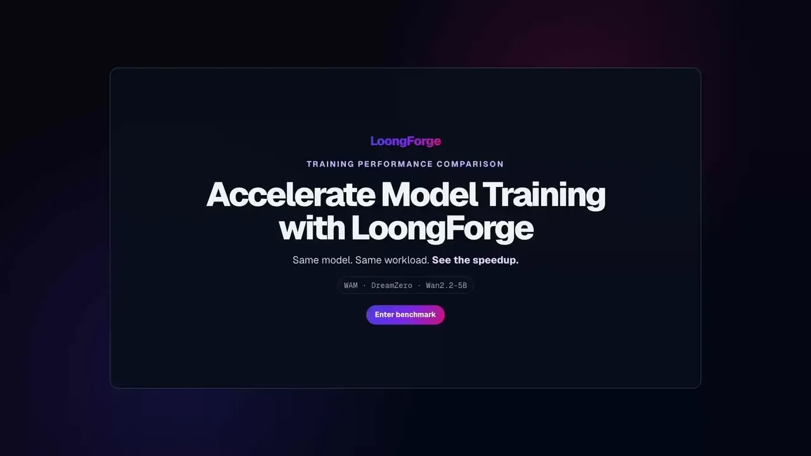
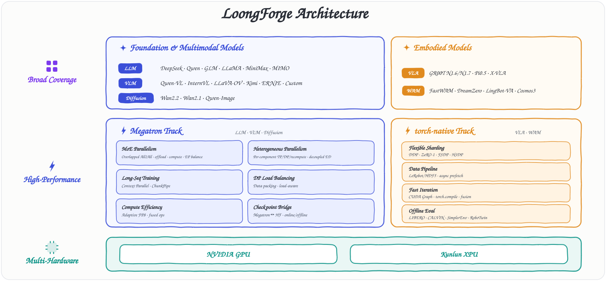
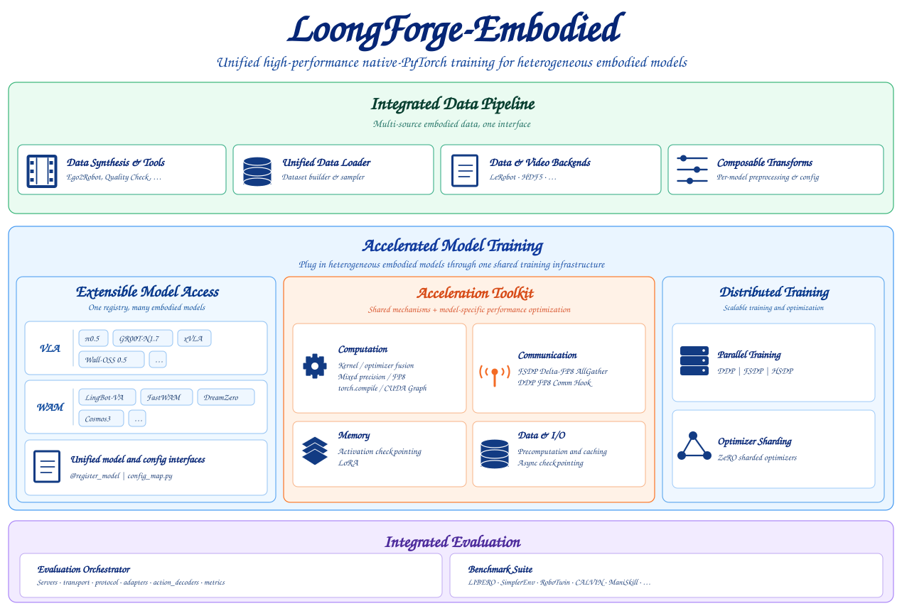
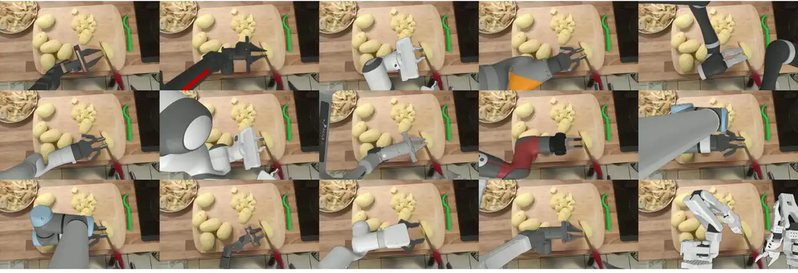
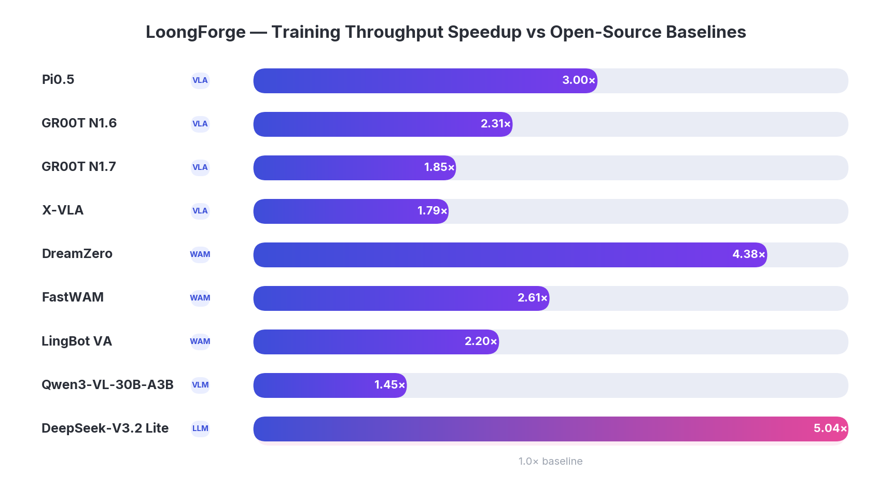

<p align="right"><sub><b>English</b> | <a href="./README_zh.md">简体中文</a></sub></p>

<div align="center">

<p align="center">
  <picture>
    <source media="(prefers-color-scheme: dark)"  srcset="./docs/assets/images/logo/banner-dark.svg">
    <source media="(prefers-color-scheme: light)" srcset="./docs/assets/images/logo/banner.svg">
    
  </picture>
</p>

<h3 align="center">Train LLMs, VLMs, diffusion, and embodied models — faster.</h3>

<p align="center">
  <a href="https://loongforge.readthedocs.io/en/latest/index.html"><b>Docs</b></a>
  &nbsp;·&nbsp;
  <a href="https://baidu-baige.github.io/LoongForge/blog/"><b>Blog</b></a>
  &nbsp;·&nbsp;
  <a href="#performance"><b>Performance</b></a>
  &nbsp;·&nbsp;
  <a href="#quickstart"><b>Quick Start</b></a>
  &nbsp;·&nbsp;
  <a href="#models"><b>Supported Models</b></a>
  &nbsp;·&nbsp;
  <a href="#powered-by-loongforge"><b>Awesome Projects</b></a>
</p>

<p align="center">
  <a href="https://hellogithub.com/repository/baidu-baige/LoongForge" target="_blank"></a>
  <a href="https://atomgit.com/baidu-baige/LoongForge" target="_blank"></a>
</p>

<p align="center">
  <a href="https://github.com/baidu-baige/LoongForge/stargazers"></a>
  <a href="./LICENSE"></a>
  <a href="https://hub.docker.com/u/loongforge"></a>
  <a href="./CONTRIBUTING.md"></a>
</p>

<p align="center">
  <a href="https://discord.gg/RnY39D6CM"></a>
  <a href="https://github.com/baidu-baige/LoongForge/issues/80"></a>
  <a href="https://github.com/baidu-baige/LoongForge/issues/80"></a>
  <a href="https://www.zhihu.com/people/nbqbn3"></a>
  <a href="https://x.com/baidu_baige_lf"></a>
</p>

</div>

**LoongForge** is an open-source training framework developed by the [Baidu AI Cloud Baige team](https://cloud.baidu.com/product/aihc.html), built to deliver faster training for mainstream **LLMs, VLMs, diffusion, and embodied models**.

- **High Performance** — Built on Megatron-LM and torch-native backends, with deep optimizations for [training speed](#performance) that keep **training loss aligned with the baseline**.
- **Easy to Use** — Ready-to-run configs and launch scripts for 40+ open-source [models](#models), plus checkpoint conversion and data preprocessing tools. Supports **pre-training**, **mid-training**, **SFT**, and **LoRA**.
- **Production-Proven** — Open-sourced from [AIAK-Training-LLM](https://cloud.baidu.com/doc/AIHC/s/Alyo476jr), which powers enterprise customers' proprietary models and several [open-source projects](#powered-by-loongforge). Production runs reach **5,000+ XPUs**.

---

**Example:** training the embodied model DreamZero on LoongForge reaches 4.38× the open-source baseline's throughput, with loss curves staying aligned

<p align="center">
  <a href="https://baidu-baige.github.io/LoongForge/assets/video/dreamzero-comparison.mp4">
    <picture>
      <source media="(prefers-reduced-motion: reduce)" srcset="./docs/assets/images/demo/dreamzero-poster.jpg">
      
    </picture>
  </a>
</p>

<p align="center">⭐ Give us a <b>Star</b> to help more people discover LoongForge and grow the community.</p>

<a id="architecture"></a>
## 🏗️ Architecture

Since optimal training strategies differ across model families and scales, LoongForge adopts a multi-backend architecture.

<p align="center">
  <picture>
    <source media="(prefers-color-scheme: dark)"  srcset="./docs/assets/images/architecture/loongforge-architecture-dark.svg">
    <source media="(prefers-color-scheme: light)" srcset="./docs/assets/images/architecture/loongforge-architecture.svg">
    
  </picture>
</p>

- **Megatron Backend** — For [LLM, VLM, and diffusion models](#llm-vlm), extended with MoE parallelism, per-component heterogeneous parallelism, long-sequence optimizations, etc.
- **torch-native Backend** — For [embodied models](#embodied) (VLA and WAM). Built on native PyTorch with **DDP / ZeRO-1 / FSDP / HSDP**, with deep optimizations for representative models across I/O, communication strategy, kernel efficiency, etc.

## 🔥 Latest News

- **[2026/10]** 🤖 Introducing **[LoongForge-VLDA](./cookbook/loongforge-vlda/)**, a Vision-Language-Delta-Action model trained with LoongForge: **98.5%** on LIBERO, **84.5%** zero-shot on LIBERO-Plus, and **+17–18 points** over π0.5 on real robots. [[project page](https://baidu-baige.github.io/LoongForge/projects/vlda.html)]
- **[2026/10]** 🦾 Open-sourced **[ego2robot](./tools/ego2robot/)** — a pipeline that converts first-person videos of human manipulation into dual-arm robot training data, outputting **LeRobot v3.0** format across **16 robot morphologies**.
- **[2026/09]** ✨ Added training support for **[GLM-5.3-flash](./examples/glm5_next/)**.
- **[2026/09]** ✨ Added **[Kimi-K3](./examples/kimi_k3/)** BF16 training support for both LLMs and VLMs.
- **[2026/09]** ⚡ Added an optimized **[DreamZero Wan2.2-5B FSDP recipe](./examples/embodied/dreamzero/run_dreamzero_wan22_5b_full_fsdp_finetune.sh)** with cache-aware data loading, compiled attention blocks, frozen-module handling, and FSDP2 Delta-FP8 Param AllGather.
- **[2026/08]** 🤖 Added VLA training support for **[Wall-OSS-0.5](./examples/embodied/wall_oss_0_5/)**, with custom fused operators for higher training throughput.
- **[2026/08]** 📄 Released the **[TAOT paper](https://arxiv.org/abs/2608.03676)** — topology-aware dynamic expert replica placement that tackles expert-parallel (**EP**) load imbalance in **MoE** training, cutting overhead by up to **74%** over industry solutions, with **1.43× speedup** measured on a real training case. [[blog](https://baidu-baige.github.io/LoongForge/blog/2026-08-taot-topology-aware-expert-placement.html)]
- **[2026/08]** ✨ Added training support for **GLM-5.2**, along with a **[GLM-5.2 + MoonViT](./configs/models/glm5.2_vit/)** custom-composition [example](./examples/glm5.2_vit/) for extending GLM with multimodal capabilities.
- **[2026/08]** ✨ Added training support for **MiniCPM-V-4.6** and **Qwen3.8-27B**.
- **[2026/08]** 🧪 Introduced a unified [**evaluation module**](./loongforge/embodied/eval/) for the embodied stack, currently covering **Pi0.5 / xVLA / GR00T**, with more models on the way.

<details>
<summary><b>📅 More</b></summary>

- **[2026/07]** 🐳 Unified the **prebuilt Docker images** — all model families (LLM / VLM / Embodied / Diffusion) now share a single image.
- **[2026/07]** 🤖 Released **[LoongForge-Embodied](./loongforge/embodied)**, a torch-native DDP/FSDP training subsystem for embodied models (Pi0.5, GR00T-N1.6/N1.7, xVLA, LingBot-VA, FastWAM, DreamZero, and Cosmos3), with up to **4.38× speedup**.
- **[2026/07]** ✨ Added training support for **DeepSeek-V4-Flash / DeepSeek-V4-Pro**.
- **[2026/07]** ✨ Added training support for **Qwen-Image-Edit-2511**.
- **[2026/06]** 🤖 Expanded VLA coverage with **GR00T N1.6**; **2.3× speedup** on GR00T training. [[blog](https://baidu-baige.github.io/LoongForge/blog/2026-06-loongforge-groot-n16-acceleration.html)]
- **[2026/05]** ⚡ Accelerated **Wan 2.2** training by **116%**, and added CP and data packing support.
- **[2026/05]** ✨ Added training support for **Kimi K2.5 / K2.6**, and introduced **INT4 / NVFP4** PTQ.
- **[2026/05]** 🎉 **v0.1.0** — first official tagged release of LoongForge.
- **[2026/05]** 🌟 Powered the training and public release of **LLaVA-OneVision-2.0**.
- **[2026/04]** 🧩 Added training support for **MiniMax-M2.7** on both NVIDIA GPU and Kunlun XPU.
- **[2026/04]** 🚀 LoongForge source code publicly available on GitHub. [[blog](https://baidu-baige.github.io/LoongForge/blog/2026-04-announcing-loongforge.html)]
- **[2025/10]** 🌟 Powered the training and public release of **LLaVA-OneVision-1.5** under **AIAK-Training-LLM**, the predecessor of LoongForge. [[blog](https://baidu-baige.github.io/LoongForge/blog/2025-10-llava-onevision-case-study.html)]

</details>

<a id="embodied"></a>
## 🤖 Embodied Models

**Data processing, training, and evaluation** for Vision-Language-Action (VLA) and World-Action (WAM) models, with **1.79×–4.38×** training throughput over open-source baselines across benchmarked models. [[Docs](https://loongforge.readthedocs.io/en/latest/embodied_tutorial/quick_start_index.html)] (Paper coming soon)

<p align="center">
  <picture>
    <source media="(prefers-color-scheme: dark)"  srcset="./docs/assets/images/architecture/loongforge-embodied-architecture-dark.svg">
    <source media="(prefers-color-scheme: light)" srcset="./docs/assets/images/architecture/loongforge-embodied-architecture.svg">
    
  </picture>
</p>

### Data

* **Unified Data Loading** — A unified data-loading interface supporting mainstream formats like LeRobot (v2.0 / v2.1 / v3.0); each model's data pipeline matches its original open-source implementation.
* **Feature Cache Precomputation (optional)** — Precompute frozen-encoder outputs for DreamZero (VAE latents, text embeddings) and FastWAM (text embeddings) ahead of training, read directly during training to avoid re-encoding every step. [[DreamZero](./tools/dreamzero_data_preprocess)] [[FastWAM](./examples/embodied/fastwam/precompute_text_embeds.sh)]
* **Ego2Robot** — Converts first-person videos of human manipulation into **LeRobot v3.0** training data across **16 robot morphologies**, each adapted to its own joint layout and gripper. [[README](./tools/ego2robot/README.md)]

<table width="100%">
  <tr>
    <th align="center" width="30%">Human Demonstration (Input)</th>
    <th align="center" width="70%">Ego2Robot Output Examples (Multiple Robot Morphologies)</th>
  </tr>
  <tr>
    <td></td>
    <td></td>
  </tr>
</table>

### Training

* **Per-Model Deep Optimization** — Custom optimizations targeting each model's bottlenecks (I/O, communication strategy, `torch.compile`, CUDA Graph, custom fused operators, etc.), reaching **1.79×–4.38×** measured throughput over open-source baselines (see [Performance](#performance)).
* **Precision Alignment** — Training loss aligns with open-source baselines; comparison curves are already available for several models and will keep expanding alongside new model support. [[Precision Comparisons](./docs/assets/images/precision/)]
* **Multiple Distributed Strategies** — Supports **DDP / DDP + ZeRO-1 / FSDP / HSDP**, selectable by model scale and cluster topology. [[Tutorial](https://loongforge.readthedocs.io/en/latest/embodied_tutorial/overview.html)]
* **FP8 Communication Optimization (optional)** — On supported NVIDIA GPUs, compresses cross-rank traffic to FP8: blockwise FP8 delta compression for FSDP2 parameter AllGather, and FP8 compression for DDP gradient all-reduce. [[Usage](https://loongforge.readthedocs.io/en/latest/features/fp8_communication.html)]

### Evaluation

* **Unified Evaluation** — Closed-loop evaluation of trained policies in the **LIBERO / CALVIN / SimplerEnv / RoboTwin / ManiSkill** simulators; coverage is expanding continuously. [[README](./loongforge/embodied/eval)]

> [!NOTE]
> Coming soon: evaluation results for models trained with LoongForge.

<a id="llm-vlm"></a>
## 🚀 LLM · VLM · Diffusion

Built on the [Megatron backend](https://github.com/baidu-baige/Loong-Megatron), supporting large-scale pre-training and SFT for LLMs and VLMs, as well as diffusion model training. Key optimizations for each scenario:

### LLM

* **MoE EP Communication Optimization** — Overlapped All2All / activation offload / compute, with **further memory reduction** beyond upstream Megatron-LM. [[Usage](https://loongforge.readthedocs.io/en/latest/features/moe_all2all_overlap.html)]
* **MoE Expert Load Balancing** — Topology-aware dynamic replication of hot experts to balance EP workloads, with up to **74%** lower overhead than industry solutions. [[TAOT Paper](https://arxiv.org/pdf/2608.03676)]
* **Adaptive FP8 Training** — End-to-end FP8 for LLMs and VLMs with standard **blockwise FP8**; an optional **adaptive** mode picks per-operator precision by GEMM shape and efficiency. [[Usage](https://loongforge.readthedocs.io/en/latest/features/adaptive_fp8.html)]
* **Custom Fused Operators** — Fused kernels like **FusedDSA** for DSA-style models — TileLang version open-sourced, high-performance CUDA version available on Baidu Baige platform.
* **Long-Sequence Training** — Scales LLM training to long sequences via **Context Parallel (CP)** and **chunked-pipeline scheduling**.

### VLM

* **Flexible Composition** — Assemble VLMs from interchangeable ViT and LLM components (e.g. **GLM-5.2 + MoonViT**) straight from config — no custom model code. [[Usage](https://loongforge.readthedocs.io/en/latest/features/model_combination.html)]
* **Heterogeneous Parallelism** — Independent TP / DP / recompute / freeze per model component (e.g. ViT vs. LLM) for optimal throughput and memory. [[blog](https://baidu-baige.github.io/LoongForge/blog/2026-05-loongforge-heterogeneous-parallel-training.html)] [[Usage](https://loongforge.readthedocs.io/en/latest/features/heterogeneous_parallel.html)]
* **Decoupled Encoder-Decoder Training** — Eliminates encoder-induced pipeline bubbles by separating ViT and LLM into independent tasks. [[Usage](https://loongforge.readthedocs.io/en/latest/features/heterogeneous_parallel.html#full-heterogeneous-dp-parallel)]
* **DP Load Balancing** — Improves multi-node scaling efficiency with load-aware data redistribution that mitigates sequence-packing imbalance. [[blog](https://baidu-baige.github.io/LoongForge/blog/2026-05-loongforge-dp-load-balancing.html)] [[Usage](https://loongforge.readthedocs.io/en/latest/features/data_parallel_balancing.html)]
* **Flexible Data Pipeline** — Energon **WebDataset** input for multimodal data, with both **online** and **offline** sequence packing. [[Usage](https://loongforge.readthedocs.io/en/latest/vlm_tutorial/dataset_conversion.html)]

### Diffusion

* **Context Parallelism** — Supports Ring, Ulysses, and hybrid context parallelism (CP) to split long video sequences across GPUs.
* **Variable-Length Sample Packing** — Packs multiple variable-length video samples into a single sequence to reduce padding waste, compatible with context parallelism. [[Usage](https://loongforge.readthedocs.io/en/latest/wan_tutorial/wan_packing.html)]

### Compatibility

* **Mcore Bridge** — Supports both **offline** bidirectional **Megatron ↔ HuggingFace** conversion and **online** native HF load/save. [[Usage](https://loongforge.readthedocs.io/en/latest/features/mcore_bridge.html)]
* **Heterogeneous Hardware** — Native support for **NVIDIA GPUs** and **Kunlun XPUs** via a minimally-intrusive plugin design.

> 📖 Deep-dive: [LLM](https://loongforge.readthedocs.io/en/latest/llm_tutorial/features_index.html) · [VLM](https://loongforge.readthedocs.io/en/latest/vlm_tutorial/features_index.html)

<a id="performance"></a>
## 📊 Performance

Training throughput speedups over mainstream open-source baselines — each model and its baseline were benchmarked on the same machine type with the same training hyperparameters:

<p align="center">
  
</p>

> DeepSeek-V3.2 Lite reflects DSA operator-level optimizations and was validated on a reduced-layer configuration due to test-bed scale limits.<br>
> Numbers were measured at a point in time and may evolve as implementations change on both sides.

<a id="quickstart"></a>
## ⚡ Quick Start

### 1. Install

Using NVIDIA GPU as an example, pull the [prebuilt image](https://hub.docker.com/u/loongforge) and start a container (requires the NVIDIA Container Toolkit):

```bash
docker pull loongforge/loongforge:latest
mkdir -p workspace
docker run --gpus all --ipc=host -it --rm \
  -v "$(pwd)/workspace:/workspace/data" \
  -w /workspace/LoongForge \
  loongforge/loongforge:latest bash
```

> The example above mounts `./workspace` to `/workspace/data` inside the container, for storing weights, datasets, and training outputs — these persist after the container exits.

For more installation options including source builds, see: [Full GPU installation guide](https://loongforge.readthedocs.io/en/latest/get_started/installation.html) · [Kunlun XPU installation guide](https://loongforge.readthedocs.io/en/latest/kunlun_tutorial/install_p800.html)

### 2. Pick a tutorial — by hardware and modality

- **NVIDIA GPU**: [LLM](https://loongforge.readthedocs.io/en/latest/llm_tutorial/quick_start_llm_pretrain.html) · [VLM](https://loongforge.readthedocs.io/en/latest/vlm_tutorial/quick_start_vlm_pretrain.html) · [VLA & WAM (Embodied)](https://loongforge.readthedocs.io/en/latest/embodied_tutorial/quick_start_index.html) · [Diffusion](https://loongforge.readthedocs.io/en/latest/wan_tutorial/quick_start_wan_training.html)
- **Kunlun XPU**: [Kunlun XPU Tutorials](https://loongforge.readthedocs.io/en/latest/kunlun_tutorial/README.html)

### 3. Launch example

Launch scripts for every supported model are already included in this repo: NVIDIA GPU scripts live under [`examples/`](./examples/), Kunlun XPU scripts under [`examples_xpu/`](./examples_xpu/) — see [Supported Models](#models) for the full list.

The example below walks through **DDP fine-tuning of Pi0.5 on LIBERO (single node, 8 GPUs)**; run all commands inside the container above.

**① Prepare weights, tokenizer, and dataset** (`hf` is the Hugging Face CLI):

```bash
hf download lerobot/pi05_base --local-dir /workspace/data/pi05_base
hf download google/paligemma-3b-pt-224 --local-dir /workspace/data/paligemma-3b-pt-224
hf download lerobot/libero_10 --repo-type dataset --local-dir /workspace/data/libero_10
```

**② Launch training** (paths are set via environment variables; defaults to 20 steps to validate the workflow):

```bash
export CHECKPOINT_PATH=/workspace/data/pi05_base
export TOKENIZER_PATH=/workspace/data/paligemma-3b-pt-224
export DATA_PATH=/workspace/data/libero_10
export OUTPUT_DIR=/workspace/data/outputs/pi05

bash examples/embodied/pi05/run_pi05_ddp_finetune.sh
```

Logs and TensorBoard data are saved under `OUTPUT_DIR`. For FSDP / ZeRO-1 launch options and LIBERO evaluation, see the [Pi0.5 tutorial](https://loongforge.readthedocs.io/en/latest/embodied_tutorial/quick_start_pi05.html).

<a id="models"></a>
## 🏛️ Supported Models

Click any model for its training examples; see [`configs/models/`](./configs/models/) for the matching parameter configs. See the [model support matrix](https://loongforge.readthedocs.io/en/latest/get_started/support_model.html) for all variants.

<table width="100%">
<colgroup>
<col width="25%">
<col width="25%">
<col width="25%">
<col width="25%">
</colgroup>
<thead align="center" valign="bottom">
<tr><th width="25%">Embodied</th><th width="25%">LLM</th><th width="25%">VLM</th><th width="25%">Diffusion</th></tr>
</thead>
<tbody valign="top">
<tr>
<td valign="top">
<ul>
<li><a href="examples/embodied/pi05/">Pi0.5</a></li>
<li><a href="examples/embodied/groot_n1_6/">GR00T-N1.6</a></li>
<li><a href="examples/embodied/groot_n1_7/">GR00T-N1.7</a></li>
<li><a href="examples/embodied/xvla/">xVLA</a></li>
<li><a href="examples/embodied/wall_oss_0_5/">Wall-OSS-0.5</a></li>
<li><a href="examples/embodied/fastwam/">FastWAM</a></li>
<li><a href="examples/embodied/lingbot_va/">LingBot-VA</a></li>
<li><a href="examples/embodied/cosmos3/">Cosmos3</a></li>
<li><a href="examples/embodied/dreamzero/">DreamZero</a></li>
</ul>
</td>
<td valign="top">
<ul>
<li><a href="examples/deepseek_v2/">DeepSeek-V2</a></li>
<li><a href="examples/deepseek_v3/">DeepSeek-V3/V3.2</a></li>
<li><a href="examples/deepseek_v4/">DeepSeek-V4</a></li>
<li><a href="examples/llama2/">LLaMA2</a></li>
<li><a href="examples/llama3/">LLaMA3</a></li>
<li><a href="examples/llama3.1/">LLaMA3.1</a></li>
<li><a href="examples/qwen/">Qwen</a></li>
<li><a href="examples/qwen1.5/">Qwen1.5</a></li>
<li><a href="examples/qwen2/">Qwen2</a></li>
<li><a href="examples/qwen2.5/">Qwen2.5</a></li>
<li><a href="examples/qwen3/">Qwen3</a></li>
<li><a href="examples/qwen3_next/">Qwen3-Next</a></li>
<li><a href="examples/minimax/">MiniMax-M2.1/2.5/2.7</a></li>
<li><a href="examples/mimo/">MIMO</a></li>
<li><a href="examples/glm5/">GLM-5</a></li>
<li><a href="examples/glm5.2/">GLM-5.2</a></li>
<li><a href="examples/kimi_k3/">Kimi-K3</a></li>
</ul>
</td>
<td valign="top">
<ul>
<li><a href="examples/qwen2.5_vl/">Qwen2.5-VL</a></li>
<li><a href="examples/qwen3_vl/">Qwen3-VL</a></li>
<li><a href="examples/qwen3.5/">Qwen3.5</a></li>
<li><a href="examples/qwen3.6/">Qwen3.6</a></li>
<li><a href="examples/qwen3.8/">Qwen3.8</a></li>
<li><a href="examples/kimi_k2.x/kimi_k2.5/">Kimi-K2.5/2.6</a></li>
<li><a href="examples/kimi_k3/">Kimi-K3</a></li>
<li><a href="examples/minicpm_v_4_6/">MiniCPM-V-4.6</a></li>
<li><a href="examples/glm5.2_vit/">GLM-5.2 + MoonViT</a></li>
<li><a href="examples/glm5_next/">GLM-5.3-flash</a></li>
<li><a href="examples/ernie4.5/">ERNIE4.5-VL</a></li>
<li><a href="examples/llava_onevision_1.5/">LLaVA-OneVision-1.5</a></li>
<li><a href="examples/internvl2.5/">InternVL2.5</a></li>
<li><a href="examples/internvl3.5/">InternVL3.5</a></li>
</ul>
</td>
<td valign="top">
<ul>
<li><a href="examples/wan/">Wan2.1</a></li>
<li><a href="examples/wan/">Wan2.2</a></li>
<li><a href="examples/qwen_image/">Qwen-Image-Edit-2511</a></li>
</ul>
</td>
</tr>
</tbody>
</table>

> [!TIP]
> For VLMs, also see the [custom composition example](./examples/custom/), which assembles a new model from a ViT and an LLM purely through configuration.

<a id="powered-by-loongforge"></a>
## 🌟 Awesome Projects Built with LoongForge

See more on the [Projects page](https://baidu-baige.github.io/LoongForge/projects.html), and if you've built something with LoongForge (or its predecessor, AIAK-Training-LLM), [let us know](https://github.com/baidu-baige/LoongForge/issues/new) — we'd love to feature it.

### From the Community

- [**LLaVA-OneVision-2.0**](https://github.com/EvolvingLMMs-Lab/LLaVA-OneVision-2) — Next-generation multimodal model, with new VideoCaption and Spatial datasets
- [**Innovator-VL**](https://github.com/InnovatorLM/Innovator-VL/tree/main) — Scientific multimodal LLM for advanced reasoning
- [**LLaVA-OneVision-1.5**](https://github.com/EvolvingLMMs-Lab/LLaVA-OneVision-2/tree/1.5) — Fully open framework for democratized multimodal training
- [**Qianfan-VL**](https://github.com/baidubce/Qianfan-VL) — Domain-enhanced vision-language models for enterprise, 3B–70B parameters

### From the LoongForge Team

- [**LoongForge-VLDA**](./cookbook/loongforge-vlda/) — Vision-Language-Delta-Action model for robotic manipulation: **98.5%** on LIBERO, **84.5%** zero-shot on LIBERO-Plus, and **17–18 points** ahead of π₀.₅ on real robots. [[project page](https://baidu-baige.github.io/LoongForge/projects/vlda.html)]

https://github.com/user-attachments/assets/8563afca-f79a-4a45-bb4f-36e06c0ccbcb

<a id="blogs"></a>
## 📝 Community Blogs

- [VLA 训练如何一步步提速：以 Pi0.5 为例的 3 倍加速实践](https://zhuanlan.zhihu.com/p/2095555587304117777)
- [百度百舸 LoongForge 团队提出 TAOT：拓扑感知传输破解大规模 MoE 训练端到端加速 1.43 倍](https://mp.weixin.qq.com/s/Op-KpFe5G1Q2IxzIUgm2KA)
- [加速 GR00T N1.6 具身 VLA 模型训练！LoongForge 开源框架实现三层全链路优化，吞吐提升 2.3 倍、训练周期缩短 56.6%](https://mp.weixin.qq.com/s/lIMsQ0Q5G9KaDKGtrBt-Nw)
- [多模态模型终于不用「抽帧看世界」？LLaVA-OneVision-2.0 全开源全帧率技术解读](https://mp.weixin.qq.com/s/dechFptcXCvF30mfmC3dWA)
- [LoongForge 多模态异构并行训练加速，从问题到方案的全面解析](https://mp.weixin.qq.com/s/ZFWSxNZvDZJ38fyyb8t7vg)
- [百度百舸开源全模态训练框架 LoongForge：一套代码跑通 GPU 与昆仑芯，多模态训练提速 45%](https://zhuanlan.zhihu.com/p/2031006068797600446)
- [刷新记录！百度百舸助力 LLaVA-OneVision-1.5 高效训练](https://mp.weixin.qq.com/s/mdH3vUStOB13ME4aHx3O8w)

## 📂 Repository Layout

<details>
<summary><b>📁 Directory tree</b></summary>

```
LoongForge/
├── loongforge/                   # Core training framework
│   ├── train/                    # Training entry points and trainers
│   │   ├── pretrain/             #   Pretraining
│   │   ├── sft/                  #   Supervised fine-tuning
│   │   └── diffusion/            #   Diffusion training
│   ├── models/                   # Unified model abstractions
│   │   ├── foundation/           #   LLM backbones
│   │   ├── encoder/              #   Vision encoders
│   │   ├── omni_models/          #   Multimodal composition (encoder + projector + decoder)
│   │   ├── diffusion/            #   Diffusion models
│   │   └── common/               #   Shared base configs, layers and utilities
│   ├── embodied/                 # Embodied (VLA + world-action) training: models, data, trainers, distributed, eval
│   ├── data/                     # Data loading and processing pipelines
│   ├── tokenizer/                # Tokenizers
│   └── utils/                    # Config registry, constants and shared helpers
├── third_party/                  # Third-party dependencies and patches
│   ├── Loong-Megatron/            # Patched Megatron-LM (git submodule)
│   └── patches/                  # TransformerEngine patches
├── configs/                      # Hydra YAML configs (models, data)
├── examples/                     # Launch scripts for NVIDIA GPUs
├── examples_xpu/                 # Launch scripts for Kunlun XPUs
├── cookbook/                     # End-to-end project recipes built on LoongForge
├── tools/                        # Standalone dev tools: checkpoint conversion, data preprocessing, etc. (see tools/README.md)
├── ops/                          # Custom fused operators (incl. open-sourced TileLang)
├── docker/                       # Dockerfiles (GPU & XPU)
├── tests/                        # Test suites (E2E, regression, unit)
└── docs/                         # Documentation
```

</details>

## 📝 Citation

If you find LoongForge helpful, please cite this project:

```bibtex
@software{LoongForge2026,
  title  = {LoongForge: A high-performance framework for training LLMs, VLMs, diffusion, and embodied models},
  author = {{The LoongForge Authors}},
  year   = {2026},
  url    = {https://github.com/baidu-baige/LoongForge}
}
```

If you use TAOT for MoE training in LoongForge, you can cite our paper:

```bibtex
@article{zhang2026taot,
  title   = {{TAOT}: Topology-Aware Optimal Transport for Dynamic Expert Replica Placement in {MoE} Training},
  author  = {Zhang, Lingyun and Zhang, Henghua and Gu, Shilei and Mo, Kai and Han, Shuai and Li, Shiyong and Wang, Yanpeng and Shen, Dou},
  journal = {arXiv preprint arXiv:2608.03676},
  year    = {2026},
  url     = {https://arxiv.org/abs/2608.03676}
}
```

## 🤝 Contributing

We warmly welcome community contributions — bug reports, feature proposals, and PRs alike. Please read our [Contributing Guidelines](./CONTRIBUTING.md) before submitting.

Thanks to all our contributors:

<a href="https://github.com/baidu-baige/LoongForge/graphs/contributors">
  
</a>

<a id="contact"></a>
## 💬 Contact Us

| Channel | What it's for |
|---------|---------------|
| [**GitHub Issues**](https://github.com/baidu-baige/LoongForge/issues/new/choose) | Bug reports, usage questions, and feature requests |
| [**Developer Communities**](https://github.com/baidu-baige/LoongForge/issues/80) | WeChat group, Xiaohongshu, and more |
| [**Email**](mailto:loongforge@baidu.com) | Enterprise adoption, large-scale deployment, partnership, or any other topic |

## 🙏 Acknowledgments

LoongForge stands on the shoulders of the open-source community. Its Megatron backend builds on NVIDIA's [Megatron-LM](https://github.com/NVIDIA/Megatron-LM), and the project also draws on [HuggingFace Transformers](https://github.com/huggingface/transformers), [LLaMA-Factory](https://github.com/hiyouga/LlamaFactory), [Megatron-Bridge](https://github.com/NVIDIA-NeMo/Megatron-Bridge), [LeRobot](https://github.com/huggingface/lerobot), and the official implementations of the models we support (e.g. [OpenPI](https://github.com/Physical-Intelligence/openpi), [NVIDIA Isaac GR00T](https://github.com/NVIDIA/Isaac-GR00T)).

We also thank the [LINUX DO](https://linux.do/) community for providing a welcoming space for technical discussion, and [AtomGit](https://atomgit.com/baidu-baige/LoongForge) for hosting LoongForge's official mirror.

## 📄 License

LoongForge is released under the [Apache License 2.0](./LICENSE); some files derive from third-party projects — see their file headers.
