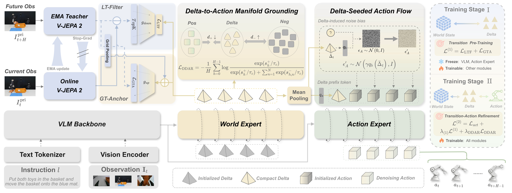

<h1 align="center">Vision-Language-Delta-Action: Learning Compact Deltas as Actionable Transition Interfaces for Robotic Manipulation</h1>

<p align="center">
  Lingsen Zhang<sup>1,2,*</sup> &nbsp;·&nbsp;
  Wei Li<sup>1,2,*</sup> &nbsp;·&nbsp;
  Jie He<sup>1,2</sup> &nbsp;·&nbsp;
  Henghua Zhang<sup>2</sup> &nbsp;·&nbsp;
  Kai Mo<sup>2</sup> &nbsp;·&nbsp;
  Shiyong Li<sup>2</sup> &nbsp;·&nbsp;
  Yanpeng Wang<sup>2</sup> &nbsp;·&nbsp;
  Rui Shao<sup>1,3,&dagger;</sup>
</p>

<p align="center">
  <sup>1</sup> Harbin Institute of Technology, Shenzhen &nbsp;·&nbsp;
  <sup>2</sup> Baidu, Inc. &nbsp;·&nbsp;
  <sup>3</sup> Shenzhen Loop Area Institute
  <br>
  <sup>*</sup> Equal contribution &nbsp;&nbsp; <sup>&dagger;</sup> Corresponding author
</p>

<p align="center">
  
  &nbsp;<a href="https://baidu-baige.github.io/LoongForge/projects/vlda.html"></a>
  &nbsp;<a href="https://huggingface.co/collections/LoongForge/loongforge-vlda"></a>
</p>

We introduce **LoongForge-VLDA** (Vision-Language-Delta-Action), a new model
architecture that learns compact Deltas as actionable transition interfaces for
robotic manipulation. It extends π₀.₅ with latent world modeling and
world-conditioned action prediction, using V-JEPA 2 visual representations to
learn latent changes and future features, and jointly trains the action policy
with an auxiliary alignment objective. This project provides the two-stage
training and evaluation recipe, built on [LoongForge](../../README.md).

## Framework

<p align="center">
  
</p>

*Overview of LoongForge-VLDA. Given the observation and instruction, the World
Expert predicts an actionable Delta under transition supervision. In training
stage I, LT-Filter and GT-Anchor learn selective and consistent transition
representations. In stage II, Delta-Driven Action Refinement grounds Delta in
the action manifold through Delta-to-Action Manifold Grounding and injects it
into action denoising through Delta-Seeded Action Flow, enabling the Action
Expert to generate action chunks.*

## Getting started

Run the commands below from the **LoongForge repository root**. The default
layout is:

```text
LoongForge/
├── .venv/                              # Training and model server
├── .venv-libero/                       # LIBERO simulator and evaluation client
├── cookbook/loongforge-vlda/            # Training and evaluation launchers
├── datasets/libero/                    # LeRobot v2 dataset and norm_stats.json
├── models/
│   ├── pi05_base_pytorch/model.safetensors
│   ├── paligemma_tokenizer.model
│   └── vjepa2/vitg.pt
├── third_party/LIBERO/
└── outputs/vlda/
```

Training asset paths can be overridden through the environment variables shown
below; evaluation paths are set in the YAML. LoongForge-VLDA training and
inference use code in this repository; they do not require a separate VLDA
checkout or patched Transformers installation.

## 1. Training environment

First follow the [LoongForge installation guide](../../docs/source/get_started/installation.md).
Use a dedicated **Python 3.12** environment for this LoongForge-VLDA recipe.
The version
combination used by the training runs is:

| Component | Version |
| --- | --- |
| Python | 3.12 |
| PyTorch / torchvision | 2.8.0 / 0.23.0, CUDA 12.8 wheels |
| LeRobot | 0.5.0 |
| Transformers | 5.3.0 |
| torchdata / torchcodec | 0.11.0 / 0.7.0 |

After the base LoongForge installation, install the LoongForge-VLDA
dependencies into that environment. The explicit PyTorch pins keep the
supplemental install on the same version:

```bash
uv pip install --python .venv/bin/python \
    torch==2.8.0 torchvision==0.23.0 torchcodec==0.7.0 \
    --index-url https://download.pytorch.org/whl/cu128

uv pip install --python .venv/bin/python \
    lerobot==0.5.0 transformers==5.3.0 torchdata==0.11.0 \
    sentencepiece timm==1.0.3 pandas pyarrow tensorboard \
    websockets==15.0.1 msgpack

source .venv/bin/activate
python -c 'import torch; print(torch.__version__, torch.version.cuda, torch.cuda.is_available())'
```

The final check should report `2.8.0+cu128 12.8 True`. These CUDA libraries
belong to the Python environment; installing the wheels does not replace the
host NVIDIA driver or system CUDA toolkit. The scripts select `.venv/bin`
for training by default.

## 2. Download LIBERO and prepare statistics

Download the [Physical Intelligence LIBERO dataset](https://huggingface.co/datasets/physical-intelligence/libero).
The pinned revision below uses **LeRobot v2 with embedded images**, as required
by the VLDA dataset reader:

```bash
.venv/bin/hf download physical-intelligence/libero \
    --repo-type dataset \
    --revision a4336d589d589045d1c56423ffdf3b88a0e19b1f \
    --local-dir datasets/libero
```

The dataset should contain `meta/info.json`, `meta/episodes.jsonl`,
`meta/tasks.jsonl`, and `data/chunk-*/episode_*.parquet`, with columns
`image`, `wrist_image`, `state`, and `actions`. This reader does not use
LeRobot v3 or video-backed datasets.

Training uses quantile normalization and needs **`q01` and `q99` for state
and actions**. The downloaded metadata's mean/std/min/max statistics are
insufficient. If you already have the statistics used for a run, reuse that
`norm_stats.json`; set `NORM_STATS_PATH` to its location. Checkpoints also
store a copy at `assets/norm_stats.json`.

For a fresh dataset without quantile statistics, the following computes them
once from the LIBERO state/action columns. Run this only when preparing new
statistics; reproducing an existing run requires its original statistics file.

```bash
DATA_PATH="$PWD/datasets/libero" .venv/bin/python - <<'PY'
import json
import os
from pathlib import Path

import numpy as np
import pyarrow as pa
import pyarrow.parquet as pq

root = Path(os.environ["DATA_PATH"])
files = sorted((root / "data").glob("chunk-*/episode_*.parquet"))
table = pa.concat_tables([pq.read_table(p, columns=["state", "actions"]) for p in files])
stats = {}
for key in ("state", "actions"):
    values = np.asarray(table[key].to_pylist(), dtype=np.float64)
    q01, q99 = np.quantile(values, [0.01, 0.99], axis=0)
    stats[key] = {
        "mean": values.mean(axis=0).tolist(),
        "std": values.std(axis=0).tolist(),
        "q01": q01.tolist(),
        "q99": q99.tolist(),
    }
output = root / "norm_stats.json"
output.write_text(json.dumps({"norm_stats": stats}, indent=2) + "\n")
print(output)
PY
```

This calculation is for the LIBERO configuration shipped here: 8-dimensional
state and 7-dimensional actions, without an additional joint-delta transform.
Use the same statistics for both stages and the checkpoint's saved statistics
for evaluation.

## 3. Prepare pretrained models

| Asset | Default location | Source |
| --- | --- | --- |
| π₀.₅ base in OpenPI PyTorch format | `models/pi05_base_pytorch/model.safetensors` | [OpenPI pretrained models and PyTorch conversion](https://github.com/Physical-Intelligence/openpi#pytorch-support) |
| PaliGemma SentencePiece tokenizer | `models/paligemma_tokenizer.model` | [Tokenizer](https://storage.googleapis.com/big_vision/paligemma_tokenizer.model) |
| V-JEPA 2 ViT-g, 256px | `models/vjepa2/vitg.pt` | [V-JEPA 2](https://github.com/facebookresearch/vjepa2) |

Use the **π₀.₅ base** weights to initialize Stage 1. If they are in JAX
format (`gs://openpi-assets/checkpoints/pi05_base`), follow OpenPI's PyTorch
setup in a separate conversion environment, then run its converter:

```bash
# Run inside the OpenPI checkout/environment, only for checkpoint conversion.
uv run examples/convert_jax_model_to_pytorch.py \
    --checkpoint_dir /path/to/pi05_base \
    --config_name pi05_libero \
    --precision bfloat16 \
    --output_path /path/to/LoongForge/models/pi05_base_pytorch
```

The converter's `pi05_libero` configuration selects the π₀.₅ architecture;
the input checkpoint above is still the base model. Once converted, training
uses only the resulting local checkpoint.

Download the tokenizer and the original V-JEPA 2 checkpoint from the
LoongForge root:

```bash
mkdir -p models/vjepa2
curl -fL https://storage.googleapis.com/big_vision/paligemma_tokenizer.model \
    -o models/paligemma_tokenizer.model
curl -fL https://dl.fbaipublicfiles.com/vjepa2/vitg.pt \
    -o models/vjepa2/vitg.pt
```

Use the original `vitg.pt` containing both `encoder` and `target_encoder`,
which initialize the online and teacher encoders respectively.

## 4. Train

### Default recipe

The two launchers below use single-node, 8-GPU DDP with **gradient
checkpointing enabled**. Each step is one optimizer update. Gradient
accumulation is `1`: global batch 128 means a batch of 16 on each of 8 GPUs.
Gradient checkpointing saves activation memory by recomputing intermediate
activations during backward; it does not change that batch calculation.

| Parameter | Stage 1 | Stage 2 |
| --- | --- | --- |
| Initialization | π₀.₅ base + V-JEPA 2 | Stage 1 checkpoint |
| Global batch / batch per GPU | 96 / 12 | 128 / 16 |
| Optimizer updates | 10,000 | 60,000 |
| Warmup updates | 500 | 10,000 |
| Peak LR | `7e-5` | `5e-5` |
| Start cosine decay | After warmup | Step 40,000 |
| Final LR | `3e-6` | `1e-5` |
| Save interval | 1,000 | 5,000 |
| Gradient checkpointing | Enabled | Enabled |
| Teacher EMA momentum | `0.9985005625` | `0.9985005625` |
| Alignment loss weight | Not used | `0.01` |

**Stage 2 learning rate:** warm up to `5e-5` during steps 0–10k, hold
`5e-5` during 10k–40k, then cosine-decay to `1e-5` during 40k–60k.
`LR_DECAY_START_ITERS=40000` implements the hold interval. It is separate
from warmup and the total training length.

Both stages use AdamW (`betas=(0.9, 0.95)`, `eps=1e-8`, weight decay
`1e-10`), gradient clipping at `1.0`, seed `42`, and ZeRO disabled.
State tokens, native preprocessing, FlexAttention, and per-layer
`torch.compile` are enabled. The precision policy uses BF16 parameters with
selected modules kept in FP32 and `model.disable_train_autocast=true`.

### Stage 1: world learning

Stage 1 freezes PaliGemma and the action expert and optimizes the world-model
objectives, `delta_loss + future_loss`.

```bash
CUDA_VISIBLE_DEVICES=0,1,2,3,4,5,6,7 \
DATA_PATH="$PWD/datasets/libero" \
NORM_STATS_PATH="$PWD/datasets/libero/norm_stats.json" \
TOKENIZER_PATH="$PWD/models/paligemma_tokenizer.model" \
CHECKPOINT_PATH="$PWD/models/pi05_base_pytorch" \
VJEPA_CHECKPOINT="$PWD/models/vjepa2/vitg.pt" \
OUTPUT_DIR="$PWD/outputs/vlda/libero_stage1" \
RESUME=0 \
bash cookbook/loongforge-vlda/run_vlda_8gpu_stage1.sh
```

### Stage 2: world-conditioned action learning

Stage 2 initializes from Stage 1 with a new optimizer and schedule. The
objective is `action_loss + delta_loss + future_loss + 0.01 * align_loss`.

```bash
INIT_CHECKPOINT="$PWD/outputs/vlda/libero_stage1/checkpoints/steps_10000"

CUDA_VISIBLE_DEVICES=0,1,2,3,4,5,6,7 \
DATA_PATH="$PWD/datasets/libero" \
NORM_STATS_PATH="$INIT_CHECKPOINT/assets/norm_stats.json" \
TOKENIZER_PATH="$PWD/models/paligemma_tokenizer.model" \
CHECKPOINT_PATH="$INIT_CHECKPOINT" \
OUTPUT_DIR="$PWD/outputs/vlda/libero_stage2" \
RESUME=0 \
bash cookbook/loongforge-vlda/run_vlda_8gpu_stage2.sh
```

Use `GPUS_PER_NODE` and `CUDA_VISIBLE_DEVICES` together when changing the
GPU count; the scripts derive the per-device batch from `GLOBAL_BATCH_SIZE`.
The batch must be divisible by GPU count × accumulation steps, and must fit
the selected GPUs. The recent batch-128 runs used 8 GPUs with 80 GB each.
Set `NUM_WORKERS` according to CPU and storage capacity. Initial steps
include compilation and autotuning.

Environment variables override the defaults, and trailing arguments override
model settings, for example `model.align_loss_weight=0.001` or
`model.gradient_checkpointing=false`. The recipe above keeps alignment at
`0.01`.

### Logs and resuming

Each output directory contains console logs under `logs/`, scalar records
in `metrics.jsonl`, TensorBoard events under `tensorboard/`, and checkpoints
under `checkpoints/steps_<N>/`. Loss logging uses all training ranks and
defaults to every 100 steps; use `LOG_INTERVAL=1` for every step.

```bash
.venv/bin/tensorboard --logdir outputs/vlda --port 6006
```

To resume an interrupted Stage 2 run, reuse its output directory and the
same model, batch, worker, and schedule settings:

```bash
CUDA_VISIBLE_DEVICES=0,1,2,3,4,5,6,7 \
DATA_PATH="$PWD/datasets/libero" \
TOKENIZER_PATH="$PWD/models/paligemma_tokenizer.model" \
OUTPUT_DIR="$PWD/outputs/vlda/libero_stage2" \
RESUME=1 \
bash cookbook/loongforge-vlda/run_vlda_8gpu_stage2.sh
```

Resume restores the saved training state and statistics. To start a new run
with a changed learning-rate schedule, use `RESUME=0`, `CHECKPOINT_PATH`,
and a new output directory instead; this loads model weights and starts a
new optimizer. In particular, the new 10k/40k/60k schedule is not an exact
resume configuration for earlier constant-LR runs.

## 5. Evaluate on LIBERO

Evaluation uses LoongForge's shared **policy server + LIBERO client**,
following the [pi05 LIBERO evaluation guide](../../docs/source/embodied_tutorial/eval_docs/benchmarks/libero.md).
The [launch script](eval/run_libero_eval.sh) starts and stops the server
automatically; one terminal is sufficient.

### Simulator environment

Keep the simulator in a separate environment from training. The recipe
below uses Python 3.10 with the package versions recorded in
[LoongForge's benchmark environments](../../docs/source/embodied_tutorial/eval_docs/benchmark_envs.md#libero):

```bash
uv venv --python 3.10 .venv-libero
git clone https://github.com/Lifelong-Robot-Learning/LIBERO.git third_party/LIBERO

uv pip install --python .venv-libero/bin/python \
    torch==2.1.2 numpy==1.24.4 robosuite==1.4.0 mujoco==3.2.3 \
    gym==0.25.2 opencv-python==4.6.0.66 \
    imageio==2.35.1 imageio-ffmpeg==0.5.1 \
    websockets==13.1 msgpack==1.1.1 PyYAML==6.0.3 \
    bddl==1.0.1 easydict==1.9 cloudpickle==2.1.0 matplotlib==3.5.3 future==0.18.2 \
    termcolor==2.5.0
uv pip install --python .venv-libero/bin/python --no-deps -e third_party/LIBERO
```

The LIBERO checkout supplies task definitions, assets, and initial states.
The evaluation YAML defaults to EGL offscreen rendering; the host/container
must expose NVIDIA EGL graphics libraries. On a machine configured for
OSMesa, set `env.mujoco_gl` and `env.pyopengl_platform` to `osmesa` in the
YAML and install the corresponding system library (`libosmesa6` on Ubuntu).

An existing working LIBERO environment can be reused by setting
`BENCHMARK_PYTHON=/path/to/libero/.venv/bin/python` and
`LIBERO_ROOT=/path/to/LIBERO`. Set the model server's Python environment
separately with `server.python` in the YAML.

For Python 3.11, use `matplotlib==3.7.5` in place of `matplotlib==3.5.3`.
The simulator client can use CPU-only PyTorch; the model server uses the
training environment's CUDA-enabled PyTorch. If a container includes another
Python environment's `torch/lib` in `LD_LIBRARY_PATH`, remove that entry before
starting evaluation so the client loads its own PyTorch libraries. Preserve
any required CUDA and graphics library paths.

### Run evaluation

First edit [libero.yaml](eval/configs/libero/libero.yaml):

- Fill the absolute paths for `server.python`, `server.ckpt_path`,
  `server.dataset_statistics_path`, `server.tokenizer_path`, and the
  repository paths under `server` and `env`.
- Set `env.libero_config_path` and `run.output_dir` to the desired local
  configuration and results directories. Use the checkpoint's
  `assets/norm_stats.json` for normalization.
- Check that `model` matches the trained checkpoint's dimensions and
  settings. The supplied values describe the default LIBERO Stage 2 model.
- Keep the desired suites in `sweep`. For a smoke test, keep only
  `libero_object` and set `benchmark.max_tasks: 1` and
  `benchmark.episodes_per_task: 1`.

Then run:

```bash
CUDA_VISIBLE_DEVICES=0 \
BENCHMARK_PYTHON="$PWD/.venv-libero/bin/python" \
bash cookbook/loongforge-vlda/eval/run_libero_eval.sh
```

By default this runs `libero_spatial`, `libero_object`, `libero_10`, and
`libero_goal`, each with **10 tasks × 50 episodes = 500 episodes**. Each
suite gets a separate directory under `run.output_dir`, with
`results.jsonl`, `summary.csv`, `suite_summary.csv`, `policy_server.log`,
and rollout artifacts; success rates are computed per suite.

The YAML uses eager inference with compilation and gradient checkpointing
disabled. `run.seed` fixes the client seed, defaulting to `7`; the server
seed is not fixed. All evaluation settings come from the YAML. To use a
different configuration:

```bash
CUDA_VISIBLE_DEVICES=0 \
BENCHMARK_PYTHON="$PWD/.venv-libero/bin/python" \
CONFIG=/path/to/libero.yaml \
bash cookbook/loongforge-vlda/eval/run_libero_eval.sh
```

## Code layout

| Component | Location |
| --- | --- |
| Training launchers | [Stage 1](run_vlda_8gpu_stage1.sh), [Stage 2](run_vlda_8gpu_stage2.sh) |
| Model and loss definitions | [modeling_vlda.py](../../loongforge/embodied/model/vlda/modeling_vlda.py) |
| Model configuration | [vlda.yaml](../../configs/models/embodied/vlda.yaml) |
| Dataset and transforms | [vlda/](../../loongforge/embodied/data/datasets/vlda/) |
| Teacher EMA and checkpoint integration | [vlda_finetune_trainer.py](../../loongforge/embodied/train/trainers/custom/vlda/vlda_finetune_trainer.py) |
| Evaluation entry | [run_libero_eval.sh](eval/run_libero_eval.sh) |

## V-JEPA 2

VLDA uses part of [V-JEPA 2](https://github.com/facebookresearch/vjepa2)'s
encoder code with minor integration changes. The original
[MIT license](../../loongforge/embodied/model/vlda/vjepa2/LICENSE) is included.

## Acknowledgements

This implementation builds on [LoongForge](../../README.md),
[OpenPI](https://github.com/Physical-Intelligence/openpi),
[V-JEPA 2](https://github.com/facebookresearch/vjepa2), and
[LIBERO](https://github.com/Lifelong-Robot-Learning/LIBERO).
