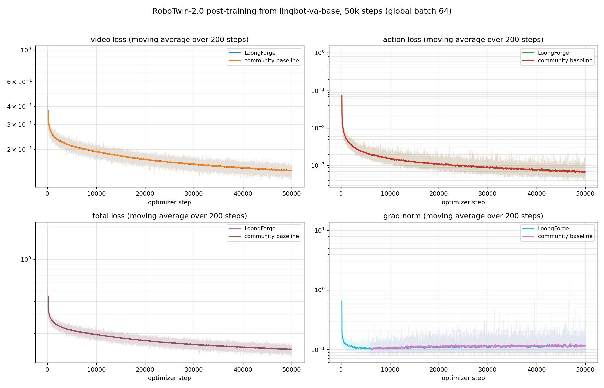
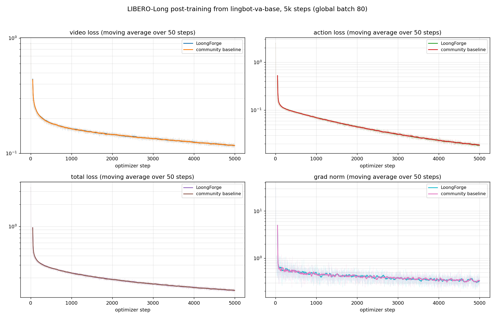
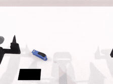
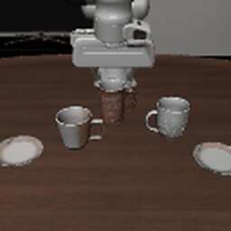
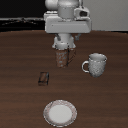

# Quick Start: LingBot-VA Training and Evaluation

This guide uses RoboTwin-2.0 and LIBERO-Long to show how to post-train **LingBot-VA** from `lingbot-va-base` in LoongForge and how to evaluate the resulting checkpoints under the community evaluation protocol. On the same hardware, data and global batch, LoongForge trains **2.85× (RoboTwin) / 2.17× (LIBERO)** faster than the community code, its training curves overlap with the community code's, and its success rates are no lower than those of the community-trained weights.

- [1. Training Preparation](#1-training-preparation)
- [2. Post-training](#2-post-training)
- [3. Evaluation Preparation](#3-evaluation-preparation)
- [4. Evaluation](#4-evaluation)

---

## 1. Training Preparation

### 1.1 Weights

| Weights | Purpose |
|---|---|
| [lingbot-va-base](https://huggingface.co/robbyant/lingbot-va-base) | Initialization for post-training (`transformer/`) |
| [lingbot-va-posttrain-robotwin](https://huggingface.co/robbyant/lingbot-va-posttrain-robotwin) | Official RoboTwin post-trained weights; provides `vae/`, `text_encoder/`, `tokenizer/` for evaluation |
| [lingbot-va-posttrain-libero-long](https://huggingface.co/robbyant/lingbot-va-posttrain-libero-long) | Official LIBERO-Long post-trained weights; provides `vae/`, `text_encoder/`, `tokenizer/` for evaluation |

### 1.2 Training Data

| Dataset | Link |
|---|---|
| RoboTwin LeRobot dataset | [robbyant/robotwin-clean-and-aug-lerobot](https://huggingface.co/datasets/robbyant/robotwin-clean-and-aug-lerobot) |
| LIBERO-Long LeRobot dataset | [robbyant/libero-long-lerobot](https://huggingface.co/datasets/robbyant/libero-long-lerobot) |

This project follows the same offline preprocessing scheme as the official LingBot-VA community: the data directory must contain pre-generated latents and the corresponding `empty_emb.pt`. When using your own dataset, first convert the raw robot data to LeRobot format, then augment each episode in `meta/episodes.jsonl` with `action_config` (start/end frames of action clips and text descriptions), map the actions to the standard 30-dimensional format (pad missing dimensions with 0), and extract video latents with the Wan2.2 VAE, placing them under a `latents/` directory that mirrors `videos/`. For detailed fields, directory layout, and preprocessing commands, refer to the **Custom Dataset Preparation** section of the official [README.md](https://github.com/Robbyant/lingbot-va/blob/main/README.md).

---

## 2. Post-training

### 2.1 Launch Training

Training scripts: `examples/embodied/lingbot_va/run_lingbot_va_robotwin_fsdp_finetune.sh` and `examples/embodied/lingbot_va/run_lingbot_va_libero_fsdp_finetune.sh`. Their defaults are the recipe behind the results in this guide (initialize from `lingbot-va-base`, FP32 gradient reduction); only the paths need to be set:

```bash
cd /path/to/LoongForge

# RoboTwin-2.0: 50000 steps, 8 GPUs x GA 8 = global batch 64
CHECKPOINT_PATH=/path/to/lingbot-va-base \
DATA_PATH=/path/to/robotwin-clean-and-aug-lerobot \
OUTPUT_DIR=/path/to/outputs/lingbot_va_robotwin \
SAVE_INTERVAL=2000 \
bash examples/embodied/lingbot_va/run_lingbot_va_robotwin_fsdp_finetune.sh

# LIBERO-Long: 5000 steps, 8 GPUs x GA 10 = global batch 80
CHECKPOINT_PATH=/path/to/lingbot-va-base \
DATA_PATH=/path/to/libero-long-lerobot \
OUTPUT_DIR=/path/to/outputs/lingbot_va_libero \
SAVE_INTERVAL=1000 \
bash examples/embodied/lingbot_va/run_lingbot_va_libero_fsdp_finetune.sh

# Smoke test: run only 20 steps to validate the training pipeline
TRAIN_ITERS=20 bash examples/embodied/lingbot_va/run_lingbot_va_robotwin_fsdp_finetune.sh
```

Checkpoints are saved in DCP format under `$OUTPUT_DIR/checkpoints/steps_<N>`; to resume after an interruption, rerun with the same `OUTPUT_DIR` and append `--resume`. The trailing `"$@"` of the scripts is passed through to `train.py` verbatim, so any training argument can be overridden.

### 2.2 Key Parameters

**Script parameters** (all can be overridden through environment variables):

| Parameter | RoboTwin default | LIBERO default | Description |
|---|:---:|:---:|---|
| `LOONGFORGE_PATH` | repo containing the script | repo containing the script | LoongForge repository root |
| `LOCAL_VLA_ARTIFACTS_ROOT` | `/path/to/vla_artifacts` | `/path/to/vla_artifacts` | Default root of the next three paths |
| `CHECKPOINT_PATH` | `<root>/lingbot_va/models/lingbot-va-base` | same | Initialization weights (containing `transformer/`) |
| `DATA_PATH` | `<root>/lingbot_va/datasets/robotwin-clean-and-aug-lerobot` | `<root>/lingbot_va/datasets/libero-long-lerobot` | Dataset directory (containing `latents/` and `empty_emb.pt`) |
| `OUTPUT_DIR` | `$LOONGFORGE_PATH/outputs/lingbot_va_robotwin` | `$LOONGFORGE_PATH/outputs/lingbot_va_libero` | Output directory |
| `GPUS_PER_NODE` / `NNODES` | 8 / 1 | 8 / 1 | GPUs per node / number of nodes |
| `TRAIN_ITERS` | 50000 | 5000 | Total training steps |
| `GRADIENT_ACCUMULATION_STEPS` | 8 | 10 | Gradient accumulation steps; keep the global batch fixed when changing the GPU count (e.g. 4 and 5 on 16 GPUs) |
| `SAVE_INTERVAL` | 0 | 0 | Checkpoint interval; 0 saves only at the end |
| `SEED` | 42 | 42 | Global seed; with `--set-seed-by-rank` every rank uses its own seed |

**Switches that affect training numerics** (exported at their recommended values by the example scripts):

| Switch | Default | Description |
|---|:---:|---|
| `LINGBOT_FSDP_BF16_REDUCE` | `0` | `0` reduces gradients in FP32; `1` reduces in the parameter dtype (BF16), removing one FP32 reduce-scatter per step. Overrides `--fsdp-reduce-dtype`. The action branch's gradients are far smaller than the video branch's; on RoboTwin, BF16 reduction raises the action loss by about 6% and lowers the success rate, so FP32 is the default |
| `LINGBOT_VA_FIXED_MICROBATCH_RNG` | `0` | `0` draws from the process-global streams like the community trainer, and with `--set-seed-by-rank` each rank samples its own timesteps / noise / chunk / window; `1` reseeds before every microbatch so all ranks share one draw (for step-by-step comparison with a patched community trainer) |
| `LINGBOT_BALANCED_SAMPLER` | `1` | Deterministically balance load across DP ranks by per-sample compute cost, reducing slow-rank stragglers; it changes the sample loading order, so set `0` for step-by-step loss alignment with the community trainer (falls back to the public `DistributedSampler` partitioning) |
| `LINGBOT_FSDP_RESHARD` | `0` | `0` keeps parameters unsharded between forward and backward (the accepted configuration); `1` restores the framework-default reshard behavior |

The example scripts also enable `--manual-gc --manual-gc-interval 50`, `--detail-log-interval 20` and `--loss-log-rank=-1`, which only affect GC cadence and logging, not numerics. With `--manual-gc`, LingBot keeps young-generation collection and suppresses generation 2 (threshold `GC_GENERATION2_THRESHOLD`) to remove periodic GC jitter.

**Functional switches** (diagnostics, reproducibility and artifact management; no change to training semantics):

| Switch | Default | Description |
|---|:---:|---|
| `LINGBOT_SAMPLE_ORDER_EXPORT_DIR` | empty (no export) | Export the per-rank, per-epoch sample order as JSON (seed, balance group size, index sequence) for reproducibility and step-by-step alignment checks |
| `LINGBOT_REPO_DISCOVERY_CACHE_DIR` | `<dataset_path>/.lingbot_cost_cache` | Repo discovery cache directory; point it at a writable path when the dataset directory is read-only or shared across jobs |

### 2.3 Training Speedup

Both frameworks train 50 steps on one 8×A800 node in the same environment, with the same data and global batch; the table reports the mean step time over steps 15–45 (LoongForge uses the example scripts' default FP32-reduce configuration):

| Benchmark | Configuration | LoongForge | Community code | Speedup |
|---|:---:|:---:|:---:|:---:|
| RoboTwin-2.0 | 8 GPUs × GA 8 (global batch 64) | 8.98 s/step | 25.55 s/step | **2.85×** |
| LIBERO-Long | 8 GPUs × GA 10 (global batch 80) | 12.49 s/step | 27.13 s/step | **2.17×** |

At these step times, 50000 RoboTwin steps take about 5.2 days instead of 14.8, and 5000 LIBERO-Long steps about 17.3 hours instead of 37.7.

The speedup comes from the following optimizations, which are baked into the LingBot implementation and have no toggle:

| Optimization | Effect | Bottleneck Addressed |
|-|-|-|
| Self-Flex BlockMask cache | Cache the BlockMask under a key built from the latent/action shapes, chunk, window and patch sizes, keeping up to 256 entries. | Avoid rebuilding CPU mask metadata and repeating H2D copies for a shape already seen. |
| Self-Flex block64 kernel configuration | Fix the block64 configuration of FlexAttention's Triton fused kernels (FWD=`64,64,4,1`, BWD=`32,32,4,1`) and take the `IS_DIVISIBLE` fast path (q/k/v sequence lengths must be multiples of 128). | Avoid falling back to dense attention, cutting attention compute and memory pressure. |
| Compiled FlexAttention and BlockMask construction | Both self-attention and `create_block_mask` run through `torch.compile(dynamic=True)`; if compilation is unavailable the code falls back to eager and warns once. | Reduce kernel launches and Python dispatch on the attention path. |
| Compiled layerwise fused paths | Six BF16 per-layer segments are compiled: modulation prologue, self residual + cross norm, cross residual + FF norm, residual gate, and output modulation norm. | Fuse the small per-layer operators, cutting kernel count and intermediate tensors. |
| Paired Triton RoPE | Apply rotary embeddings to q and k in one Triton kernel (`apply_triton_rope_pair`). | Replace repeated elementwise ops and transposes, lowering memory traffic and launch cost. |
| RoPE frequency and timestep frequency caches | Rotary frequencies are cached per grid key (up to 16 entries), timestep frequencies per device and dimension, and the time/text embeddings run compiled implementations. | Avoid recomputing trigonometric terms and projections every step, shortening host-side forward preparation. |
| Transformer Engine Q/K RMSNorm | Q/K normalization uses the fused `te.RMSNorm` implementation. | Reduce normalization kernel launches, memory access, and intermediate tensors. |
| Cross attention through SDPA | Cross-attention calls `F.scaled_dot_product_attention` directly instead of entering the flex path. | Cross-attention needs no block-sparse mask, so the flex path's extra overhead is avoided. |
| LeRobot repo discovery cache | The repo list and per-sample costs are cached on disk under a data signature (default `<dataset_path>/.lingbot_cost_cache`), coordinated across ranks by a file lock with a 1800 s wait and 2 s polling. | Avoid every rank rescanning large volumes of metadata, shrinking startup and dataloader initialization time. |
| Nested FSDP2 wrapping with post-step reshard | Apply nested `fully_shard` in block + root order and reshard after the optimizer step (active when `LINGBOT_FSDP_RESHARD=0`). | Remove the redundant all-gather between forward and backward, reducing communication volume. |
| Compiled device-side loss guard | NaN/inf and loss-scaling checks run in a `fullgraph`-compiled device-side operator. | Avoid a device-to-host synchronization per micro-batch just to run the checks. |

### 2.4 Loss Curves

Starting from the same `lingbot-va-base` with the same data and global batch, LoongForge and the community code produce overlapping video / action / total loss and grad-norm curves; segment means differ by less than 1% for the losses and less than 2% for the grad norm (the community code's grad norm for the first 6000 RoboTwin steps was logged differently and is not plotted):

| RoboTwin-2.0 (50000 steps, 200-step moving average) |
|:---:|
|  |
| **LIBERO-Long (5000 steps, 50-step moving average)** |
|  |

### 2.5 Correctness Verification

To ensure the optimizations do not affect training accuracy, we performed a step-by-step loss comparison between LoongForge's LingBot-VA adaptation and the official implementation under identical data, weights, and training configurations. The results show that LoongForge's performance optimizations do not affect training accuracy:


---

## 3. Evaluation Preparation

### 3.1 Evaluation Environment

Evaluation uses a server / client architecture: the LoongForge policy server loads the checkpoint and runs inference, and the simulator interacts with it as a client; the two can use different Python environments. The server uses the LoongForge training environment; install the client environment following each benchmark's guide:

- RoboTwin-2.0: see [RoboTwin Evaluation](eval_docs/benchmarks/robotwin.md) (SAPIEN / Vulkan environment).
- LIBERO: see [LIBERO Evaluation](eval_docs/benchmarks/libero.md); headless machines can render with `osmesa`.

### 3.2 Export the Evaluation Checkpoint

Training produces DCP shards, while the policy server expects one checkpoint root holding `transformer/`, `vae/`, `text_encoder/` and `tokenizer/`. Export it with `export_eval_checkpoint.py`:

```bash
cd /path/to/LoongForge

# RoboTwin: vae / text_encoder / tokenizer come from the official RoboTwin post-trained weights
python examples/embodied/lingbot_va/export_eval_checkpoint.py \
    --ckpt  /path/to/outputs/lingbot_va_robotwin/checkpoints/steps_50000 \
    --base  /path/to/lingbot-va-base \
    --codec /path/to/lingbot-va-posttrain-robotwin \
    --out   /path/to/eval_ckpt/lingbot_va_robotwin_steps_50000

# LIBERO-Long: vae / text_encoder / tokenizer come from the official LIBERO-Long post-trained weights
python examples/embodied/lingbot_va/export_eval_checkpoint.py \
    --ckpt  /path/to/outputs/lingbot_va_libero/checkpoints/steps_5000 \
    --base  /path/to/lingbot-va-base \
    --codec /path/to/lingbot-va-posttrain-libero-long \
    --out   /path/to/eval_ckpt/lingbot_va_libero_steps_5000
```

The script consolidates the model tensors from DCP (kept in FP32), writes 4 GiB safetensors shards and their index, reuses the initialization checkpoint's `config.json` with `attn_mode` set to the inference path `torch`, and symlinks the three frozen components. To evaluate the official post-trained weights, use the official weight directory as the checkpoint root directly.

---

## 4. Evaluation

### 4.1 Launch Evaluation

Fill in the `/path/to/...` placeholders of the evaluation YAML first (`server.ckpt_path` points at the exported directory), then launch. The scripts start and stop the policy server automatically:

```bash
cd /path/to/LoongForge

# RoboTwin-2.0: defaults to configs/robotwin/robotwin_50tasks.yaml, all 50 tasks one after another
REPO_ROOT=$PWD \
BENCHMARK_PYTHON=/path/to/robotwin/bin/python \
CUDA_VISIBLE_DEVICES=0 \
bash examples/embodied/lingbot_va/eval/run_robotwin_eval.sh

# LIBERO-Long: defaults to configs/libero/libero_10_full.yaml, 10 tasks x 50 episodes
REPO_ROOT=$PWD \
BENCHMARK_PYTHON=/path/to/libero/bin/python \
CUDA_VISIBLE_DEVICES=0 \
bash examples/embodied/lingbot_va/eval/run_libero_eval.sh

# Smoke test: a single episode
CONFIG=examples/embodied/lingbot_va/eval/configs/robotwin/adjust_bottle.yaml bash examples/embodied/lingbot_va/eval/run_robotwin_eval.sh
CONFIG=examples/embodied/lingbot_va/eval/configs/libero/libero_10.yaml bash examples/embodied/lingbot_va/eval/run_libero_eval.sh
```

For RoboTwin Hard, change `benchmark.task_config` from `demo_clean` to `demo_randomized`. Each task writes its results under `run.output_dir/<task_name>/` (`results.jsonl`, `summary.csv`, `suite_summary.csv`). A full evaluation takes a long time; split the tasks into several YAMLs to run them on multiple GPUs in parallel.

### 4.2 Evaluation Protocol

The shipped full-evaluation YAMLs already encode the protocol of the community LingBot-VA evaluation client; only the paths need filling in, and the following fields should be left as they are:

| Field | RoboTwin (`robotwin_50tasks.yaml`) | LIBERO (`libero_10_full.yaml`) |
|---|---|---|
| Instructions | `benchmark.instruction_type: seen` (the community client always uses seen; the runner defaults to unseen when the key is absent) | The task's own instruction |
| Seeds | `benchmark.start_seed: 10000` with expert check on, so only expert-solvable seeds are evaluated | `run.seed: 7`; episode seed = 7 + 1000 × task + idx, reset per episode |
| Step limit | Per task from the official `task_config/_eval_step_limit.yml` (400–1700), set in the `sweep` | `benchmark.max_steps: 800`, `num_steps_wait: 5` |
| Scale | 50 tasks × 50 episodes | 10 tasks × 50 episodes |
| Action interface | `action_bridge: lingbot_va_ee_quat_16d` (16-D dual-arm end-effector pose) | 7-D delta end-effector action, continuous gripper |
| Inference | Official `va_robotwin_cfg.py`: 25 video / 50 action steps, three cameras at 256×320 | Official `va_libero_cfg.py`: 20 video / 50 action steps, two cameras at 128×128 |

`adjust_bottle.yaml` and `libero_10.yaml` are single-episode smoke-test configs, not the full protocol. When writing your own RoboTwin YAML, set `benchmark.instruction_type: seen` explicitly.

### 4.3 Evaluation Results

RoboTwin-2.0 (50 tasks × 50 episodes, 50000-step weights):

| Weights | Easy (demo_clean) | Hard (demo_randomized) |
|---|:---:|:---:|
| Trained with LoongForge | **87.6%** (2189 / 2500) | **85.7%** (2143 / 2500) |
| Trained with the community code | 86.1% | 85.1% |

LIBERO-Long (10 tasks × 50 episodes, 5000-step weights):

| Weights | Success rate |
|---|:---:|
| Trained with LoongForge | **84.6%** (423 / 500) |
| Trained with the community code | 77.8% (389 / 500) |

> **Note**:
> - With 2500 episodes the 95% confidence interval of 87.6% is about 86.2%–88.8%, and with 500 episodes that of 84.6% is about 81.2%–87.5%; a single task has only 50 episodes, so per-task differences should not be read on their own.
> - Evaluation is stochastic; results vary slightly from run to run.

### 4.4 Rollout Examples

Successful rollouts of the LoongForge-trained weights on the hardest tasks. RoboTwin-2.0 (the 5 tasks with the lowest Easy success rate):

| hanging_mug | open_microwave | turn_switch |
|:---:|:---:|:---:|
|  |  |  |
| **move_stapler_pad** | **put_bottles_dustbin** | |
|  |  | |

LIBERO-Long (the 2 tasks with the lowest success rate):

| libero_10 task 4 | libero_10 task 6 |
|:---:|:---:|
|  |  |
| *put the white mug on the left plate and put the yellow and white mug on the right plate* | *put the white mug on the plate and put the chocolate pudding to the right of the plate* |
