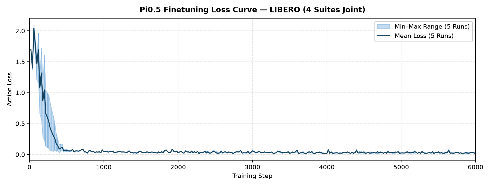
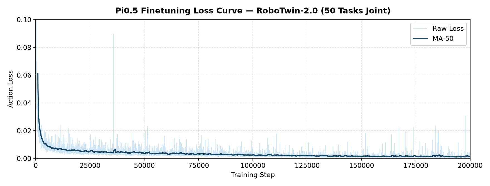
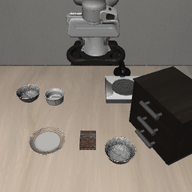
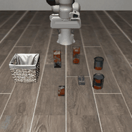
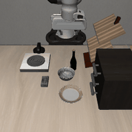
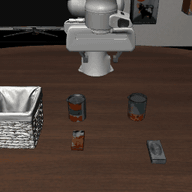
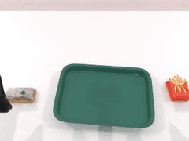

# Quick Start: Pi0.5 Training

Using LIBERO (four suites trained jointly) and RoboTwin-2.0 (50 `demo_clean` tasks) as examples, this guide shows how to finetune **Pi0.5 (π₀.₅)** with LoongForge and evaluate the resulting checkpoints.

- [1. Training Setup](#1-training-setup)
- [2. Finetuning](#2-finetuning)
- [3. Evaluation Setup](#3-evaluation-setup)
- [4. Evaluation](#4-evaluation)

---

## 1. Training Setup

### 1.1 Environment

Following the LoongForge installation guide, pull the latest GPU image and start a container:

```bash
docker pull loongforge/loongforge:latest
mkdir -p workspace
docker run --gpus all --ipc=host -it --rm \
  -v "$(pwd)/workspace:/workspace/data" \
  -w /workspace/LoongForge \
  loongforge/loongforge:latest bash
```

The image ships LeRobot and can train Pi0.5 out of the box; no extra dependencies are required.

### 1.2 Pretrained Weights and Tokenizer

Download the following from Hugging Face:

| Artifact | Purpose |
|---|---|
| [lerobot/pi05_libero](https://huggingface.co/lerobot/pi05_libero) | Pi0.5 weights already adapted to LIBERO; the starting point of the LIBERO recipe |
| [lerobot/pi05_base](https://huggingface.co/lerobot/pi05_base) | Pi0.5 base weights; the starting point of the RoboTwin-2.0 recipe |
| [google/paligemma-3b-pt-224](https://huggingface.co/google/paligemma-3b-pt-224) | PaliGemma tokenizer / processor |

```bash
hf download lerobot/pi05_libero --local-dir /workspace/data/pi05_libero
hf download lerobot/pi05_base   --local-dir /workspace/data/pi05_base
hf download google/paligemma-3b-pt-224 --local-dir /workspace/data/paligemma-3b-pt-224
```

The main weights are passed through `CHECKPOINT_PATH` and loaded by `--pretrained-checkpoint`; the original Hugging Face safetensors layout is read directly, with no conversion step. The tokenizer is passed through `TOKENIZER_PATH` and loaded by `--tokenizer-path`.

### 1.3 Training Data

Both recipes read LeRobot-format datasets (`--dataset-format lerobot_datasets`). The sample transform and batch collator run online during training, so no offline preprocessing is needed beyond the statistics view described below for RoboTwin.

**LIBERO** — [lerobot/libero](https://huggingface.co/datasets/lerobot/libero) already combines the four suites (`libero_spatial`, `libero_object`, `libero_goal`, `libero_10`). After downloading, make sure `meta/stats.json` exists in the dataset root:

```bash
hf download lerobot/libero --repo-type dataset \
  --local-dir /workspace/data/libero
```

**RoboTwin-2.0** — [lerobot/robotwin_unified](https://huggingface.co/datasets/lerobot/robotwin_unified) holds the 50 `demo_clean` tasks:

```bash
hf download lerobot/robotwin_unified --repo-type dataset \
  --local-dir /workspace/data/robotwin_unified
```

The RoboTwin recipe sets `data.use_aloha_pi_delta_actions=true`, which converts the dataset's environment-space 14-D joint actions into pi-space relative actions (arm joints relative to the chunk-anchor proprioception, grippers absolute in angular space) and rewrites `observation.state` into pi-space proprioception before normalization. The dataset's `meta/stats.json` must therefore hold pi-space statistics for both `action` and `observation.state`. `build_pidelta_stats.py` creates a lightweight symlink view whose `meta/stats.json` is replaced with the pi-space statistics shipped in the repository:

```bash
python examples/embodied/pi05/build_pidelta_stats.py \
    --src /workspace/data/robotwin_unified \
    --dst /workspace/data/robotwin_unified_pidelta
```

---

## 2. Finetuning

### 2.1 Launch Training

Two benchmark recipes ship with tuned defaults. Set the weight, tokenizer, dataset and output paths via environment variables, then launch:

```bash
# LIBERO — four suites trained jointly, 8 GPUs (DDP), 6,000 steps
CHECKPOINT_PATH=/workspace/data/pi05_libero \
TOKENIZER_PATH=/workspace/data/paligemma-3b-pt-224 \
DATA_PATH=/workspace/data/libero \
OUTPUT_DIR=/workspace/outputs/pi05_libero \
bash examples/embodied/pi05/LIBERO/run_pi05_libero_ddp_finetune.sh

# RoboTwin-2.0 — 50 demo_clean tasks trained jointly, 8 GPUs (DDP), 200,000 steps
CHECKPOINT_PATH=/workspace/data/pi05_base \
TOKENIZER_PATH=/workspace/data/paligemma-3b-pt-224 \
DATA_PATH=/workspace/data/robotwin_unified_pidelta \
OUTPUT_DIR=/workspace/outputs/pi05_robotwin \
bash examples/embodied/pi05/RoboTwin/run_pi05_robotwin_ddp_finetune.sh

# Resume from the latest checkpoint in $OUTPUT_DIR
bash examples/embodied/pi05/RoboTwin/run_pi05_robotwin_ddp_finetune.sh --resume

# Smoke test: 50 iterations to validate the training pipeline
TRAIN_ITERS=50 SAVE_INTERVAL=50 \
  bash examples/embodied/pi05/LIBERO/run_pi05_libero_ddp_finetune.sh
```

Checkpoints are saved to `$OUTPUT_DIR/checkpoints/steps_<N>` and TensorBoard logs to `$OUTPUT_DIR/tensorboard`. Each aliased weight is stored once, so a training checkpoint can be evaluated directly; no conversion is needed.

### 2.2 Key Parameters

**Script parameters** (all can be overridden via environment variables):

| Parameter | LIBERO | RoboTwin | Description |
|---|:---:|:---:|---|
| `LOONGFORGE_PATH` | repo root | repo root | LoongForge repository root |
| `CHECKPOINT_PATH` | `pi05_libero` | `pi05_base` | Pretrained weight directory |
| `TOKENIZER_PATH` | - | - | PaliGemma tokenizer directory |
| `DATA_PATH` | - | - | LeRobot dataset root |
| `OUTPUT_DIR` | `outputs/pi05_libero` | `outputs/pi05_robotwin` | Output root for checkpoints and logs |
| `GPUS_PER_NODE` / `NNODES` | 8 / 1 | 8 / 1 | GPUs per node / number of nodes |
| `TRAIN_ITERS` | 6000 | 200000 | Total training iterations |
| `PER_DEVICE_BATCH_SIZE` | 16 | 8 | Per-device batch size |
| `GRADIENT_ACCUMULATION_STEPS` | 2 | 2 | Gradient accumulation steps; global batch size is 256 (LIBERO) and 128 (RoboTwin) |
| `LR_BASE` / `MIN_LR` | 2.5e-5 / 5e-6 | 5e-5 / 5e-6 | Peak / floor learning rate, cosine decay (`cosine_with_min_lr`) |
| `LR_WARMUP_ITERS` | 1000 | 2000 | Learning-rate warmup iterations |
| `SAVE_INTERVAL` | 2000 | 10000 | Checkpoint save interval (iterations) |
| `NUM_WORKERS` | 4 | 16 | DataLoader workers per device |
| `SEED` | 1000 | 1000 | Random seed |

**Model and data configuration**: defaults live in `configs/models/embodied/pi05.yaml`; each recipe overrides what it needs. Commonly used fields:

| Field | Default | LIBERO | RoboTwin | Description |
|---|:---:|:---:|:---:|---|
| `model.action_dim` | 7 | 7 | 14 | Action dimensionality |
| `model.state_dim` | 7 | 8 | 14 | Proprioception dimensionality |
| `model.action_horizon` | 50 | 10 | 30 | Action chunk length of each sample |
| `model.max_action_dim` / `model.max_state_dim` | 32 / 32 | 32 / 32 | 32 / 32 | Width the action / state vectors are padded to |
| `data.image_size` | 224 | 224 | 224 | Input resolution |
| `data.image_normalize_mode` | `identity` | `siglip` | `identity` | Image normalization |
| `data.num_images` | 2 | 2 | 3 | Camera views per sample |
| `data.normalization_mode` | `q99` | `mean_std` | `q99` | Action / state normalization read from `meta/stats.json` |
| `data.max_token_len` | 200 | 200 | 200 | Maximum language token length |
| `data.use_aloha_pi_delta_actions` | false | false | true | Convert environment-space Aloha joint actions into pi-space relative actions |

Rather than editing the config file, pass `model:` / `data:` fields to the launch script in dotlist form:

```bash
bash examples/embodied/pi05/LIBERO/run_pi05_libero_ddp_finetune.sh \
    data.max_token_len=160 model.gradient_checkpointing=true
```

> **Note**: the script appends its own dotlist overrides last, so they win over anything passed on the command line. Fields a recipe already pins — `ACTION_HORIZON`, `ACTION_DIM`, `STATE_DIM`, `NUM_IMAGES`, `IMAGE_NORMALIZE_MODE`, `NORMALIZATION_MODE`, `USE_ALOHA_PI_DELTA` — must be changed through those environment variables instead.

### 2.3 Training Acceleration

**Distributed strategies**: besides the two benchmark recipes, three scripts under `examples/embodied/pi05/` run the same model under different parallelism strategies. They default to `TRAIN_ITERS=20` and `SAVE_INTERVAL=0`, so they are short runs for validating and comparing the strategies rather than full reproduction recipes:

| Script | Strategy | Notes |
|---|---|---|
| `run_pi05_ddp_finetune.sh` | DDP | Parameters replicated on every rank; the default for both benchmark recipes |
| `run_pi05_ddp_zero1_finetune.sh` | DDP + ZeRO-1 (`--zero-optimizer`) | Shards optimizer state across ranks to cut memory without changing the gradient reduction |
| `run_pi05_fsdp_finetune.sh` | FSDP2 (`--distributed-strategy fsdp`) | `--fsdp-no-wrap-modules` keeps the PaliGemma / PiGemma container modules unsharded so only leaf blocks are wrapped; the script also forces `model.compile_model=False` |

**torch.compile**: Pi0.5 compiles its backbone by default. The granularity is selectable because a single whole-backbone graph is slow to compile and recompiles easily:

| Field | Default | Description |
|---|:---:|---|
| `model.compile_model` | true | Whether to apply `torch.compile` |
| `model.compile_mode` | `max-autotune-no-cudagraphs` | Inductor compilation mode |
| `model.compile_scope` | `multi_group` | `backbone` compiles `PaliGemmaWithExpertModel.forward` as one graph; `multi_group` compiles per-layer plus the final norms and the action-head bundle; `per_layer` compiles only `_compute_layer_complete` and leaves everything else eager |

**Other acceleration arguments** used by the benchmark recipes:

| Argument | Value | Description |
|---|:---:|---|
| `--dtype` | `bfloat16` | Compute dtype |
| `--optimizer` | `TorchFusedAdamW` (LIBERO) / `AdamW` (RoboTwin) | The fused variant folds the AdamW element-wise update into fewer kernels |
| `--activation-checkpoint-module-patterns` | SigLIP encoder layers | Recomputes the vision tower's activations in the backward pass to save memory |
| `--ddp-static-graph` | on | Declares the graph static across iterations, enabling DDP static-graph optimizations |
| `--ddp-gradient-as-bucket-view` | on | Exposes gradients as views into the DDP communication buckets, avoiding one copy per gradient |
| `--ddp-find-unused-parameters` | on | Detects parameters that receive no gradient in a step |
| `--no-dynamo-optimize-ddp` | on | Stops Dynamo from splitting the compiled graph at DDP bucket boundaries |

### 2.4 Training Loss Curves

| LIBERO | RoboTwin-2.0 |
|:---:|:---:|
|  |  |

### 2.5 Correctness Verification

To ensure training accuracy is not affected by the optimizations, we compared the step-by-step action loss of LoongForge's Pi0.5 implementation against the official one, using identical data, weights and training configuration. The results show that LoongForge's performance optimizations preserve training accuracy:


---

## 3. Evaluation Setup

LoongForge ships a standalone benchmark evaluation module covering LIBERO / CALVIN / SimplerEnv / RoboTwin / ManiSkill. Evaluation uses a server / client architecture, so each side keeps its own Python environment and simulator dependencies:

- **Policy server** — runs in the LoongForge training environment (`server.python`) and serves `PI05Policy`.
- **Benchmark client** — runs in the simulator's environment (`env.libero_python` / `env.robotwin_python`, overridable via `BENCHMARK_PYTHON`) and talks to the server over a socket.

Set up the LIBERO simulator environment:

```bash
conda create -n libero python=3.8.13 -y
conda activate libero

git clone https://github.com/Lifelong-Robot-Learning/LIBERO.git
cd LIBERO
pip install -r requirements.txt
pip install torch==1.11.0+cu113 torchvision==0.12.0+cu113 torchaudio==0.11.0 \
    --extra-index-url https://download.pytorch.org/whl/cu113
pip install -e .

# Client-side dependencies of the LoongForge eval harness
pip install tyro pyyaml msgpack numpy pillow
```

For RoboTwin-2.0, follow the [RoboTwin-2.0 installation documentation](https://robotwin-platform.github.io/doc/usage/robotwin-install.html) to install the simulator (SAPIEN and CuRobo) and its assets under `ROBOTWIN_ROOT`, then install the client dependencies:

```bash
pip install msgpack pyyaml tyro
```

---

## 4. Evaluation

The finetuned checkpoints of both recipes are released on Hugging Face: [LoongForge/Loongforge-pi05-LIBERO](https://huggingface.co/LoongForge/Loongforge-pi05-LIBERO) and [LoongForge/Loongforge-pi05-RoboTwin](https://huggingface.co/LoongForge/Loongforge-pi05-RoboTwin).

```bash
hf download LoongForge/Loongforge-pi05-LIBERO   --local-dir /workspace/data/pi05_libero_ft
hf download LoongForge/Loongforge-pi05-RoboTwin --local-dir /workspace/data/pi05_robotwin_ft
```

### 4.1 Launch

Evaluation is driven by a YAML config: fill in the `/path/to/...` placeholders, then run the matching launch script. Paths below are relative to `examples/embodied/pi05/`:

| Benchmark | Config | Launch script |
|---|---|---|
| LIBERO | `eval/configs/libero/libero_pi05.yaml` | `eval/run_libero_eval.sh` |
| RoboTwin-2.0 | `eval/configs/robotwin/robotwin_pi05.yaml` | `eval/run_robotwin_eval.sh` |
| CALVIN | `eval/configs/calvin/smoke.yaml` | `eval/run_calvin_eval.sh` |
| SimplerEnv | `eval/configs/simplerenv/widowx_stack_cube_smoke.yaml` | `eval/run_simplerenv_eval.sh` |
| ManiSkill | `eval/configs/maniskill/pick_cube_smoke.yaml` | `eval/run_maniskill_eval.sh` |

```bash
# LIBERO
REPO_ROOT=/workspace/LoongForge \
BENCHMARK_PYTHON=/path/to/conda/envs/libero/bin/python \
CONFIG=examples/embodied/pi05/eval/configs/libero/libero_pi05.yaml \
bash examples/embodied/pi05/eval/run_libero_eval.sh

# RoboTwin-2.0
REPO_ROOT=/workspace/LoongForge \
BENCHMARK_PYTHON=/path/to/conda/envs/robotwin/bin/python \
CONFIG=examples/embodied/pi05/eval/configs/robotwin/robotwin_pi05.yaml \
bash examples/embodied/pi05/eval/run_robotwin_eval.sh
```

The launch script starts and stops the policy server itself; no manual deployment is needed. The smoke configs (`libero/object_smoke.yaml`, `robotwin/adjust_bottle_smoke.yaml`) run a single task with a handful of episodes and are the fastest way to confirm the server / client wiring.

Results are written to `run.output_dir`: `results.jsonl` plus `eval_info.json` for LIBERO, `results.jsonl` plus `summary.csv` for RoboTwin.

### 4.2 Key Parameters

**Launch-script environment variables**:

| Variable | Default | Description |
|---|:---:|---|
| `REPO_ROOT` | - | LoongForge repository root |
| `CONFIG` | `configs/libero/object_smoke.yaml` | Evaluation YAML; a relative path is resolved against `REPO_ROOT` |
| `BENCHMARK_PYTHON` | - | Python interpreter of the simulator environment |
| `CUDA_VISIBLE_DEVICES` | 0 | GPU used by the policy server |

**YAML fields that must be filled in**:

| Field | Description |
|---|---|
| `benchmark.suite` | LIBERO only: `libero_spatial` / `libero_object` / `libero_goal` / `libero_10` |
| `benchmark.task_name` / `benchmark.task_config` | RoboTwin only: one of the 50 tasks (e.g. `adjust_bottle`), and `demo_clean` |
| `benchmark.episodes_per_task` | Episodes per task; 10 for a quick check, 100 for the full RoboTwin protocol |
| `benchmark.max_steps` | LIBERO step budget; `0` uses the suite default (280 / 300 / 520) |
| `server.python` | Python interpreter of the LoongForge environment |
| `server.ckpt_path` | Finetuned checkpoint directory, e.g. `$OUTPUT_DIR/checkpoints/steps_6000` |
| `server.dataset_statistics_path` | Statistics used for training: the dataset's `meta/stats.json` for LIBERO, `eval/assets/pi05_robotwin2_dataset_stats.json` for RoboTwin |
| `server.loongforge_root` | LoongForge repository root |
| `server.tokenizer_path` | PaliGemma tokenizer directory |
| `server.chunk_execute_steps` | Actions executed in the environment per inference call |
| `env.libero_config_path` | LIBERO only: path to `~/.libero/config.yaml` |
| `env.robotwin_root` / `env.robotwin_python` | RoboTwin only: simulator repository root and its Python interpreter |
| `env.mujoco_gl` | MuJoCo rendering backend; `egl` by default, switch to `osmesa` if the environment requires it |
| `run.output_dir` | Where results are written |

The YAML's `model:` section must match the training recipe (`action_dim`, `state_dim`, `action_horizon`, `eval_image_normalize_mode`, `eval_normalization_mode`, `state_encoding`). The shipped templates already match their respective recipes, so they only need the paths filled in.

### 4.3 Results

**LIBERO** — evaluated at step 6,000 on all four suites, 10 tasks × 10 episodes per suite:

| Suite | Successful episodes | LoongForge (single run) | LoongForge (5-run mean) | Baseline |
|---|:---:|:---:|:---:|:---:|
| libero_spatial | 100 / 100 | 100.0% | 99.6% | 97.0% |
| libero_object | 100 / 100 | 100.0% | 99.6% | 99.0% |
| libero_goal | 98 / 100 | 98.0% | 98.8% | 98.0% |
| libero_10 (Long) | 97 / 100 | 97.0% | 97.0% | 96.0% |
| **Average** | **395 / 400** | **98.75%** | **98.75%** | **97.50%** |

**RoboTwin-2.0** — `demo_clean`, 50 tasks × 100 episodes, `start_seed=100000`:

| Setting | Tasks | Successful episodes | LoongForge | Baseline |
|---|:---:|:---:|:---:|:---:|
| `demo_clean` | 50 | 3,878 / 5,000 | 77.56% | 67.91% |

> **Note**: per-task breakdowns are in [`examples/embodied/pi05/LIBERO/README.md`](https://github.com/baidu-baige/LoongForge/blob/master/examples/embodied/pi05/LIBERO/README.md) and [`examples/embodied/pi05/RoboTwin/README.md`](https://github.com/baidu-baige/LoongForge/blob/master/examples/embodied/pi05/RoboTwin/README.md).

### 4.4 Rollout Examples

LIBERO:

| libero_spatial | libero_object |
|:---:|:---:|
|  |  |
| *pick up the black bowl next to the ramekin and place it on the plate* | *pick up the cream cheese and place it in the basket* |
| **libero_goal** | **libero_10** |
|  |  |
| *put the bowl on the stove* | *put both the cream cheese box and the butter in the basket* |

RoboTwin-2.0:

| adjust_bottle | grab_roller |
|:---:|:---:|
|  |  |
| *adjust bottle* | *grab roller* |
| **place_burger_fries** | **stack_blocks_two** |
|  |  |
| *place burger fries* | *stack blocks two* |
