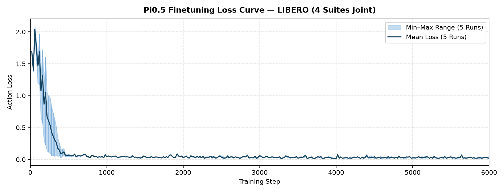
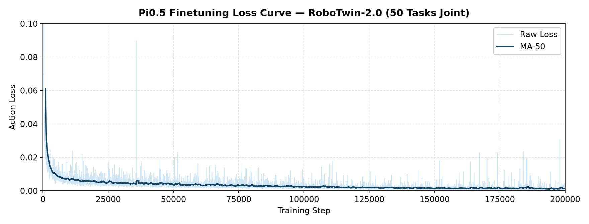
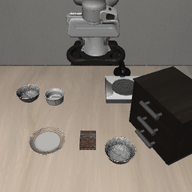
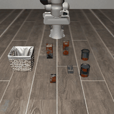
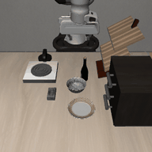
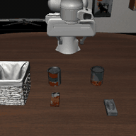
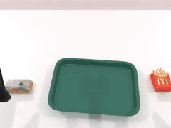

# 快速入门：Pi0.5 模型训练

本文档以 LIBERO（四个 suite 联合训练）和 RoboTwin-2.0（50 个 `demo_clean` 任务）为例，介绍如何在 LoongForge 框架下微调 **Pi0.5（π₀.₅）**，并对得到的 checkpoint 进行评测。

- [1. 训练准备](#1-训练准备)
- [2. 微调训练](#2-微调训练)
- [3. 评测准备](#3-评测准备)
- [4. 评测](#4-评测)

---

## 1. 训练准备

### 1.1 环境

参照 LoongForge 安装指南，拉取最新 GPU 镜像并启动容器：

```bash
docker pull loongforge/loongforge:latest
mkdir -p workspace
docker run --gpus all --ipc=host -it --rm \
  -v "$(pwd)/workspace:/workspace/data" \
  -w /workspace/LoongForge \
  loongforge/loongforge:latest bash
```

镜像已内置 LeRobot，开箱即可训练 Pi0.5，无需额外安装依赖。

### 1.2 预训练权重与 Tokenizer

从 Hugging Face 下载以下内容：

| 资源 | 用途 |
|---|---|
| [lerobot/pi05_libero](https://huggingface.co/lerobot/pi05_libero) | 已适配 LIBERO 的 Pi0.5 权重，LIBERO 配方的训练起点 |
| [lerobot/pi05_base](https://huggingface.co/lerobot/pi05_base) | Pi0.5 基座权重，RoboTwin-2.0 配方的训练起点 |
| [google/paligemma-3b-pt-224](https://huggingface.co/google/paligemma-3b-pt-224) | PaliGemma tokenizer / processor |

```bash
hf download lerobot/pi05_libero --local-dir /workspace/data/pi05_libero
hf download lerobot/pi05_base   --local-dir /workspace/data/pi05_base
hf download google/paligemma-3b-pt-224 --local-dir /workspace/data/paligemma-3b-pt-224
```

主权重由 `CHECKPOINT_PATH` 指定、通过 `--pretrained-checkpoint` 加载，可直接读取 Hugging Face 原始 safetensors 权重形态，无需转换。tokenizer 由 `TOKENIZER_PATH` 指定、通过 `--tokenizer-path` 加载。

### 1.3 训练数据

两个配方都读取 LeRobot 格式的数据集（`--dataset-format lerobot_datasets`）。sample transform 和 batch collator 在训练时在线执行，因此除下文 RoboTwin 的统计量视图外，不需要额外的离线预处理。

**LIBERO** —— [lerobot/libero](https://huggingface.co/datasets/lerobot/libero) 已经合并了四个 suite（`libero_spatial`、`libero_object`、`libero_goal`、`libero_10`）。下载后确认数据集根目录下存在 `meta/stats.json`：

```bash
hf download lerobot/libero --repo-type dataset \
  --local-dir /workspace/data/libero
```

**RoboTwin-2.0** —— [lerobot/robotwin_unified](https://huggingface.co/datasets/lerobot/robotwin_unified) 包含 50 个 `demo_clean` 任务：

```bash
hf download lerobot/robotwin_unified --repo-type dataset \
  --local-dir /workspace/data/robotwin_unified
```

RoboTwin 配方开启了 `data.use_aloha_pi_delta_actions=true`，会把数据集中环境空间的 14 维关节动作转换为 pi 空间相对动作（手臂关节相对于 chunk 锚点的本体感知，夹爪在角度空间取绝对值），并在归一化前把 `observation.state` 改写为 pi 空间的本体感知。因此数据集的 `meta/stats.json` 必须同时提供 `action` 和 `observation.state` 的 pi 空间统计量。`build_pidelta_stats.py` 会创建一个轻量的 symlink 视图，并将其 `meta/stats.json` 替换为仓库内置的 pi 空间统计量：

```bash
python examples/embodied/pi05/build_pidelta_stats.py \
    --src /workspace/data/robotwin_unified \
    --dst /workspace/data/robotwin_unified_pidelta
```

---

## 2. 微调训练

### 2.1 启动训练

仓库提供两个已调好默认参数的 benchmark 配方。通过环境变量设置权重、tokenizer、数据集和输出路径后即可启动：

```bash
# LIBERO —— 四个 suite 联合训练，8 卡 DDP，6000 步
CHECKPOINT_PATH=/workspace/data/pi05_libero \
TOKENIZER_PATH=/workspace/data/paligemma-3b-pt-224 \
DATA_PATH=/workspace/data/libero \
OUTPUT_DIR=/workspace/outputs/pi05_libero \
bash examples/embodied/pi05/LIBERO/run_pi05_libero_ddp_finetune.sh

# RoboTwin-2.0 —— 50 个 demo_clean 任务联合训练，8 卡 DDP，20 万步
CHECKPOINT_PATH=/workspace/data/pi05_base \
TOKENIZER_PATH=/workspace/data/paligemma-3b-pt-224 \
DATA_PATH=/workspace/data/robotwin_unified_pidelta \
OUTPUT_DIR=/workspace/outputs/pi05_robotwin \
bash examples/embodied/pi05/RoboTwin/run_pi05_robotwin_ddp_finetune.sh

# 从 $OUTPUT_DIR 中最新的 checkpoint 续训
bash examples/embodied/pi05/RoboTwin/run_pi05_robotwin_ddp_finetune.sh --resume

# 冒烟测试：只跑 50 步验证训练链路
TRAIN_ITERS=50 SAVE_INTERVAL=50 \
  bash examples/embodied/pi05/LIBERO/run_pi05_libero_ddp_finetune.sh
```

checkpoint 保存在 `$OUTPUT_DIR/checkpoints/steps_<N>`，TensorBoard 日志保存在 `$OUTPUT_DIR/tensorboard`。别名权重只存一份，训练 checkpoint 可直接用于评测，无需做权重转换。

### 2.2 关键参数

**脚本参数**（均可通过环境变量覆盖）：

| 参数 | LIBERO | RoboTwin | 说明 |
|---|:---:|:---:|---|
| `LOONGFORGE_PATH` | 仓库根目录 | 仓库根目录 | LoongForge 仓库根目录 |
| `CHECKPOINT_PATH` | `pi05_libero` | `pi05_base` | 预训练权重目录 |
| `TOKENIZER_PATH` | - | - | PaliGemma tokenizer 目录 |
| `DATA_PATH` | - | - | LeRobot 数据集根目录 |
| `OUTPUT_DIR` | `outputs/pi05_libero` | `outputs/pi05_robotwin` | checkpoint 与日志的输出根目录 |
| `GPUS_PER_NODE` / `NNODES` | 8 / 1 | 8 / 1 | 单机卡数 / 节点数 |
| `TRAIN_ITERS` | 6000 | 200000 | 总训练步数 |
| `PER_DEVICE_BATCH_SIZE` | 16 | 8 | 单卡 batch size |
| `GRADIENT_ACCUMULATION_STEPS` | 2 | 2 | 梯度累积步数；对应全局 batch size 为 256（LIBERO）和 128（RoboTwin） |
| `LR_BASE` / `MIN_LR` | 2.5e-5 / 5e-6 | 5e-5 / 5e-6 | 峰值 / 最低学习率，cosine 衰减（`cosine_with_min_lr`） |
| `LR_WARMUP_ITERS` | 1000 | 2000 | 学习率 warmup 步数 |
| `SAVE_INTERVAL` | 2000 | 10000 | checkpoint 保存间隔（步） |
| `NUM_WORKERS` | 4 | 16 | 单卡 DataLoader worker 数 |
| `SEED` | 1000 | 1000 | 随机种子 |

**模型与数据配置**：默认值定义在 `configs/models/embodied/pi05.yaml`，各配方按需覆盖。常用字段如下：

| 字段 | 默认值 | LIBERO | RoboTwin | 说明 |
|---|:---:|:---:|:---:|---|
| `model.action_dim` | 7 | 7 | 14 | 动作维度 |
| `model.state_dim` | 7 | 8 | 14 | 本体感知维度 |
| `model.action_horizon` | 50 | 10 | 30 | 单个样本的 action chunk 长度 |
| `model.max_action_dim` / `model.max_state_dim` | 32 / 32 | 32 / 32 | 32 / 32 | action / state 向量 padding 到的宽度 |
| `data.image_size` | 224 | 224 | 224 | 输入分辨率 |
| `data.image_normalize_mode` | `identity` | `siglip` | `identity` | 图像归一化方式 |
| `data.num_images` | 2 | 2 | 3 | 单个样本的相机视角数 |
| `data.normalization_mode` | `q99` | `mean_std` | `q99` | 读取 `meta/stats.json` 做 action / state 归一化的方式 |
| `data.max_token_len` | 200 | 200 | 200 | 语言 token 的最大长度 |
| `data.use_aloha_pi_delta_actions` | false | false | true | 是否把环境空间的 Aloha 关节动作转换为 pi 空间相对动作 |

无需修改配置文件，这些字段可以用 dotlist 形式直接传给启动脚本：

```bash
bash examples/embodied/pi05/LIBERO/run_pi05_libero_ddp_finetune.sh \
    data.max_token_len=160 model.gradient_checkpointing=true
```

> **注意**：脚本自身的 dotlist 覆盖项排在命令行参数之后，会覆盖命令行上同名的字段。配方已经固定的字段 —— `ACTION_HORIZON`、`ACTION_DIM`、`STATE_DIM`、`NUM_IMAGES`、`IMAGE_NORMALIZE_MODE`、`NORMALIZATION_MODE`、`USE_ALOHA_PI_DELTA` —— 需改用对应的环境变量。

### 2.3 训练加速

**分布式策略**：除两个 benchmark 配方外，`examples/embodied/pi05/` 下还有三个脚本用不同并行策略跑同一个模型。它们默认 `TRAIN_ITERS=20`、`SAVE_INTERVAL=0`，用于验证和对比各策略，而不是完整的复现配方：

| 脚本 | 策略 | 说明 |
|---|---|---|
| `run_pi05_ddp_finetune.sh` | DDP | 参数在每张卡上复制一份；两个 benchmark 配方也采用该策略 |
| `run_pi05_ddp_zero1_finetune.sh` | DDP + ZeRO-1（`--zero-optimizer`） | 将 optimizer state 切分到各 rank 以降低显存，不改变梯度规约方式 |
| `run_pi05_fsdp_finetune.sh` | FSDP2（`--distributed-strategy fsdp`） | `--fsdp-no-wrap-modules` 让 PaliGemma / PiGemma 这些容器模块不被切分，只包裹叶子层；脚本同时强制 `model.compile_model=False` |

**torch.compile**：Pi0.5 默认对 backbone 做编译。由于整个 backbone 编译成单图既慢又容易触发重编译，编译粒度是可选的：

| 字段 | 默认值 | 说明 |
|---|:---:|---|
| `model.compile_model` | true | 是否启用 `torch.compile` |
| `model.compile_mode` | `max-autotune-no-cudagraphs` | Inductor 编译模式 |
| `model.compile_scope` | `multi_group` | `backbone` 把 `PaliGemmaWithExpertModel.forward` 编译为单图；`multi_group` 按层编译，外加 final norms 和 action head 两组；`per_layer` 只编译 `_compute_layer_complete`，其余保持 eager |

**其他加速参数**（benchmark 配方中使用）：

| 参数 | 取值 | 说明 |
|---|:---:|---|
| `--dtype` | `bfloat16` | 计算精度 |
| `--optimizer` | `TorchFusedAdamW`（LIBERO）/ `AdamW`（RoboTwin） | 融合版本把 AdamW 的逐元素更新合并到更少的 kernel 中 |
| `--activation-checkpoint-module-patterns` | SigLIP encoder 各层 | 在反向时重算视觉塔的激活值以节省显存 |
| `--ddp-static-graph` | 开启 | 声明各步计算图不变，从而启用 DDP 静态图优化 |
| `--ddp-gradient-as-bucket-view` | 开启 | 让梯度直接成为 DDP 通信 bucket 的视图，省掉每个梯度的一次拷贝 |
| `--ddp-find-unused-parameters` | 开启 | 检测某步中没有收到梯度的参数 |
| `--no-dynamo-optimize-ddp` | 开启 | 避免 Dynamo 在 DDP bucket 边界处切分编译图 |

### 2.4 训练 Loss 曲线

| LIBERO | RoboTwin-2.0 |
|:---:|:---:|
|  |  |

### 2.5 正确性验证

为保证训练精度不受优化手段影响，我们在相同数据、权重和训练配置下，对 LoongForge 适配的 Pi0.5 与官方实现进行了逐 step 的 action loss 对比验证。结果表明，LoongForge 的各项性能优化对训练精度无损：


---

## 3. 评测准备

LoongForge 提供独立的 benchmark 评测模块，覆盖 LIBERO / CALVIN / SimplerEnv / RoboTwin / ManiSkill。评测采用 server / client 架构，两侧各自保留独立的 Python 环境和仿真器依赖：

- **Policy server** —— 运行在 LoongForge 训练环境中（`server.python`），对外提供 `PI05Policy`。
- **Benchmark client** —— 运行在仿真器自己的环境中（`env.libero_python` / `env.robotwin_python`，可用 `BENCHMARK_PYTHON` 覆盖），通过 socket 与 server 通信。

搭建 LIBERO 仿真环境：

```bash
conda create -n libero python=3.8.13 -y
conda activate libero

git clone https://github.com/Lifelong-Robot-Learning/LIBERO.git
cd LIBERO
pip install -r requirements.txt
pip install torch==1.11.0+cu113 torchvision==0.12.0+cu113 torchaudio==0.11.0 \
    --extra-index-url https://download.pytorch.org/whl/cu113
pip install -e .

# LoongForge 评测 client 所需的依赖
pip install tyro pyyaml msgpack numpy pillow
```

RoboTwin-2.0 请参照 [RoboTwin-2.0 安装文档](https://robotwin-platform.github.io/doc/usage/robotwin-install.html) 安装仿真器（需要 SAPIEN 和 CuRobo）及其资产到 `ROBOTWIN_ROOT`，再安装 client 通信依赖：

```bash
pip install msgpack pyyaml tyro
```

---

## 4. 评测

两个配方微调后的 checkpoint 已发布在 Hugging Face 上：[LoongForge/Loongforge-pi05-LIBERO](https://huggingface.co/LoongForge/Loongforge-pi05-LIBERO) 和 [LoongForge/Loongforge-pi05-RoboTwin](https://huggingface.co/LoongForge/Loongforge-pi05-RoboTwin)。

```bash
hf download LoongForge/Loongforge-pi05-LIBERO   --local-dir /workspace/data/pi05_libero_ft
hf download LoongForge/Loongforge-pi05-RoboTwin --local-dir /workspace/data/pi05_robotwin_ft
```

### 4.1 启动评测

评测由 YAML 配置驱动：先填好其中的 `/path/to/...` 占位符，再运行对应的启动脚本。下表路径相对于 `examples/embodied/pi05/`：

| Benchmark | 配置 | 启动脚本 |
|---|---|---|
| LIBERO | `eval/configs/libero/libero_pi05.yaml` | `eval/run_libero_eval.sh` |
| RoboTwin-2.0 | `eval/configs/robotwin/robotwin_pi05.yaml` | `eval/run_robotwin_eval.sh` |
| CALVIN | `eval/configs/calvin/smoke.yaml` | `eval/run_calvin_eval.sh` |
| SimplerEnv | `eval/configs/simplerenv/widowx_stack_cube_smoke.yaml` | `eval/run_simplerenv_eval.sh` |
| ManiSkill | `eval/configs/maniskill/pick_cube_smoke.yaml` | `eval/run_maniskill_eval.sh` |

```bash
# LIBERO
REPO_ROOT=/workspace/LoongForge \
BENCHMARK_PYTHON=/path/to/conda/envs/libero/bin/python \
CONFIG=examples/embodied/pi05/eval/configs/libero/libero_pi05.yaml \
bash examples/embodied/pi05/eval/run_libero_eval.sh

# RoboTwin-2.0
REPO_ROOT=/workspace/LoongForge \
BENCHMARK_PYTHON=/path/to/conda/envs/robotwin/bin/python \
CONFIG=examples/embodied/pi05/eval/configs/robotwin/robotwin_pi05.yaml \
bash examples/embodied/pi05/eval/run_robotwin_eval.sh
```

启动脚本会自行拉起和关闭 policy server，无需手动部署。smoke 配置（`libero/object_smoke.yaml`、`robotwin/adjust_bottle_smoke.yaml`）只跑单个任务和少量 episode，是验证 server / client 链路最快的方式。

评测结果写入 `run.output_dir`：LIBERO 产出 `results.jsonl` 和 `eval_info.json`，RoboTwin 产出 `results.jsonl` 和 `summary.csv`。

### 4.2 关键参数

**启动脚本环境变量**：

| 变量 | 默认值 | 说明 |
|---|:---:|---|
| `REPO_ROOT` | - | LoongForge 仓库根目录 |
| `CONFIG` | `configs/libero/object_smoke.yaml` | 评测 YAML；相对路径按 `REPO_ROOT` 解析 |
| `BENCHMARK_PYTHON` | - | 仿真器环境的 Python 解释器 |
| `CUDA_VISIBLE_DEVICES` | 0 | policy server 使用的 GPU |

**需要填写的 YAML 字段**：

| 字段 | 说明 |
|---|---|
| `benchmark.suite` | 仅 LIBERO：`libero_spatial` / `libero_object` / `libero_goal` / `libero_10` |
| `benchmark.task_name` / `benchmark.task_config` | 仅 RoboTwin：50 个任务之一（如 `adjust_bottle`），以及 `demo_clean` |
| `benchmark.episodes_per_task` | 每个任务的 episode 数；快速检查用 10，RoboTwin 完整协议用 100 |
| `benchmark.max_steps` | LIBERO 的单 episode 步数上限；`0` 表示使用 suite 默认值（280 / 300 / 520） |
| `server.python` | LoongForge 环境的 Python 解释器 |
| `server.ckpt_path` | 微调得到的 checkpoint 目录，例如 `$OUTPUT_DIR/checkpoints/steps_6000` |
| `server.dataset_statistics_path` | 训练时使用的统计量：LIBERO 用数据集的 `meta/stats.json`，RoboTwin 用 `eval/assets/pi05_robotwin2_dataset_stats.json` |
| `server.loongforge_root` | LoongForge 仓库根目录 |
| `server.tokenizer_path` | PaliGemma tokenizer 目录 |
| `server.chunk_execute_steps` | 每次推理在环境中实际执行的动作步数 |
| `env.libero_config_path` | 仅 LIBERO：`~/.libero/config.yaml` 的路径 |
| `env.robotwin_root` / `env.robotwin_python` | 仅 RoboTwin：仿真器仓库根目录及其 Python 解释器 |
| `env.mujoco_gl` | MuJoCo 渲染后端，默认 `egl`，按环境需要可切换为 `osmesa` |
| `run.output_dir` | 评测结果的输出目录 |

YAML 的 `model:` 段必须与训练配方一致（`action_dim`、`state_dim`、`action_horizon`、`eval_image_normalize_mode`、`eval_normalization_mode`、`state_encoding`）。仓库内置的模板已经与各自的配方对齐，只需补全路径即可。

### 4.3 评测结果

**LIBERO** —— 在第 6000 步的 checkpoint 上评测四个 suite，每个 suite 10 个任务 × 10 个 episode：

| Suite | 成功 episode 数 | LoongForge（单次） | LoongForge（5 次均值） | Baseline |
|---|:---:|:---:|:---:|:---:|
| libero_spatial | 100 / 100 | 100.0% | 99.6% | 97.0% |
| libero_object | 100 / 100 | 100.0% | 99.6% | 99.0% |
| libero_goal | 98 / 100 | 98.0% | 98.8% | 98.0% |
| libero_10 (Long) | 97 / 100 | 97.0% | 97.0% | 96.0% |
| **平均** | **395 / 400** | **98.75%** | **98.75%** | **97.50%** |

**RoboTwin-2.0** —— `demo_clean`，50 个任务 × 100 个 episode，`start_seed=100000`：

| 设置 | 任务数 | 成功 episode 数 | LoongForge | Baseline |
|---|:---:|:---:|:---:|:---:|
| `demo_clean` | 50 | 3,878 / 5,000 | 77.56% | 67.91% |

> **注意**：逐任务的明细见 [`examples/embodied/pi05/LIBERO/README.md`](https://github.com/baidu-baige/LoongForge/blob/master/examples/embodied/pi05/LIBERO/README.md) 和 [`examples/embodied/pi05/RoboTwin/README.md`](https://github.com/baidu-baige/LoongForge/blob/master/examples/embodied/pi05/RoboTwin/README.md)。

### 4.4 Rollout 示例

LIBERO：

| libero_spatial | libero_object |
|:---:|:---:|
|  |  |
| *pick up the black bowl next to the ramekin and place it on the plate* | *pick up the cream cheese and place it in the basket* |
| **libero_goal** | **libero_10** |
|  |  |
| *put the bowl on the stove* | *put both the cream cheese box and the butter in the basket* |

RoboTwin-2.0：

| adjust_bottle | grab_roller |
|:---:|:---:|
|  |  |
| *adjust bottle* | *grab roller* |
| **place_burger_fries** | **stack_blocks_two** |
|  |  |
| *place burger fries* | *stack blocks two* |
