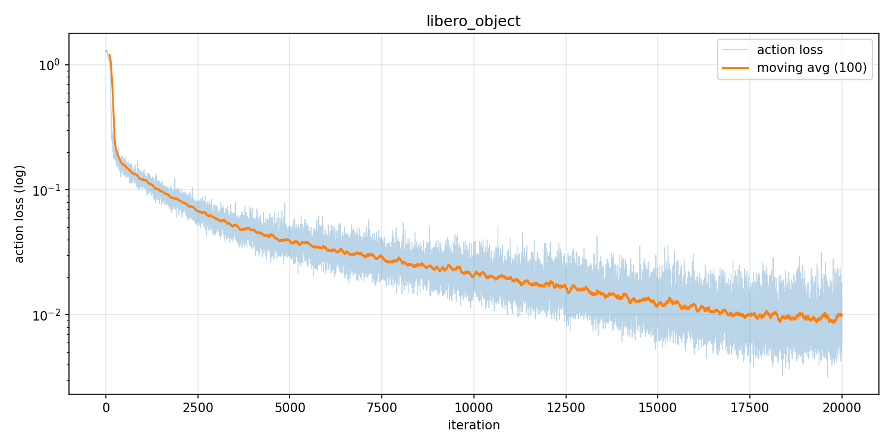
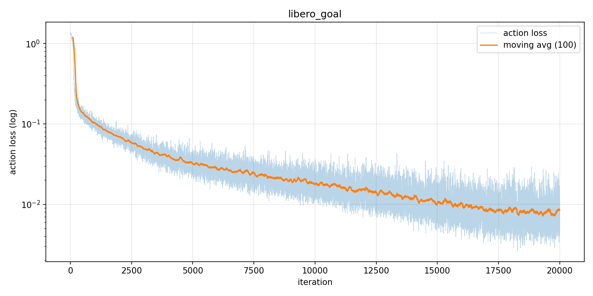
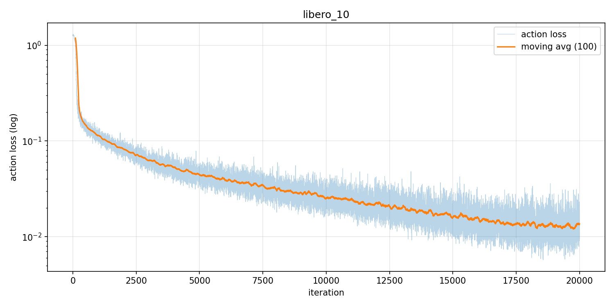
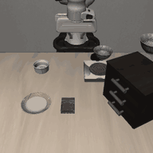
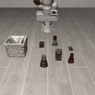
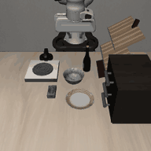
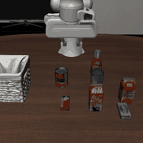

# GR00T-N1.7 Finetuning and Evaluation on LIBERO

This guide walks through finetuning GR00T-N1.7 on the four LIBERO suites with LoongForge and evaluating the resulting checkpoints.

- [1. Training Setup](#1-training-setup)
- [2. Finetuning](#2-finetuning)
- [3. Evaluation Setup](#3-evaluation-setup)
- [4. Evaluation](#4-evaluation)

---

## 1. Training Setup

### 1.1 Environment

Following the LoongForge installation guide, pull the latest GPU image and start a container:

```bash
docker pull loongforge/loongforge:latest
mkdir -p workspace
docker run --gpus all --ipc=host -it --rm \
  -v "$(pwd)/workspace:/workspace/data" \
  -w /workspace/LoongForge \
  loongforge/loongforge:latest bash
```

The image can train GR00T out of the box; no extra dependencies are required.

### 1.2 Pretrained Weights

Download the following weights from Hugging Face:

| Weights | Purpose |
|---|---|
| [GR00T-N1.7-3B](https://huggingface.co/nvidia/GR00T-N1.7-3B) | The pretrained weights actually used for finetuning |
| [Cosmos-Reason2-2B](https://huggingface.co/nvidia/Cosmos-Reason2-2B) | Only provides the VLM backbone architecture and the tokenizer / processor |

> **Note**: the Cosmos-Reason2-2B weights are overwritten by the GR00T-N1.7-3B weights after loading.

### 1.3 Training Data

LIBERO has four suites. The datasets are hosted under the IPEC-COMMUNITY organization on Hugging Face:

| Suite | Focus | Dataset |
|---|---|---|
| Spatial | Spatial reasoning | [libero_spatial_no_noops_1.0.0_lerobot](https://huggingface.co/datasets/IPEC-COMMUNITY/libero_spatial_no_noops_1.0.0_lerobot) |
| Object | Object generalization | [libero_object_no_noops_1.0.0_lerobot](https://huggingface.co/datasets/IPEC-COMMUNITY/libero_object_no_noops_1.0.0_lerobot) |
| Goal | Goal-conditioned learning | [libero_goal_no_noops_1.0.0_lerobot](https://huggingface.co/datasets/IPEC-COMMUNITY/libero_goal_no_noops_1.0.0_lerobot) |
| 10 (Long) | Long-horizon multi-step tasks | [libero_10_no_noops_1.0.0_lerobot](https://huggingface.co/datasets/IPEC-COMMUNITY/libero_10_no_noops_1.0.0_lerobot) |

Each dataset has the following layout:

```text
my_dataset/
├── meta/
│   ├── info.json          # dataset metadata
│   ├── episodes.jsonl     # episode index and lengths
│   ├── tasks.jsonl        # language task descriptions
│   ├── stats.json         # normalization stats (must contain q01/q99; generated below)
│   └── modality.json      # state/action/video key mapping (GR00T-specific)
├── data/chunk-000/        # parquet files (state, action per timestep)
└── videos/chunk-000/      # mp4 video files per episode
```

After downloading, run the following steps from the LoongForge root (replace `{suite}` with the dataset directory of each suite):

```bash
# 1. Overwrite modality.json (all four suites)
cp examples/embodied/gr00t_n1_7/LIBERO/dataset/modality.json \
   /path/to/IPEC-COMMUNITY/{suite}/meta/modality.json

# 2. Generate meta/stats.json (normalization stats with q01/q99) for all four suites;
#    the script overwrites each dataset's meta/stats.json in place
python examples/embodied/gr00t_n1_7/gen_stats.py \
   /path/to/IPEC-COMMUNITY/libero_spatial_no_noops_1.0.0_lerobot \
   /path/to/IPEC-COMMUNITY/libero_object_no_noops_1.0.0_lerobot \
   /path/to/IPEC-COMMUNITY/libero_goal_no_noops_1.0.0_lerobot \
   /path/to/IPEC-COMMUNITY/libero_10_no_noops_1.0.0_lerobot

# 3. Goal suite only: replace one corrupted video
cp examples/embodied/gr00t_n1_7/LIBERO/dataset/Goal/patches/episode_000082.mp4 \
   /path/to/IPEC-COMMUNITY/libero_goal_no_noops_1.0.0_lerobot/videos/chunk-000/observation.images.wrist_image/
```

---

## 2. Finetuning

Training script: `examples/embodied/gr00t_n1_7/LIBERO/run_libero_sft.sh`

Set the LoongForge, pretrained-weight and dataset paths in the script (or pass them as environment variables), then start training.

> **Notes**:
> - `data.embodiment_tag=libero_sim` tells GR00T-N1.7 that the data comes from the Panda arm in the LIBERO simulator. **Do not change it.**
> - If a CUDA Graph replay fails, training automatically falls back to eager mode and continues normally.

```bash
cd examples/embodied/gr00t_n1_7/LIBERO

# Finetune a single suite, e.g. Spatial
bash run_libero_sft.sh spatial

# Finetune all suites (spatial, object, goal, 10)
bash run_libero_sft.sh all
```


### 2.1 Training Time

Training time on 8 × A800:

| Suite | Wall-clock time |
|---|:---:|
| libero_spatial | 4h 33m 35s |
| libero_object | 5h 30m 09s |
| libero_goal | 4h 27m 19s |
| libero_10 | 6h 12m 01s |
| **Total** | **20h 43m 04s** |

### 2.2 Loss Curves

| libero_spatial | libero_object |
|:---:|:---:|
|  |  |
| **libero_goal** | **libero_10** |
|  |  |

---

## 3. Evaluation Setup

Install the base LIBERO environment following the official [LIBERO](https://github.com/Lifelong-Robot-Learning/LIBERO) repository, then install the extra dependencies the eval client needs:

```bash
pip install websockets msgpack pyyaml
```

Alternatively, build the evaluation environment following [Isaac-GR00T](https://github.com/NVIDIA/Isaac-GR00T):

```bash
git clone https://github.com/NVIDIA/Isaac-GR00T.git
cd Isaac-GR00T
bash gr00t/eval/sim/LIBERO/setup_libero.sh
pip install websockets
```

---

## 4. Evaluation

### 4.1 Launch

`examples/embodied/gr00t_n1_7/eval/run_libero_eval.sh` evaluates the four suites serially, 200 episodes per suite (10 tasks × 20 episodes):

```bash
cd examples/embodied/gr00t_n1_7/eval

COSMOS_PATH=/path/to/Cosmos-Reason2-2B \
CKPT_PATH=/path/to/libero_{suite}/checkpoints \
STATS_PATH=/path/to/IPEC-COMMUNITY/libero_{suite}_no_noops_1.0.0_lerobot/meta/stats.json \
LOONGFORGE_PATH=/path/to/LoongForge \
OUT_ROOT=/path/to/outputs \
SERVER_PY=/path/to/policy/bin/python \
BENCHMARK_PYTHON=/path/to/libero/bin/python \
GPU=0 \
bash run_libero_eval.sh
```

Main parameters:

| Parameter | Description |
|---|---|
| `COSMOS_PATH` | Local Cosmos-Reason2-2B directory |
| `CKPT_PATH` | Finetuned checkpoint path; `{suite}` is replaced in turn with `spatial` / `object` / `goal` / `10` |
| `STATS_PATH` | Statistics file (`stats.json`) of the suite; also supports `{suite}` |
| `LOONGFORGE_PATH` | LoongForge repository root |
| `OUT_ROOT` | Root directory for evaluation outputs |
| `SERVER_PY` | Python interpreter of the LoongForge policy server |
| `BENCHMARK_PYTHON` | Python interpreter of the LIBERO simulator (LIBERO must be installed) |
| `GPU` | GPU index to use |

### 4.2 Results

Success rates on the four suites (10 tasks × 20 episodes = 200 episodes per suite):

| Suite | Successful episodes | LoongForge | Official N1.7 |
|---|:---:|:---:|:---:|
| libero_spatial | 196 / 200 | 98.0% | 97.65% |
| libero_object | 197 / 200 | 98.5% | 98.45% |
| libero_goal | 193 / 200 | 96.5% | 97.5% |
| libero_10 (Long) | 191 / 200 | 95.5% | 94.35% |
| **Average** | **777 / 800** | **97.13%** | **96.99%** |

> **Notes**:
> - The "Official N1.7" column is taken from Isaac-GR00T `examples/LIBERO/README.md`.
> - Evaluation is stochastic, so results vary slightly from run to run.

### 4.3 Rollout Examples

| libero_spatial | libero_object |
|:---:|:---:|
|  |  |
| *pick up the black bowl on the wooden cabinet and place it on the plate* | *pick up the orange juice and place it in the basket* |
| **libero_goal** | **libero_10** |
|  |  |
| *put the bowl on the stove* | *put both the cream cheese box and the butter in the basket* |
