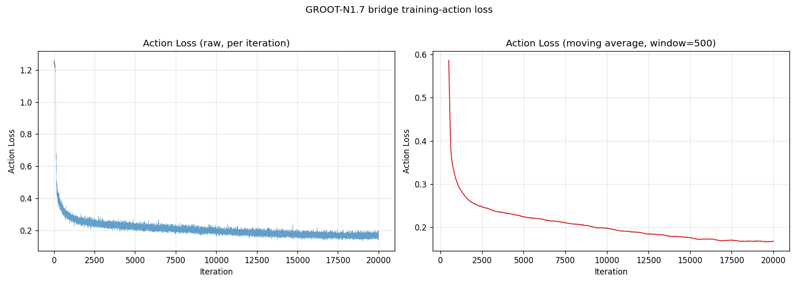
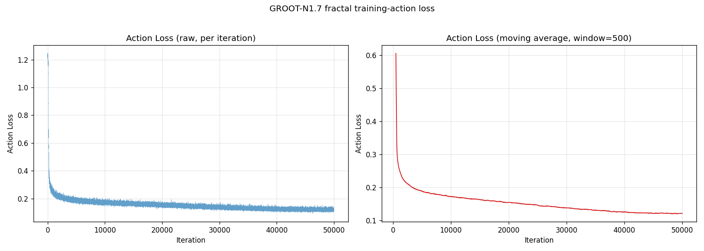
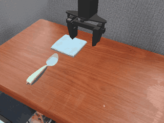
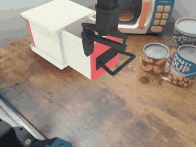
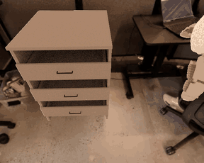
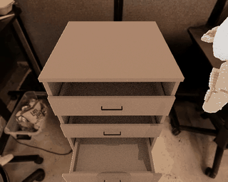

# GR00T-N1.7 Finetuning and Evaluation on SimplerEnv

This guide walks through finetuning GR00T-N1.7 with LoongForge on the two SimplerEnv embodiments — **Bridge / WidowX** and **Fractal / Google Robot** — and evaluating the resulting checkpoints.

- [1. Training Setup](#1-training-setup)
- [2. Finetuning](#2-finetuning)
- [3. Evaluation Setup](#3-evaluation-setup)
- [4. Evaluation](#4-evaluation)

---

## 1. Training Setup

### 1.1 Environment

Following the [LoongForge](https://github.com/baidu-baige/LoongForge) installation guide, pull the latest GPU image and start a container:

```bash
docker pull loongforge/loongforge:latest
mkdir -p workspace
docker run --gpus all --ipc=host -it --rm \
  -v "$(pwd)/workspace:/workspace/data" \
  -w /workspace/LoongForge \
  loongforge/loongforge:latest bash
```

### 1.2 Pretrained Weights

Download the following weights from Hugging Face:

| Weights | Purpose |
|---|---|
| [GR00T-N1.7-3B](https://huggingface.co/nvidia/GR00T-N1.7-3B) | The pretrained weights actually used for finetuning |
| [Cosmos-Reason2-2B](https://huggingface.co/nvidia/Cosmos-Reason2-2B) | Only provides the VLM backbone architecture and the tokenizer / processor |

> **Note**: the Cosmos-Reason2-2B weights are overwritten by the GR00T-N1.7-3B weights after loading.

### 1.3 Training Data

The training data for both embodiments is hosted under the IPEC-COMMUNITY organization on Hugging Face:

| Embodiment | Robot | Dataset | State | Action | Camera |
|---|---|---|---|---|---|
| Bridge | WidowX | [bridge_orig_lerobot](https://huggingface.co/datasets/IPEC-COMMUNITY/bridge_orig_lerobot) | 8D `x,y,z,roll,pitch,yaw,pad,gripper` | 7D absolute EEF (Euler angles) | `image_0` |
| Fractal | Google Robot | [fractal20220817_data_lerobot](https://huggingface.co/datasets/IPEC-COMMUNITY/fractal20220817_data_lerobot) | 8D `x,y,z,rx,ry,rz,rw,gripper` (quaternion) | 7D absolute EEF (Euler angles) | `image` (256×320) |

Each dataset has the following layout:

```text
my_dataset/
├── meta/
│   ├── info.json          # dataset metadata
│   ├── episodes.jsonl     # episode index and lengths
│   ├── tasks.jsonl        # language task descriptions
│   ├── stats.json         # normalization stats (must contain q01/q99; generated below)
│   └── modality.json      # state/action/video key mapping (GR00T-specific)
├── data/chunk-000/        # parquet files (state, action per timestep)
└── videos/chunk-000/      # mp4 video files per episode
```

After downloading, run the following steps from the LoongForge root:

```bash
# 1. Overwrite modality.json (both datasets)
cp examples/embodied/gr00t_n1_7/SimplerEnv/bridge/modality.json \
   /path/to/IPEC-COMMUNITY/bridge_orig_lerobot/meta/modality.json
cp examples/embodied/gr00t_n1_7/SimplerEnv/fractal/modality.json \
   /path/to/IPEC-COMMUNITY/fractal20220817_data_lerobot/meta/modality.json

# 2. Generate meta/stats.json (normalization stats with q01/q99) for both datasets;
#    the script overwrites each dataset's meta/stats.json in place
python examples/embodied/gr00t_n1_7/gen_stats.py \
   /path/to/IPEC-COMMUNITY/bridge_orig_lerobot \
   /path/to/IPEC-COMMUNITY/fractal20220817_data_lerobot

# 3. Fractal only: the videos are AV1-encoded, which torchcodec cannot decode;
#    convert them to H.264 in place
python examples/embodied/gr00t_n1_7/SimplerEnv/fractal/convert_av1_to_h264.py \
   /path/to/IPEC-COMMUNITY/fractal20220817_data_lerobot/videos --jobs 8
```

> **Note**: Fractal has 87,212 episodes, so the AV1 conversion takes a long time.

---

## 2. Finetuning

```bash
# Finetune Bridge (WidowX)
cd examples/embodied/gr00t_n1_7/SimplerEnv/bridge

LOONGFORGE_PATH=/path/to/LoongForge \
CHECKPOINT_PATH=/path/to/GR00T-N1.7-3B \
COSMOS_LOCAL_PATH=/path/to/Cosmos-Reason2-2B \
DATASET_PATH=/path/to/IPEC-COMMUNITY/bridge_orig_lerobot \
OUTPUT_ROOT=/path/to/outputs/gr00t_n1_7_bridge \
bash run_bridge_sft.sh

# Finetune Fractal (Google Robot)
cd examples/embodied/gr00t_n1_7/SimplerEnv/fractal

LOONGFORGE_PATH=/path/to/LoongForge \
CHECKPOINT_PATH=/path/to/GR00T-N1.7-3B \
COSMOS_LOCAL_PATH=/path/to/Cosmos-Reason2-2B \
DATASET_PATH=/path/to/IPEC-COMMUNITY/fractal20220817_data_lerobot \
OUTPUT_ROOT=/path/to/outputs/gr00t_n1_7_fractal \
bash run_fractal_sft.sh
```

> **Note**: due to tight GPU memory, CUDA Graph is disabled by default in the current configuration. If you have enough GPU memory, you can enable it by adding the following arguments to `DISTRIBUTED_TRAINING_ARGS` in the training script:
>
> ```bash
> --cuda-graph-impl local
> --cuda-graph-scope full_iteration
> --cuda-graph-warmup-steps 3
> --cuda-graph-pad-length 0
> --cuda-graph-ddp-sync-in-graph
> --ddp-static-graph
> ```

### 2.1 Training Time and Loss Curves

Training time of both embodiments on 8 × A800 (from iteration 1 to the last iteration):

| Embodiment | Iterations | Wall-clock time |
|---|:---:|:---:|
| Bridge (WidowX) | 20,000 | 6h 05m 52s |
| Fractal (Google Robot) | 50,000 | 19h 34m 08s |

Loss curves (left half of each plot: raw action loss; right half: 500-step moving average):

| Bridge (WidowX) | Fractal (Google Robot) |
|:---:|:---:|
|  |  |

---

## 3. Evaluation Setup

Install SimplerEnv following the official [SimplerEnv repository](https://github.com/simpler-env/SimplerEnv) (including the `ManiSkill2_real2sim` submodule), then install the extra dependencies:

```bash
pip install websockets msgpack msgpack-numpy pyyaml
```

Alternatively, build the evaluation environment following [Isaac-GR00T](https://github.com/NVIDIA/Isaac-GR00T):

```bash
git clone https://github.com/NVIDIA/Isaac-GR00T.git
cd Isaac-GR00T
bash gr00t/eval/sim/SimplerEnv/setup_SimplerEnv.sh
uv pip install --python gr00t/eval/sim/SimplerEnv/simpler_uv/.venv/bin/python \
  websockets msgpack msgpack-numpy pyyaml opencv-python-headless transforms3d
```

---

## 4. Evaluation

### 4.1 Launch

The scripts under `examples/embodied/gr00t_n1_7/eval/` run a serial evaluation: for each task they start a policy server, run all episodes, stop the server and move on to the next task, then aggregate the success rates.

```bash
cd examples/embodied/gr00t_n1_7/eval

# Bridge (WidowX): 7 tasks x 100 episodes
COSMOS_PATH=/path/to/Cosmos-Reason2-2B \
CKPT_PATH=/path/to/bridge/checkpoints \
STATS_PATH=/path/to/IPEC-COMMUNITY/bridge_orig_lerobot/meta/stats.json \
LOONGFORGE_PATH=/path/to/LoongForge \
SIMPLERENV_ROOT=/path/to/SimplerEnv \
BENCHMARK_PYTHON=/path/to/simplerenv/bin/python \
OUT_ROOT=/path/to/bridge_output \
bash run_simplerenv_bridge_eval.sh

# Fractal (Google Robot): 6 tasks x 100 episodes
COSMOS_PATH=/path/to/Cosmos-Reason2-2B \
CKPT_PATH=/path/to/fractal/checkpoints \
STATS_PATH=/path/to/IPEC-COMMUNITY/fractal20220817_data_lerobot/meta/stats.json \
LOONGFORGE_PATH=/path/to/LoongForge \
SIMPLERENV_ROOT=/path/to/SimplerEnv \
BENCHMARK_PYTHON=/path/to/simplerenv/bin/python \
OUT_ROOT=/path/to/fractal_output \
bash run_simplerenv_fractal_eval.sh
```

Main parameters:

| Parameter | Description |
|---|---|
| `COSMOS_PATH` | Local Cosmos-Reason2-2B directory |
| `CKPT_PATH` | Finetuned weights: a `pytorch_model.pt` file, or a directory with `config.json` + safetensors (e.g. the official checkpoint) |
| `STATS_PATH` | For self-trained weights, the training dataset's `meta/stats.json`; for official weights, the bundled `statistics.json` |
| `LOONGFORGE_PATH` | LoongForge repository root |
| `SIMPLERENV_ROOT` | SimplerEnv directory |
| `OUT_ROOT` | Root directory for evaluation outputs |
| `SERVER_PY` | Python interpreter of the LoongForge policy server |
| `BENCHMARK_PYTHON` | Python interpreter of the SimplerEnv simulator |

### 4.2 Results

Bridge, 7 tasks:

| Task | LoongForge | Official N1.7 |
|---|:---:|:---:|
| widowx_open_drawer | 100.0% | 100.0% |
| widowx_close_drawer | 73.0% | 97.0% |
| widowx_spoon_on_towel | 86.0% | 78.0% |
| widowx_put_eggplant_in_basket | 83.0% | 53.0% |
| widowx_carrot_on_plate | 47.0% | 58.0% |
| widowx_stack_cube | 45.0% | 48.0% |
| widowx_put_eggplant_in_sink | 10.0% | 2.0% |
| **Average** | **63.5%** | **62.3%** |

Fractal, 6 tasks:

| Task | LoongForge | Official N1.7 |
|---|:---:|:---:|
| google_robot_pick_coke_can | 100.0% | 100.0% |
| google_robot_pick_object | 77.0% | 94.0% |
| google_robot_move_near | 100.0% | 100.0% |
| google_robot_open_drawer | 62.0% | 65.0% |
| google_robot_close_drawer | 88.0% | 69.0% |
| google_robot_place_in_closed_drawer | 6.0% | 7.0% |
| **Average** | **72.1%** | **72.5%** |

> **Notes**:
> - The "Official N1.7" column is taken from Isaac-GR00T `examples/SimplerEnv/README.md` (official weights, 100 episodes per task).
> - The flow-matching sampling noise is unseeded, so repeated evaluations with the same config and seeds still fluctuate. The LoongForge numbers are the mean of 3 evaluation runs.

### 4.3 Rollout Examples

| Bridge (WidowX) | Bridge (WidowX) |
|:---:|:---:|
|  |  |
| *put the spoon on the towel* | *close the drawer* |
| **Fractal (Google Robot)** | **Fractal (Google Robot)** |
|  |  |
| *open bottom drawer* | *close bottom drawer* |
