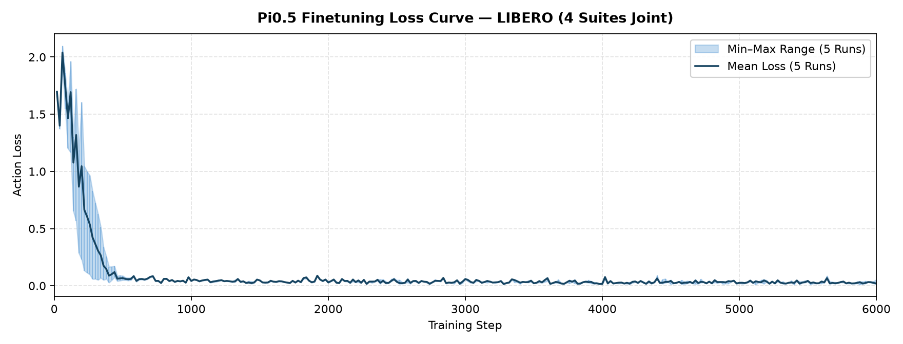
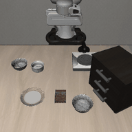
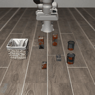
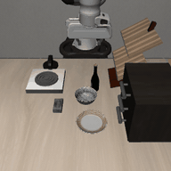
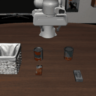

# Pi0.5 Finetuning and Evaluation on LIBERO

End-to-end guide for finetuning Pi0.5 on the LIBERO benchmark and running closed-loop evaluation.

## Table of Contents

- [1. Training Setup](#1-training-setup)
- [2. Finetuning](#2-finetuning)
- [3. Evaluation Setup](#3-evaluation-setup)
- [4. Evaluation](#4-evaluation)

---

## 1. Training Setup

### 1.1 Environment

Follow the [LoongForge installation guide](../../../../README.md) to set up the training environment.

### 1.2 Pretrained Weights & Tokenizer

Download the Pi0.5 base checkpoint and the PaliGemma tokenizer from HuggingFace:

- Base model: `lerobot/pi05_libero` (or `lerobot/pi05_base`)
- Tokenizer: `google/paligemma-3b-pt-224`

### 1.3 Training Data

Prepare the LIBERO LeRobot dataset (combining `libero_spatial`, `libero_object`, `libero_goal`, and `libero_10`, e.g., `physical-intelligence/libero`) and ensure `meta/stats.json` is present in the dataset root.

---

## 2. Finetuning

The launch script is [`run_pi05_libero_ddp_finetune.sh`](run_pi05_libero_ddp_finetune.sh). It finetunes on all 4 LIBERO suites jointly using 8 GPUs (DDP) for 6,000 steps (`per_device_batch_size=16`, `gradient_accumulation_steps=2`, global batch size 256, `action_horizon=10`, `state_dim=8`, `image_normalize_mode=siglip`, `normalization_mode=mean_std`).

```bash
# Override default paths via environment variables:
export CHECKPOINT_PATH=/path/to/pi05_libero
export TOKENIZER_PATH=/path/to/paligemma-3b-pt-224
export DATA_PATH=/path/to/libero_dataset
export OUTPUT_DIR=/path/to/outputs/pi05_libero

bash examples/embodied/pi05/LIBERO/run_pi05_libero_ddp_finetune.sh
```

Or override individual parameters inline:

```bash
TRAIN_ITERS=6000 SAVE_INTERVAL=1000 \
  bash examples/embodied/pi05/LIBERO/run_pi05_libero_ddp_finetune.sh
```

Checkpoints are saved under `$OUTPUT_DIR/checkpoints/steps_<N>`. Copy the dataset's `meta/stats.json` into the checkpoint directory as `dataset_statistics.json` (or point `server.dataset_statistics_path` directly to `meta/stats.json` during evaluation).

Training checkpoints store each aliased weight once and can be used directly for
evaluation; no checkpoint conversion is needed. The shared Pi05 loader also
accepts historical checkpoints containing both `model.*` and `pi05.*` keys.

### 2.1 Training Time

Training time on 8 × A800 (joint multi-task finetuning across all 4 LIBERO suites):

| Setting | Iterations | Global Batch Size | Wall-Clock Time |
| --- | :---: | :---: | :---: |
| LIBERO (4 suites joint) | 6,000 | 256 | 3h 44m 04s |

### 2.2 Loss Curve



---

## 3. Evaluation Setup

Pi05 defaults to `q99` normalization. When statistics for `observation.state`
or `action` are absent, the corresponding normalization or denormalization is
skipped, preserving compatibility with existing stat-free smoke configurations.
For benchmark evaluation, set `server.dataset_statistics_path` to the statistics
used for training.

LIBERO evaluation runs in a client-server architecture:

- **Policy Server** — runs in the LoongForge training environment (`server.python`) and serves `PI05Policy`.
- **Benchmark Client** — runs in a separate Python 3.8 environment with the LIBERO simulator (`env.libero_python` / `BENCHMARK_PYTHON`).

Set up the LIBERO simulator environment:

```bash
conda create -n libero python=3.8.13 -y
conda activate libero

git clone https://github.com/Lifelong-Robot-Learning/LIBERO.git
cd LIBERO
pip install -r requirements.txt
pip install torch==1.11.0+cu113 torchvision==0.12.0+cu113 torchaudio==0.11.0 \
    --extra-index-url https://download.pytorch.org/whl/cu113
pip install -e .

# Client-side dependencies required by the LoongForge eval harness:
pip install tyro pyyaml msgpack numpy pillow
```

---

## 4. Evaluation

### 4.1 Launch

Edit [`examples/embodied/pi05/eval/configs/libero/libero_pi05.yaml`](../eval/configs/libero/libero_pi05.yaml) and fill in the `/path/to/...` placeholders:

- `benchmark.suite`: `libero_spatial` | `libero_object` | `libero_goal` | `libero_10`
- `benchmark.max_steps`: `280` for `libero_spatial`; `0` to use the suite default (`280` / `300` / `520`)
- `server.python`: Python binary of the LoongForge environment
- `server.ckpt_path`: path to the finetuned checkpoint directory (e.g., `$OUTPUT_DIR/checkpoints/steps_6000`)
- `server.dataset_statistics_path`: path to `dataset_statistics.json` (or `$DATA_PATH/meta/stats.json`)
- `server.loongforge_root`: path to the LoongForge repository root
- `server.tokenizer_path`: path to `paligemma-3b-pt-224`
- `env.libero_config_path`: path to `~/.libero/config.yaml`

Then launch evaluation via [`examples/embodied/pi05/eval/run_libero_eval.sh`](../eval/run_libero_eval.sh):

```bash
export REPO_ROOT=/path/to/LoongForge
export BENCHMARK_PYTHON=/path/to/conda/envs/libero/bin/python
export CONFIG=examples/embodied/pi05/eval/configs/libero/libero_pi05.yaml

bash examples/embodied/pi05/eval/run_libero_eval.sh
```

Results (`results.jsonl` and `eval_info.json`) are written to `run.output_dir`.

### 4.2 Results

#### Suite-Level Summary

Evaluated at step 6,000 across all 4 LIBERO suites (10 tasks × 10 episodes = 100 episodes per suite, 400 episodes total):

| Suite | Successful Episodes | Success Rate (Single Run) | Success Rate (5-Run Mean) |
| --- | :---: | :---: | :---: |
| `libero_spatial` | 100 / 100 | 100.0% | 99.6% |
| `libero_object` | 100 / 100 | 100.0% | 99.6% |
| `libero_goal` | 98 / 100 | 98.0% | 98.8% |
| `libero_10` | 97 / 100 | 97.0% | 97.0% |
| **Average** | **395 / 400** | **98.75%** | **98.75%** |

#### Per-Task Breakdown

`libero_spatial` (10 tasks):

| Task ID | Task Description | Single Run (10 eps) | 5-Run Mean (50 eps) |
| :---: | --- | :---: | :---: |
| 0 | pick up the black bowl between the plate and the ramekin and place it on the plate | 100.0% (10/10) | 100.0% (50/50) |
| 1 | pick up the black bowl next to the ramekin and place it on the plate | 100.0% (10/10) | 100.0% (50/50) |
| 2 | pick up the black bowl from table center and place it on the plate | 100.0% (10/10) | 100.0% (50/50) |
| 3 | pick up the black bowl on the cookie box and place it on the plate | 100.0% (10/10) | 100.0% (50/50) |
| 4 | pick up the black bowl in the top drawer of the wooden cabinet and place it on the plate | 100.0% (10/10) | 100.0% (50/50) |
| 5 | pick up the black bowl on the ramekin and place it on the plate | 100.0% (10/10) | 96.0% (48/50) |
| 6 | pick up the black bowl next to the cookie box and place it on the plate | 100.0% (10/10) | 100.0% (50/50) |
| 7 | pick up the black bowl on the stove and place it on the plate | 100.0% (10/10) | 100.0% (50/50) |
| 8 | pick up the black bowl next to the plate and place it on the plate | 100.0% (10/10) | 100.0% (50/50) |
| 9 | pick up the black bowl on the wooden cabinet and place it on the plate | 100.0% (10/10) | 100.0% (50/50) |
| **Average** | | **100.0% (100/100)** | **99.6% (498/500)** |

`libero_object` (10 tasks):

| Task ID | Task Description | Single Run (10 eps) | 5-Run Mean (50 eps) |
| :---: | --- | :---: | :---: |
| 0 | pick up the alphabet soup and place it in the basket | 100.0% (10/10) | 100.0% (50/50) |
| 1 | pick up the cream cheese and place it in the basket | 100.0% (10/10) | 100.0% (50/50) |
| 2 | pick up the salad dressing and place it in the basket | 100.0% (10/10) | 100.0% (50/50) |
| 3 | pick up the bbq sauce and place it in the basket | 100.0% (10/10) | 96.0% (48/50) |
| 4 | pick up the ketchup and place it in the basket | 100.0% (10/10) | 100.0% (50/50) |
| 5 | pick up the tomato sauce and place it in the basket | 100.0% (10/10) | 100.0% (50/50) |
| 6 | pick up the butter and place it in the basket | 100.0% (10/10) | 100.0% (50/50) |
| 7 | pick up the milk and place it in the basket | 100.0% (10/10) | 100.0% (50/50) |
| 8 | pick up the chocolate pudding and place it in the basket | 100.0% (10/10) | 100.0% (50/50) |
| 9 | pick up the orange juice and place it in the basket | 100.0% (10/10) | 100.0% (50/50) |
| **Average** | | **100.0% (100/100)** | **99.6% (498/500)** |

`libero_goal` (10 tasks):

| Task ID | Task Description | Single Run (10 eps) | 5-Run Mean (50 eps) |
| :---: | --- | :---: | :---: |
| 0 | open the middle drawer of the cabinet | 100.0% (10/10) | 100.0% (50/50) |
| 1 | put the bowl on the stove | 100.0% (10/10) | 100.0% (50/50) |
| 2 | put the wine bottle on top of the cabinet | 90.0% (9/10) | 94.0% (47/50) |
| 3 | open the top drawer and put the bowl inside | 100.0% (10/10) | 100.0% (50/50) |
| 4 | put the bowl on top of the cabinet | 100.0% (10/10) | 100.0% (50/50) |
| 5 | push the plate to the front of the stove | 100.0% (10/10) | 98.0% (49/50) |
| 6 | put the cream cheese in the bowl | 100.0% (10/10) | 98.0% (49/50) |
| 7 | turn on the stove | 100.0% (10/10) | 100.0% (50/50) |
| 8 | put the bowl on the plate | 100.0% (10/10) | 100.0% (50/50) |
| 9 | put the wine bottle on the rack | 90.0% (9/10) | 98.0% (49/50) |
| **Average** | | **98.0% (98/100)** | **98.8% (494/500)** |

`libero_10` (10 tasks):

| Task ID | Task Description | Single Run (10 eps) | 5-Run Mean (50 eps) |
| :---: | --- | :---: | :---: |
| 0 | put both the alphabet soup and the tomato sauce in the basket | 90.0% (9/10) | 94.0% (47/50) |
| 1 | put both the cream cheese box and the butter in the basket | 100.0% (10/10) | 100.0% (50/50) |
| 2 | turn on the stove and put the moka pot on it | 90.0% (9/10) | 96.0% (48/50) |
| 3 | put the black bowl in the bottom drawer of the cabinet and close it | 100.0% (10/10) | 100.0% (50/50) |
| 4 | put the white mug on the left plate and put the yellow and white mug on the right plate | 100.0% (10/10) | 98.0% (49/50) |
| 5 | pick up the book and place it in the back compartment of the caddy | 100.0% (10/10) | 100.0% (50/50) |
| 6 | put the white mug on the plate and put the chocolate pudding to the right of the plate | 100.0% (10/10) | 100.0% (50/50) |
| 7 | put both the alphabet soup and the cream cheese box in the basket | 100.0% (10/10) | 94.0% (47/50) |
| 8 | put both moka pots on the stove | 90.0% (9/10) | 88.0% (44/50) |
| 9 | put the yellow and white mug in the microwave and close it | 100.0% (10/10) | 100.0% (50/50) |
| **Average** | | **97.0% (97/100)** | **97.0% (485/500)** |

### 4.3 Rollout Examples

| `libero_spatial` | `libero_object` |
| :---: | :---: |
|  |  |
| *pick up the black bowl next to the ramekin and place it on the plate* | *pick up the cream cheese and place it in the basket* |
| **`libero_goal`** | **`libero_10`** |
|  |  |
| *put the bowl on the stove* | *put both the cream cheese box and the butter in the basket* |
