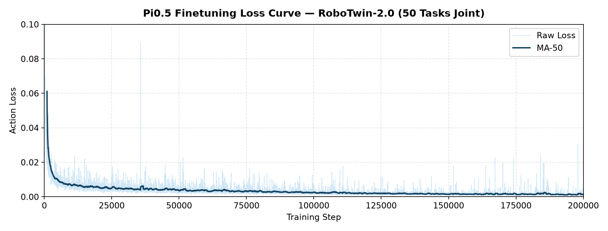
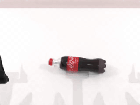
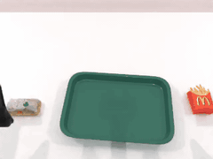
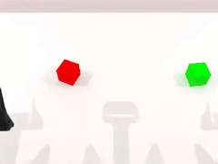

# Pi0.5 Finetuning and Evaluation on RoboTwin-2.0

End-to-end guide for finetuning Pi0.5 on the RoboTwin-2.0 benchmark (`demo_clean`, 50 tasks) and running closed-loop evaluation.

## Table of Contents

- [1. Training Setup](#1-training-setup)
- [2. Finetuning](#2-finetuning)
- [3. Evaluation Setup](#3-evaluation-setup)
- [4. Evaluation](#4-evaluation)

---

## 1. Training Setup

### 1.1 Environment

Follow the [LoongForge installation guide](../../../../README.md) to set up the training environment.

### 1.2 Pretrained Weights & Tokenizer

Download the Pi0.5 base checkpoint and the PaliGemma tokenizer from HuggingFace:

- Base model: `lerobot/pi05_base`
- Tokenizer: `google/paligemma-3b-pt-224`

### 1.3 Training Data & Pi-Space Stats View

Prepare the 50-task RoboTwin-2.0 `demo_clean` LeRobot dataset (`robotwin_unified`).

When `data.use_aloha_pi_delta_actions=true` is enabled, `AlohaPiDeltaActionTransform` converts raw environment-space 14D joint actions into pi-space relative actions (arm joints relative to the chunk-anchor proprioception, grippers absolute in angular space) and rewrites `observation.state` into pi-space proprioception before normalization and state discretization. Therefore, the dataset's `meta/stats.json` must hold pi-space statistics for both `action` and `observation.state`.

Use [`examples/embodied/pi05/build_pidelta_stats.py`](../build_pidelta_stats.py) to create a lightweight symlink view of `robotwin_unified` whose `meta/stats.json` uses the pi-space statistics (`examples/embodied/pi05/eval/assets/pi05_robotwin2_dataset_stats.json`):

```bash
python examples/embodied/pi05/build_pidelta_stats.py \
    --src /path/to/robotwin_unified \
    --dst /path/to/robotwin_unified_pidelta
```

---

## 2. Finetuning

The launch script is [`run_pi05_robotwin_ddp_finetune.sh`](run_pi05_robotwin_ddp_finetune.sh). It finetunes on all 50 RoboTwin-2.0 tasks jointly using 8 GPUs (DDP) for 200,000 steps (`per_device_batch_size=8`, `gradient_accumulation_steps=2`, global batch size 128, `action_horizon=30`, `action_dim=14`, `state_dim=14`, `num_images=3`, `normalization_mode=q99`, `use_aloha_pi_delta_actions=true`).

```bash
# Override default paths via environment variables:
export CHECKPOINT_PATH=/path/to/pi05_base
export TOKENIZER_PATH=/path/to/paligemma-3b-pt-224
export DATA_PATH=/path/to/robotwin_unified_pidelta
export OUTPUT_DIR=/path/to/outputs/pi05_robotwin

bash examples/embodied/pi05/RoboTwin/run_pi05_robotwin_ddp_finetune.sh
```

To resume from the latest saved checkpoint in `$OUTPUT_DIR`:

```bash
bash examples/embodied/pi05/RoboTwin/run_pi05_robotwin_ddp_finetune.sh --resume
```

Checkpoints are saved under `$OUTPUT_DIR/checkpoints/steps_<N>`. For evaluation, copy `examples/embodied/pi05/eval/assets/pi05_robotwin2_dataset_stats.json` into the checkpoint directory as `dataset_statistics.json` (or point `server.dataset_statistics_path` to that file).

Training checkpoints store each aliased weight once and can be used directly for
evaluation; no checkpoint conversion is needed. The shared Pi05 loader also
accepts historical checkpoints containing both `model.*` and `pi05.*` keys.

### 2.1 Loss Curve



---

## 3. Evaluation Setup

Pi05 defaults to `q99` normalization. When statistics for `observation.state`
or `action` are absent, the corresponding normalization or denormalization is
skipped, preserving compatibility with existing stat-free smoke configurations.
For benchmark evaluation, set `server.dataset_statistics_path` to the statistics
used for training.

RoboTwin-2.0 evaluation runs in a client-server architecture:

- **Policy Server** — runs in the LoongForge training environment (`server.python`) and serves `PI05Policy`.
- **Benchmark Client** — runs in the RoboTwin simulator environment (`env.robotwin_python`) with SAPIEN and CuRobo installed.

Follow the [RoboTwin-2.0 installation documentation](https://robotwin-platform.github.io/doc/usage/robotwin-install.html) to set up the simulator environment and assets under `ROBOTWIN_ROOT`, and install the client communication dependencies (`msgpack`, `pyyaml`, `tyro`).

---

## 4. Evaluation

### 4.1 Launch

Edit [`examples/embodied/pi05/eval/configs/robotwin/robotwin_pi05.yaml`](../eval/configs/robotwin/robotwin_pi05.yaml) and fill in the `/path/to/...` placeholders:

- `benchmark.task_name`: any of the 50 RoboTwin-2.0 tasks (e.g., `adjust_bottle`)
- `benchmark.task_config`: `demo_clean`
- `benchmark.episodes_per_task`: `100` (full benchmark) or `10` (quick check)
- `server.python`: Python binary of the LoongForge environment
- `server.ckpt_path`: path to the finetuned checkpoint directory
- `server.dataset_statistics_path`: path to `pi05_robotwin2_dataset_stats.json`
- `server.loongforge_root`: path to the LoongForge repository root
- `server.tokenizer_path`: path to `paligemma-3b-pt-224`
- `env.robotwin_root`: path to the RoboTwin-2.0 repository root
- `env.robotwin_python`: Python binary of the RoboTwin simulator environment

Then launch evaluation via [`examples/embodied/pi05/eval/run_robotwin_eval.sh`](../eval/run_robotwin_eval.sh):

```bash
export REPO_ROOT=/path/to/LoongForge
export BENCHMARK_PYTHON=/path/to/conda/envs/robotwin/bin/python
export CONFIG=examples/embodied/pi05/eval/configs/robotwin/robotwin_pi05.yaml

bash examples/embodied/pi05/eval/run_robotwin_eval.sh
```

Results (`results.jsonl` and `summary.csv`) are written to `run.output_dir`.

### 4.2 Results

#### Overall Summary

Evaluated on RoboTwin-2.0 (`demo_clean`, 50 tasks × 100 episodes = 5,000 episodes total, `start_seed=100000`):

| Setting | Tasks | Successful Episodes | Mean Success Rate |
| --- | :---: | :---: | :---: |
| `demo_clean` | 50 | 3,878 / 5,000 | **77.56%** |

#### Per-Task Breakdown

| Task | Successful Episodes | Success Rate |
| --- | :---: | :---: |
| `adjust_bottle` | 96 / 100 | 96.0% |
| `beat_block_hammer` | 93 / 100 | 93.0% |
| `blocks_ranking_rgb` | 0 / 100 | 0.0% |
| `blocks_ranking_size` | 1 / 100 | 1.0% |
| `click_alarmclock` | 80 / 100 | 80.0% |
| `click_bell` | 93 / 100 | 93.0% |
| `dump_bin_bigbin` | 87 / 100 | 87.0% |
| `grab_roller` | 100 / 100 | 100.0% |
| `handover_block` | 72 / 100 | 72.0% |
| `handover_mic` | 91 / 100 | 91.0% |
| `hanging_mug` | 50 / 100 | 50.0% |
| `lift_pot` | 97 / 100 | 97.0% |
| `move_can_pot` | 92 / 100 | 92.0% |
| `move_pillbottle_pad` | 83 / 100 | 83.0% |
| `move_playingcard_away` | 98 / 100 | 98.0% |
| `move_stapler_pad` | 67 / 100 | 67.0% |
| `open_laptop` | 79 / 100 | 79.0% |
| `open_microwave` | 16 / 100 | 16.0% |
| `pick_diverse_bottles` | 89 / 100 | 89.0% |
| `pick_dual_bottles` | 92 / 100 | 92.0% |
| `place_a2b_left` | 97 / 100 | 97.0% |
| `place_a2b_right` | 92 / 100 | 92.0% |
| `place_bread_basket` | 90 / 100 | 90.0% |
| `place_bread_skillet` | 93 / 100 | 93.0% |
| `place_burger_fries` | 95 / 100 | 95.0% |
| `place_can_basket` | 62 / 100 | 62.0% |
| `place_cans_plasticbox` | 85 / 100 | 85.0% |
| `place_container_plate` | 97 / 100 | 97.0% |
| `place_dual_shoes` | 90 / 100 | 90.0% |
| `place_empty_cup` | 99 / 100 | 99.0% |
| `place_fan` | 89 / 100 | 89.0% |
| `place_mouse_pad` | 76 / 100 | 76.0% |
| `place_object_basket` | 86 / 100 | 86.0% |
| `place_object_scale` | 90 / 100 | 90.0% |
| `place_object_stand` | 96 / 100 | 96.0% |
| `place_phone_stand` | 92 / 100 | 92.0% |
| `place_shoe` | 98 / 100 | 98.0% |
| `press_stapler` | 91 / 100 | 91.0% |
| `put_bottles_dustbin` | 0 / 100 | 0.0% |
| `put_object_cabinet` | 78 / 100 | 78.0% |
| `rotate_qrcode` | 90 / 100 | 90.0% |
| `scan_object` | 92 / 100 | 92.0% |
| `shake_bottle` | 99 / 100 | 99.0% |
| `shake_bottle_horizontally` | 100 / 100 | 100.0% |
| `stack_blocks_three` | 0 / 100 | 0.0% |
| `stack_blocks_two` | 98 / 100 | 98.0% |
| `stack_bowls_three` | 0 / 100 | 0.0% |
| `stack_bowls_two` | 91 / 100 | 91.0% |
| `stamp_seal` | 65 / 100 | 65.0% |
| `turn_switch` | 71 / 100 | 71.0% |
| **Average (50 Tasks)** | **3,878 / 5,000** | **77.56%** |

### 4.3 Rollout Examples

| `adjust_bottle` | `grab_roller` |
| :---: | :---: |
|  |  |
| *adjust bottle* | *grab roller* |
| **`place_burger_fries`** | **`stack_blocks_two`** |
|  |  |
| *place burger fries* | *stack blocks two* |
